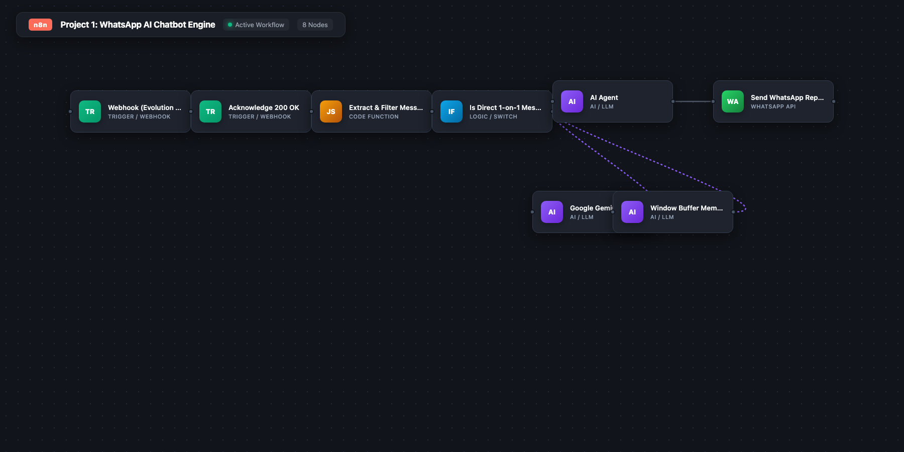

# 🤖 WhatsApp AI Chatbot Solutions

This directory houses two production-ready WhatsApp AI Auto-Responder solutions for n8n, powered by **Google Gemini 2.5 Flash** and **LangChain Window Buffer Memory**.

---

## 🖼️ Workflow Architecture Canvas

---

## 🧭 Which Solution Should You Choose?

| Comparison Point | 🟢 [Evolution API (QR Code)](file:///Users/serhatkumas/Desktop/n8n/projects/01.whatsapp-ai-chatbot-projects/whatsapp-ai-bot-evolution-api/README.md) | 🔵 [Meta Cloud API (Official)](file:///Users/serhatkumas/Desktop/n8n/projects/01.whatsapp-ai-chatbot-projects/whatsapp-ai-bot-meta/README.md) |
| :--- | :--- | :--- |
| **Target Audience** | Freelancers, startups, informal businesses | Officially registered companies |
| **Business Verification** | ❌ **Not required** (Zero paperwork) | ✅ **Mandatory** (Tax certificate, trade docs) |
| **Phone App Usability** | ✅ **WhatsApp app stays active on your phone** | ❌ **Phone app is disabled** (API only) |
| **Setup Method** | Scan QR code from phone (Linked Devices) | Meta Developer App & System User Token |
| **AI LLM Engine** | Google Gemini 2.5 Flash *(Free tier)* | Google Gemini 2.5 Flash *(Free tier)* |
| **Context Memory** | Per-user multi-turn memory | Per-user multi-turn memory |
| **Cost** | 100% Free & Open Source | 1,000 free conversations/month, then paid |

---

## 📁 Projects in this Directory

### 1. [`whatsapp-ai-bot-evolution-api/`](file:///Users/serhatkumas/Desktop/n8n/projects/01.whatsapp-ai-chatbot-projects/whatsapp-ai-bot-evolution-api/README.md) *(Recommended for Unverified Businesses)*
- Connects your real WhatsApp Business phone number via QR Code scanning.
- Keeps your WhatsApp mobile app working normally.
- Zero Meta restrictions, no developer account approvals.
- Complete with Docker Compose, sample payloads, and n8n workflow.

### 2. [`whatsapp-ai-bot-meta/`](file:///Users/serhatkumas/Desktop/n8n/projects/01.whatsapp-ai-chatbot-projects/whatsapp-ai-bot-meta/README.md) *(For Verified Corporate Businesses)*
- Direct integration with Meta's official WhatsApp Cloud API (Graph API v21.0).
- Automatic webhook verification challenge handshake.
- Instant 200 OK webhook acknowledgement.
- Best suited for verified corporate entities with business registry credentials.
