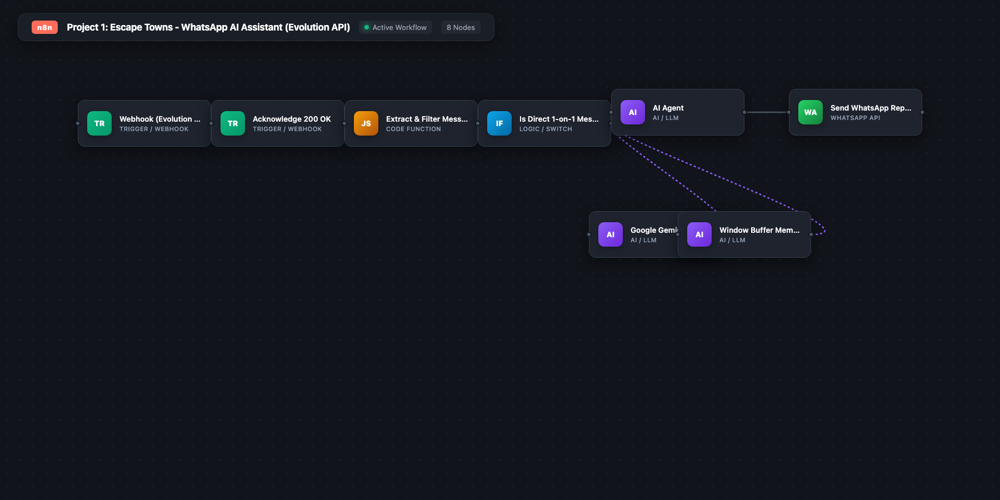

# Escape Towns — WhatsApp AI Assistant

Evolution API connects the Escape Towns WhatsApp account to n8n. Incoming direct text messages go to Gemini, and the generated answer is returned through Evolution API. The instance ID is `escapetowns`; the assistant's business name is **Escape Towns**.

The services run continuously on the Oracle server (`ubuntu@89.168.108.192`), not on your Mac. QR scanning links the phone initially. Session data is persisted across container restarts, but WhatsApp can invalidate a linked session, so reconnecting may sometimes require another scan.

## 🖼️ Workflow Architecture Canvas



---

## Connect your phone

On your Mac, from this directory:

```bash
python3 pair.py
```

Open [the local pairing page](http://127.0.0.1:8766). On your phone, choose **WhatsApp → Settings → Linked Devices → Link a Device** and scan the QR. The page refreshes it automatically and reports when connected. Closing this helper does not stop the server or bot.

The helper uses your existing SSH key (`~/.ssh/id_ed25519`) to reach the server. It retrieves the API key on the server without exposing it in the page. It requires Python 3 and working SSH access. Optional arguments: `--server user@host --key /path/to/key --port 8766`.

Opening `/instance/connect/escapetowns` directly in a browser is not sufficient: the API requires an authentication header and returns JSON, rather than a QR display page.

## Server setup

The existing server deployment lives in `~/n8n`. For a fresh deployment, copy [docker-compose.evolution.yml](docker-compose.evolution.yml) there and add the values from [.env.example](.env.example) to its `.env`. Preserve the existing n8n environment values.

Generate separate random values for the API key and database password:

```bash
openssl rand -hex 32
```

Do not change the configured password for an existing PostgreSQL volume without also changing the database user's password. Use URL-safe characters in the database password because it is part of the connection URI.

```bash
cd ~/n8n
docker compose -f docker-compose.evolution.yml config --quiet
docker compose -f docker-compose.evolution.yml up -d
```

The `n8n_network` network must already exist (created by the main n8n stack). PostgreSQL has a readiness check; both services restart automatically. The API port is bound to server localhost. n8n reaches it through `http://evolution_api:8080` on Docker's private network.

The Compose file pins Evolution API to `v2.3.7` and sets `CONFIG_SESSION_PHONE_VERSION` using `WHATSAPP_WEB_VERSION`. The default `2.3000.1043857760` generated QR codes on October 19, 2026. If pairing later stops working, check the logs and retrieve a current protocol version before changing this value:

```bash
sudo docker exec evolution_api node -e 'require("baileys").fetchLatestBaileysVersion().then(x => { console.log(x); process.exit(0); })'
```

## n8n workflow and credentials

Import [workflow.json](workflow.json) into n8n for a new installation. For the existing deployment, edit the existing Escape Towns workflow rather than importing a duplicate with the same webhook path.

Configure these credentials:

| Node | Credential | Setting |
| --- | --- | --- |
| Google Gemini Chat Model | Google Gemini / PaLM API | Your Gemini API key; model `models/gemini-3.8-flash` |
| Webhook (Evolution API) | Header Auth | Name `x-escape-towns-webhook`; value is a separate random secret |
| Send WhatsApp Reply (Evolution API) | Header Auth | Name `apikey`; value matches `EVOLUTION_API_KEY` on the server |

Publish the workflow in n8n 2.x (activate it in older versions). The production endpoint is `https://n8n.codewaft.com/webhook/whatsapp-evolution`.

For a fresh instance, call `POST /instance/create` with `instanceName: escapetowns`, `integration: WHATSAPP-BAILEYS`, and `qrcode: true`. Authenticate Evolution API requests with the `apikey` header. Do not recreate an existing instance.

Configure `POST /webhook/set/escapetowns` with this body, replacing the webhook secret with the credential value above:

```json
{
  "webhook": {
    "enabled": true,
    "url": "http://n8n:5678/webhook/whatsapp-evolution",
    "byEvents": false,
    "base64": false,
    "headers": { "x-escape-towns-webhook": "YOUR_PRIVATE_WEBHOOK_SECRET" },
    "events": ["MESSAGES_UPSERT"]
  }
}
```

The internal URL is for this shared Docker network. It avoids a public network round trip; the n8n webhook still requires the header credential.

## Verify

1. Confirm the pairing page reports **Connected**.
2. From a second WhatsApp account, send a direct text message to the linked business number.
3. Check n8n's execution and the received WhatsApp reply.

The workflow acknowledges valid webhook requests immediately. It ignores outgoing messages, groups, broadcasts, other instances/events, and messages without text or a supported caption. Conversation memory is keyed by instance and sender and is lost on n8n restart. No delivery deduplication is implemented, so webhook retries can produce duplicate replies.

The assistant has no business knowledge base or reservation integration yet. Its prompt explicitly prohibits inventing prices, locations, opening hours, availability, or confirmed bookings. Gemini API availability, limits, and charges depend on your Google account.

Evolution API uses an unofficial WhatsApp connection. The repository's older claims of "zero restrictions" and guaranteed permanent linking should not be relied on.

## Files

- [docker-compose.evolution.yml](docker-compose.evolution.yml): API and persistent PostgreSQL services.
- [.env.example](.env.example): configuration placeholders; production secrets stay outside Git.
- [workflow.json](workflow.json): importable workflow with credential placeholders.
- [pair.py](pair.py): local QR viewer over SSH.
- [sample-data/evolution-webhook-message.json](sample-data/evolution-webhook-message.json): sample incoming message without an API key. Do not post the sample to a live bot; it contains a fictional recipient.
