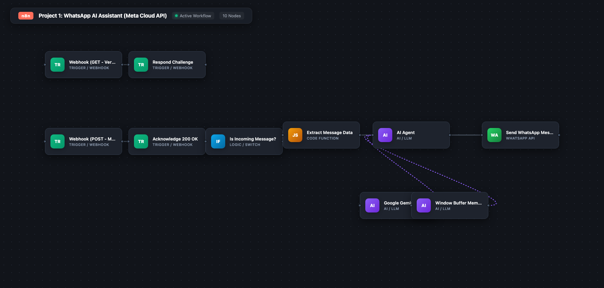
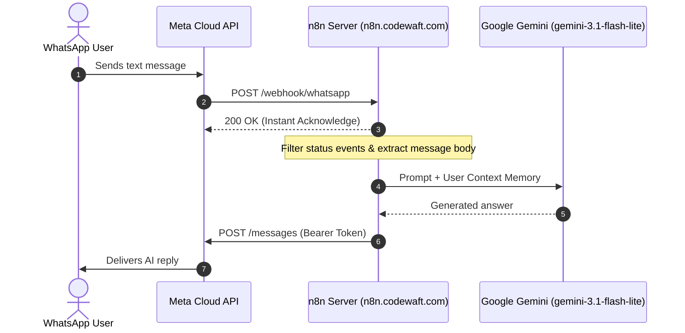

# 🤖 WhatsApp AI Auto-Responder (Meta Cloud API)

An intelligent, context-aware WhatsApp customer service & sales auto-responder built on **n8n**, powered by **Google Gemini / LangChain**, and integrated with the official **Meta WhatsApp Cloud API**.

---

## 🖼️ Workflow Architecture Canvas



---

## 🌟 Key Features

- **Official Meta Cloud API**: Zero risk of phone number bans; 1,000 free service conversations every month.
- **AI Agent with Persona**: Customized virtual assistant for Codewaft answering inquiries, support requests, and service details.
- **Per-User Memory**: Uses LangChain Window Buffer Memory keyed on the sender's phone number (`senderPhone`), allowing natural multi-turn conversations.
- **Smart Filtering**: Filters out delivery status receipts (`sent`, `delivered`, `read`) to avoid unnecessary executions or message loops.
- **Instant Webhook ACK**: Immediately acknowledges incoming Meta webhooks (`200 OK`) within Meta's strict 3-second timeout window.

---

## 🏛️ Architecture Flow



---

## 📋 Prerequisites

1. **Meta for Developers Account**: [developers.facebook.com](https://developers.facebook.com/) *(Free)*
2. **Google Gemini API Key**: [aistudio.google.com](https://aistudio.google.com/) *(100% Free, no credit card required)*
3. **Live n8n Instance**: [https://n8n.codewaft.com](https://n8n.codewaft.com)

---

## ⚙️ Step-by-Step Setup Guide

### Step 1: Create a Meta WhatsApp App
1. Go to [Meta for Developers](https://developers.facebook.com/) and click **My Apps** → **Create App**.
2. Select **Other** → **Business**.
3. Name your app (e.g. `Codewaft Bot`) and select your Business Portfolio (or create one).
4. In the App Dashboard, scroll down to **WhatsApp** and click **Set up**.
5. You will see the **API Setup** page with a **Test Phone Number**, **Phone Number ID**, and a **Temporary Access Token**.

---

### Step 2: Configure the Webhook in Meta
1. In the left sidebar of your Meta App, go to **WhatsApp** → **Configuration**.
2. Click **Edit** next to **Webhook**:
   - **Callback URL**:
     ```text
     https://n8n.codewaft.com/webhook/whatsapp
     ```
   - **Verify Token**: Enter any secret string of your choice (e.g. `codewaft_secret_token_123`).
3. Back in n8n, make sure your workflow is **Saved and Activated** (or click *Listen for test event* on the GET webhook node).
4. Click **Verify and Save** in the Meta portal. Meta will send a verification request; n8n will instantly return the challenge.
5. Under **Webhook fields**, click **Manage** and subscribe to:
   - ✅ **`messages`**

---

### Step 3: Import the Workflow into n8n
1. Open your n8n dashboard: [https://n8n.codewaft.com](https://n8n.codewaft.com).
2. Click **Add workflow** → Click **`...`** (top right) → **Import from File...**.
3. Select [`projects/01.whatsapp-ai-chatbot-projects/whatsapp-ai-bot-meta/workflow.json`](file:///Users/serhatkumas/Desktop/n8n/projects/01.whatsapp-ai-chatbot-projects/whatsapp-ai-bot-meta/workflow.json).

---

### Step 4: Configure Credentials in n8n

#### 1. Google Gemini API Account
- Click on the **Google Gemini Chat Model** node.
- Under **Credential for Google Gemini(PaLM) API**, click **Create New Credential**.
- Paste your free API key from [Google AI Studio](https://aistudio.google.com/).
- Model: Select **Gemini 2.5 Flash** from the dropdown (lightning-fast, state of the art, and 100% free under Google AI Studio's free tier).

#### 2. Meta WhatsApp Access Token
- Click on the **Send WhatsApp Message** node.
- Under **Credential for Header Auth**:
  - **Name**: `Authorization`
  - **Value**: `Bearer YOUR_META_WHATSAPP_ACCESS_TOKEN` *(Replace with your Meta Token from Step 1)*.

> [!TIP]
> **Getting a Permanent Meta Token**:
> The test token in the API setup expires after 24 hours. For production:
> 1. In Meta Business Manager, go to **System Users**.
> 2. Create a System User with role **Admin**.
> 3. Generate a token with permissions: `whatsapp_business_messaging` and `whatsapp_business_management`. Set expiration to **Never**.

---

## 🧪 Testing the Workflow

1. In the Meta API Setup page, add your personal phone number to the **"To"** test recipients list.
2. Send a WhatsApp message from your phone to the test number:
   > *"Hello! Can you tell me what Codewaft does?"*
3. The AI agent will respond within 2–3 seconds on WhatsApp!
4. Follow up with:
   > *"Can you give me an example?"*
   Notice that the bot remembers the context of the previous message!

---

## 📁 Included Files

- [`workflow.json`](file:///Users/serhatkumas/Desktop/n8n/projects/01.whatsapp-ai-chatbot-projects/whatsapp-ai-bot-meta/workflow.json): Production-ready n8n workflow.
- [`sample-data/incoming-message.json`](file:///Users/serhatkumas/Desktop/n8n/projects/01.whatsapp-ai-chatbot-projects/whatsapp-ai-bot-meta/sample-data/incoming-message.json): Test mock payload for incoming user message.
- [`sample-data/verification-request.json`](file:///Users/serhatkumas/Desktop/n8n/projects/01.whatsapp-ai-chatbot-projects/whatsapp-ai-bot-meta/sample-data/verification-request.json): Mock payload for webhook verification handshake.
