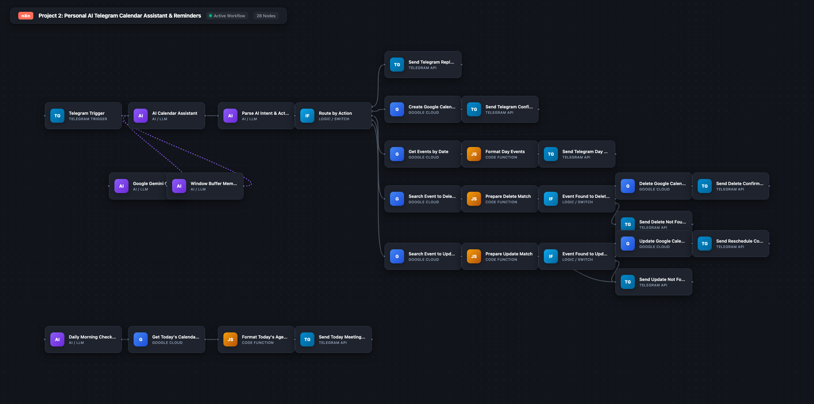
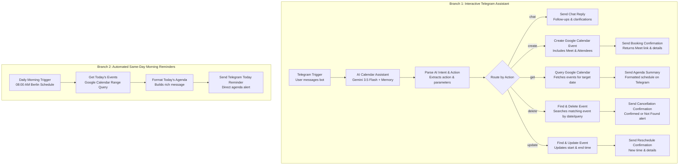

# 📅 Personal AI Telegram Calendar Assistant & Auto-Reminder

An intelligent, conversational **Personal AI Executive Secretary** on Telegram that manages your **Google Calendar** end-to-end:
* 📆 **Book new meetings** with automatic **Google Meet** links and optional attendee email invites.
* 🔍 **Check your schedule / agenda** for any specific date.
* 🗑️ **Delete / cancel** meetings effortlessly.
* 🔄 **Reschedule / move** meetings to a new date or time.
* 🔔 Automatically sends you a **daily morning agenda reminder** for that day at 07:00 AM (Berlin time).

Powered by **Google Gemini 3.5 Flash**, **LangChain Conversational Buffer Memory**, and native **Google Calendar + Telegram integrations** in n8n.

---

## 🖼️ Workflow Architecture Canvas



---

## 🌟 Key Features

* **💬 Natural Language Scheduling:** Text your Telegram bot naturally:
  > *"Schedule a 30-min sync with Ahmet tomorrow at 3 PM about the new product launch."*
* **📹 Built-in Google Meet by Default:** Every meeting defaults to Google Meet for call links/locations.
* **✉️ Intelligent Email Invite Handling:** The assistant politely asks if you'd like to invite participants via email. If provided, Google Calendar automatically sends invitations; if not, it generates the Google Meet link directly.
* **🔍 Check Meetings by Date:** Ask about your agenda for any day:
  > *"What meetings do I have tomorrow?"* or *"Check my schedule for October 25th."*
* **🗑️ Cancel / Delete Meetings:** Cancel meetings in plain language:
  > *"Cancel my meeting with John tomorrow at 4 PM."*
* **🔄 Reschedule Meetings:** Move meetings with natural commands:
  > *"Move my meeting with Deniz on Friday to 5 PM."*
* **🧠 Dynamic Slot-Filling:** If you miss critical details, the AI asks follow-up questions before taking action.
* **🔔 Auto Same-Day Morning Reminders:** A built-in automated scheduler checks your Google Calendar every morning at 08:00 AM (Berlin time) and alerts you with a clean agenda of that day's meetings.
* **🧠 12-Turn Context Memory:** Follow up or revise previous statements across turns naturally.

---

## 🏗️ Workflow Architecture



---

## 📋 Prerequisites & Credentials

You need 3 simple credentials in n8n:

| Service | Credential Type in n8n | Where to Get |
| :--- | :--- | :--- |
| **Telegram Bot** | `Telegram API` | Free via [@BotFather](https://t.me/BotFather) on Telegram |
| **Google Calendar** | `Google Calendar OAuth2 API` | Google Cloud Console OAuth 2.0 Client ID |
| **Google Gemini** | `Google Gemini(PaLM) API` | Free key from [Google AI Studio](https://aistudio.google.com/) |

---

## 🚀 Setup Guide

### Step 1: Create your Telegram Bot

1. Open Telegram and search for [@BotFather](https://t.me/BotFather).
2. Send `/newbot` and follow the prompts:
   - Display name: e.g. `Serhat Assistant`
   - Username: e.g. `serhat_calendar_bot` (must end with `bot`)
3. Copy the **HTTP API Bot Token** provided by BotFather (looks like `7123456789:AAH...`).
4. Find your personal **Telegram Chat ID**:
   - Message [@userinfobot](https://t.me/userinfobot) or [@raw_data_bot](https://t.me/raw_data_bot) on Telegram to get your numeric ID (e.g. `123456789`).

---

### Step 2: Set up Google Calendar OAuth2 in n8n

1. Go to the [Google Cloud Console](https://console.cloud.google.com/).
2. Create a project and enable the **Google Calendar API**.
3. Under **OAuth consent screen**:
   - User Type: **External**
   - Fill in App Name & Support Email.
   - **Important:** Add your Google account email under **Test Users** (avoids 403 Access Denied errors while in Testing status).
   - *Do not* check "Use this client for an AI-powered agent".
4. Under **Credentials** → **Create Credentials** → **OAuth client ID**:
   - Application type: **Web application**
   - Authorized redirect URI:
     ```text
     https://n8n.codewaft.com/rest/oauth2-credential/callback
     ```
5. Copy your **Client ID** and **Client Secret**.
6. In n8n, go to **Credentials** → **New Credential** → **Google Calendar OAuth2 API**:
   - Paste Client ID and Client Secret.
   - Click **Sign in with Google** and approve permissions.

---

### Step 3: Get your Google Gemini API Key

1. Go to [Google AI Studio](https://aistudio.google.com/).
2. Click **Get API key** → **Create API key**.
3. In n8n, create a **Google Gemini(PaLM) API** credential and paste your API key.
4. The workflow is already pre-configured to use **`models/gemini-3.5-flash`** for instant responses.

---

### Step 4: Import & Activate the Workflow

1. Open your n8n dashboard: [https://n8n.codewaft.com](https://n8n.codewaft.com).
2. Click **Add workflow** → Click **`...`** (top right) → **Import from File...**.
3. Select [`workflow.json`](workflow.json).
4. Assign your credentials to the respective nodes:
   * **Telegram Trigger** & **Telegram Send nodes** ➡️ Select your **Telegram account**.
   * **Google Calendar nodes** ➡️ Select your **Google Calendar account**.
   * **Google Gemini Chat Model** ➡️ Select your **Google Gemini account**.
5. In the **Send Today Meeting Reminder** node, set your Telegram Chat ID in the `chatId` field (or set n8n variable `TELEGRAM_MY_CHAT_ID`).
6. Click **Save** and toggle the workflow to **Active / Published**!

---

## 💬 Example Dialogues

### 1. Booking with Google Meet & Optional Email Invite
> **You:** *"Hey, schedule a sync with Deniz tomorrow at 3 PM about Q4 marketing."*
>
> **AI:** *"I can set that up for tomorrow at 3:00 PM on Google Meet! Would you like me to send a calendar invite to Deniz's email address, or will the Google Meet link be enough?"*
>
> **You:** *"Just the link is enough."*
>
> **AI / Bot:**  
> ✅ **Meeting Scheduled on Google Calendar!**  
> 📌 **Title:** Sync with Deniz - Q4 Marketing  
> ⏰ **Start:** 2026-10-23 15:00  
> ⏳ **End:** 2026-10-23 15:30  
> 📍 **Location:** Google Meet  
> 🔗 [Open in Google Calendar](https://calendar.google.com/...)  
> 🔔 *I've noted this down and will send you a reminder on Telegram at 08:00 AM that day!*

---

### 2. Checking Schedule by Date
> **You:** *"What meetings do I have tomorrow?"*
>
> **Bot:**  
> 📅 **Your Schedule for Friday, 24 October 2026:**
>
> 1. ⏰ **11:00 - 11:45** — **Escape Towns Strategy Sync**  
>    📍 *Google Meet* | [Calendar Link](https://calendar.google.com/...)  
>
> 2. ⏰ **15:00 - 15:30** — **Sync with Deniz - Q4 Marketing**  
>    📍 *Google Meet* | [Calendar Link](https://calendar.google.com/...)  
>
> ✨ Total: 2 meeting(s)

---

### 3. Rescheduling a Meeting
> **You:** *"Can you move my sync with Deniz tomorrow to 5 PM instead?"*
>
> **Bot:**  
> 🔄 **Meeting Rescheduled Successfully!**  
> 📌 **Title:** Sync with Deniz - Q4 Marketing  
> ⏰ **New Start:** 2026-10-23 17:00  
> ⏳ **New End:** 2026-10-23 17:30  
> 🔗 [Open in Google Calendar](https://calendar.google.com/...)

---

### 4. Canceling / Deleting a Meeting
> **You:** *"Cancel my meeting with Deniz tomorrow."*
>
> **Bot:**  
> 🗑️ **Meeting Cancelled Successfully!**  
> 📌 **Title:** Sync with Deniz - Q4 Marketing  
> 📅 The event has been removed from your Google Calendar.

---

### 5. Automated Same-Day Agenda Reminder
Every morning at 08:00 AM (Europe/Berlin), the bot checks your calendar for that day. If you have meetings, you automatically receive:

> 🔔 **Today's Meeting Reminder (Friday, 24 October 2026)**
>
> You have **2** meeting(s) scheduled for today:
>
> 1. ⏰ **11:00 - 11:45** — **Escape Towns Strategy Sync** | 📍 *Google Meet* ([Calendar Link](https://calendar.google.com/...))
> 2. ⏰ **17:00 - 17:30** — **Sync with Deniz - Q4 Marketing** | 📍 *Google Meet* ([Calendar Link](https://calendar.google.com/...))
>
> Have a productive day today! 🚀

---

## 📁 Files in this Project

- [`workflow.json`](workflow.json): Complete production-ready n8n workflow export with Create, Get, Delete, Update, and Reminder capabilities.
- [`sample-data/telegram-message.json`](sample-data/telegram-message.json): Test mock payload of an incoming Telegram update.
