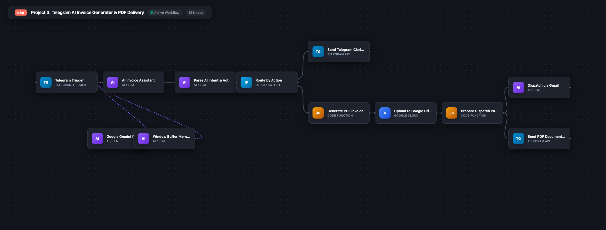
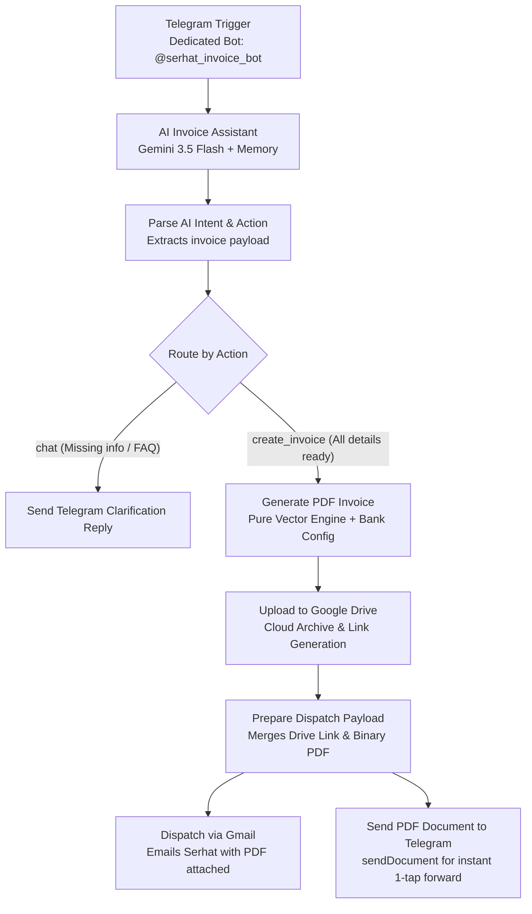

# 🧾 Automated PDF Invoice Generator & Cloud Dispatcher

An intelligent, conversational **Personal AI Financial Secretary** on Telegram that generates professional, high-resolution vector **PDF Invoices & Proposals**, uploads them to **Google Drive**, emails them via **Gmail**, and delivers the PDF directly to your **Telegram chat for instant 1-tap forwarding**.

Powered by **Google Gemini 3.5 Flash**, **LangChain Buffer Memory**, and native **Google Drive + Gmail + Telegram integrations** in n8n.

---

## 🖼️ Workflow Architecture Canvas



---

## 🌟 Key Features

* **💬 Natural Language Invoicing:** Simply tell the bot what you need:
  > *"Acme Corp için 1.500 EUR Web Development and AI Integration faturası kesebilir misin bugünün tarihiyle?"*  
  > or  
  > *"Create an invoice for TechCorp: 2,500 USD for Cloud Architecture consulting."*
* **🧠 Intelligent Multi-Turn Slot Filling:** If any essential detail is missing (Client Company, Description, or Amount), the AI politely asks follow-up questions before generating the invoice.
* **🏢 Invoicer Always Serhat Kumaş:** Pre-configured with Serhat Kumaş as the official proposal/invoice issuer.
* **💳 Editable Bank Transfer & IBAN Details:** Configurable directly inside the `Generate PDF Invoice` node in n8n (Bank Name, Account Holder, IBAN, BIC/SWIFT, Tax ID).
* **📄 Crisp Vector PDF Generation:** Generates a lightweight, pixel-perfect single-page A4 PDF invoice (PDF-1.4 standard) without external API costs or browser dependencies.
* **☁️ Google Drive Archive:** Automatically uploads every generated invoice PDF to your Google Drive and returns the direct access link.
* **✉️ Automatic Gmail Dispatch:** Sends an official email summary with the PDF attached directly to your inbox (`serhat.kumas.SK@gmail.com`).
* **📲 Instant Telegram File Return:** Sends the PDF file as a native Telegram document (`sendDocument`), allowing you to preview or forward it to clients with 1 tap.

---

## 🏗️ Workflow Architecture



---

## 💳 How to Edit Your Bank & IBAN Details in n8n

Open the **`Generate PDF Invoice`** node in n8n. At the very top of the script (lines 4–16), you can edit your bank details anytime:

```javascript
// =========================================================================
// 🏢 INVOICER & BANK TRANSFER DETAILS (Edit these anytime!)
// =========================================================================
const INVOICER_CONFIG = {
  name: 'Serhat Kumaş',
  title: 'Software Engineer & AI Consultant',
  company: 'Serhat Kumaş Consulting',
  email: 'serhat.kumas.SK@gmail.com',
  address: 'Berlin, Germany',
  taxId: 'DE123456789', // Your VAT / Tax ID
  
  // 💳 Bank Transfer & IBAN Details
  bankName: 'Deutsche Bank / N26',
  accountHolder: 'Serhat Kumaş',
  iban: 'DE89 3704 0044 0532 0130 00',
  bic: 'DBBTTDDBXXX',
  paymentTerms: 'Please transfer to the IBAN above within 14 days. Reference invoice number.'
};
```

---

## 📋 Prerequisites & Credentials

| Service | Credential Type in n8n | Where to Get |
| :--- | :--- | :--- |
| **Telegram Bot** | `Telegram API` | Create dedicated bot via [@BotFather](https://t.me/BotFather) (e.g. `serhat_invoice_bot`) |
| **Google Gemini** | `Google Gemini(PaLM) API` | Free key from [Google AI Studio](https://aistudio.google.com/) |
| **Google Drive** | `Google Drive OAuth2 API` | Google Cloud Console OAuth Client ID |
| **Gmail** | `Gmail OAuth2 API` | Google Cloud Console OAuth Client ID |

---

## 🚀 Setup Guide

### Step 1: Create your Telegram Invoice Bot
1. Open Telegram and search for [@BotFather](https://t.me/BotFather).
2. Type `/newbot`:
   - Name: `Serhat Invoice Assistant`
   - Username: e.g. `serhat_invoice_bot` (must end with `bot`).
3. Copy the HTTP API token provided by BotFather.

---

### Step 2: Set up Google Drive & Gmail OAuth2 in n8n
1. In Google Cloud Console, enable **Google Drive API** and **Gmail API** in your existing project.
2. In n8n, create credentials:
   - **Google Drive OAuth2 API** ➡️ Authenticate with your Google account.
   - **Gmail OAuth2 API** ➡️ Authenticate with your Google account (`serhat.kumas.SK@gmail.com`).

---

### Step 3: Import & Activate the Workflow
1. Open your n8n dashboard: [https://n8n.codewaft.com](https://n8n.codewaft.com).
2. Click **Add workflow** → **`...`** (top right) → **Import from File...**.
3. Select [`workflow.json`](workflow.json).
4. Assign your credentials to each node:
   - **Telegram Trigger & Telegram Nodes** ➡️ Select your Telegram invoice bot credential.
   - **Google Gemini Chat Model** ➡️ Select your Gemini credential.
   - **Upload to Google Drive** ➡️ Select your Google Drive credential.
   - **Dispatch via Gmail** ➡️ Select your Gmail credential.
5. Click **Save** and toggle to **Active**!

---

## 💬 Example Dialogues

### Scenario 1: Complete Information in One Message
> **You:** *"Acme Corp için 1500 EUR Web Development and AI Integration faturası kesebilir misin bugünün tarihiyle?"*
>
> **AI / Bot:**  
> ✅ **Invoice Generated Successfully!**  
>  
> 📄 **Invoice:** INV-20261023-01  
> 🏢 **Client:** Acme Corp  
> 💰 **Total Due:** 1500 € (EUR)  
> 📅 **Invoice Date:** 2026-10-23  
> ⏳ **Due Date:** 2026-11-06  
> 📝 **Service:** Web Development and AI Integration  
>  
> ☁️ [Open in Google Drive](https://drive.google.com/...)  
> ✉️ *A copy with the PDF attached has also been sent to your Gmail!*  
>  
> *(The PDF file `Invoice_INV-20261023-01_Acme_Corp.pdf` is sent right into your chat ready to forward!)*

---

### Scenario 2: Incomplete Details (Slot-Filling)
> **You:** *"TechCorp için fatura keselim."*
>
> **AI:** *"TechCorp için fatura oluşturmaktan memnuniyet duyarım! Faturaya hangi hizmet tanımını ve ne kadarlık bir tutar (ve para birimi) yazmamı istersiniz?"*
>
> **You:** *"Cloud Architecture Consulting, 2500 USD."*
>
> **AI:** *"Harika! TechCorp için 2.500 USD tutarında faturayı hazırlıyorum..."*
>
> *(Bot creates the PDF, uploads to Drive, sends email, and delivers the PDF to Telegram!)*

---

## 📁 Files in this Project

- [`workflow.json`](workflow.json): Complete production-ready n8n workflow export.
- [`sample-data/invoice-request.json`](sample-data/invoice-request.json): Sample mock Telegram request.
