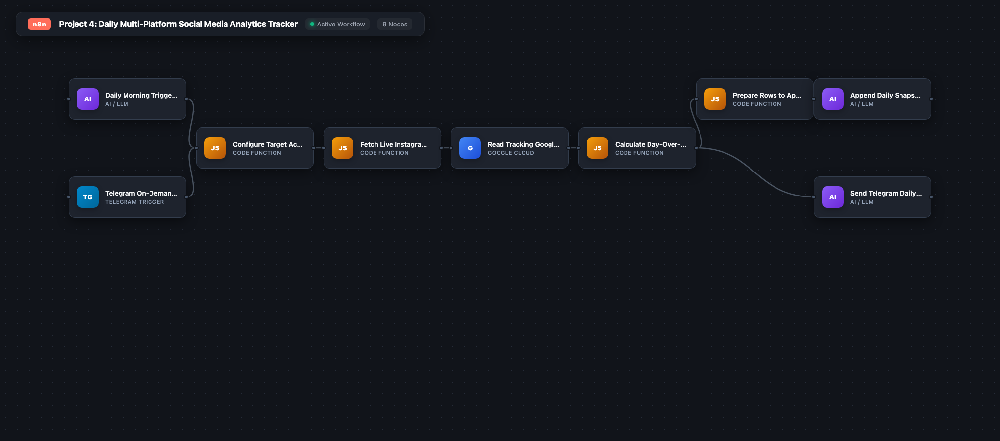
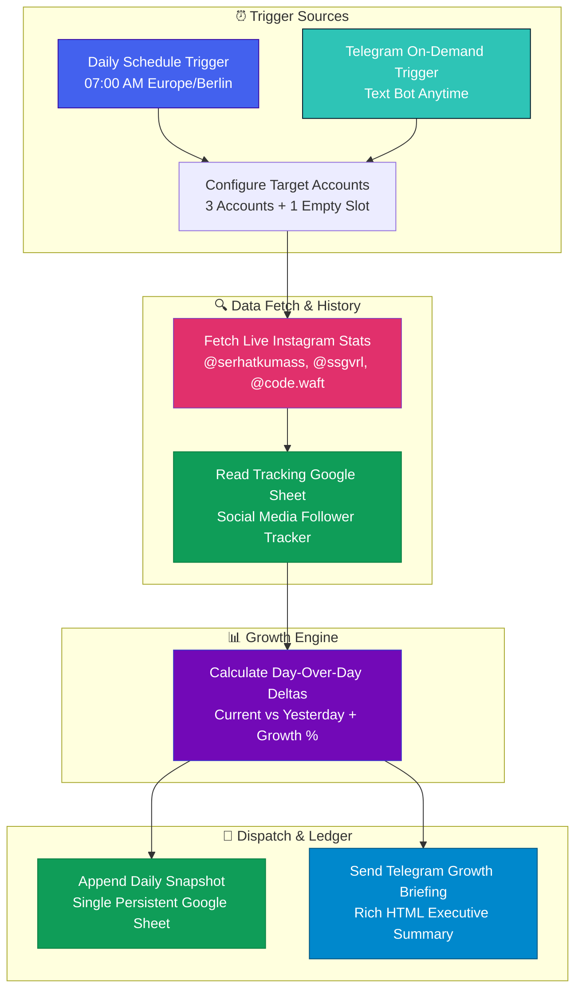

# 📊 Daily Social Media Follower & Growth Tracker (Instagram)

An automated, executive-grade **Instagram Follower & Growth Tracking Bot** built on **n8n** that monitors your selected Instagram accounts daily at **07:00 AM (Berlin Time)**.

* 📱 **Monitored Accounts:**
  * 👤 **Personal Brand:** `@serhatkumass`
  * ❤️ **Personal:** `@ssgvrl`
  * 💻 **Code Waft:** `@code.waft`
  * 🚀 **Account 4:** Empty (skipped until a handle is added)
* 🕒 **Daily Schedule:** Fires every single morning at **07:00 AM (Europe/Berlin)**.
* 📈 **Day-Over-Day Growth Analytics:** Automatically computes exact follower deltas (+/-) and percentage growth rates compared to the previous day.
* 📑 **Single Persistent Google Sheet:** Records every daily snapshot into the **exact same Google Sheet** (`Social Media Follower Tracker` ➔ `Snapshots` tab). Never creates duplicate or cluttered files!
* 💬 **Dual Trigger Modes:** Fully automated at 07:00 AM, plus on-demand Telegram trigger for instant live stats anytime!

---

## 🖼️ Workflow Architecture Canvas



---

## 🏗️ Workflow Architecture



---

## 📱 Executive Telegram Briefing Example

Every morning at 07:00 AM Berlin time (or when queried on-demand), you receive this briefing (illustrative counts):

```text
📊 Instagram Growth Tracker
🗓 Friday, 24 October 2026 • 07:00 Berlin
━━━━━━━━━━━━━━━━━━━━

👤 Serhat Kumaş • @serhatkumass
├ 👥 Followers: 778
└ 📈 24h: +5 (+0.65%) 🟢

❤️ SSGVRL • @ssgvrl
├ 👥 Followers: 180
└ 📈 24h: 0 (0.00%) ⚪

💻 Code Waft • @code.waft
├ 👥 Followers: 7
└ 📈 24h: +1 (+16.67%) 🟢

🚀 Account 4
└ ⏳ Awaiting account link

━━━━━━━━━━━━━━━━━━━━
📂 Open Google Sheets Database ↗
```

---

## 📑 Google Sheets Persistent Ledger

The system uses **one single Google Sheet** across all 365 days of the year. It appends up to three rows daily, one for each account with an available follower count. The empty fourth slot is never queried or saved. The counts below are illustrative:

| Date | Account | Handle | Platform | Current Followers | Previous Followers | Daily Change | Growth Rate (%) | Snapshot Time | Notes |
| :--- | :--- | :--- | :--- | :--- | :--- | :--- | :--- | :--- | :--- |
| **2026-10-23** | Personal | `@serhatkumass` | Instagram | `2,340` | `2,332` | `+8` | `+0.34%` | `07:00:00 (Berlin)` | Automated Daily Snapshot |
| **2026-10-23** | SSGVRL | `@ssgvrl` | Instagram | `12,415` | `12,390` | `+25` | `+0.20%` | `07:00:00 (Berlin)` | Automated Daily Snapshot |
| **2026-10-23** | Code Waft | `@code.waft` | Instagram | `4,808` | `4,795` | `+13` | `+0.27%` | `07:00:00 (Berlin)` | Automated Daily Snapshot |

A header-only starter template, without historical account data, is provided in [`sample-data/follower-tracker-template.csv`](file:///Users/serhatkumas/Desktop/n8n/projects/04.daily-social-media-tracker/sample-data/follower-tracker-template.csv).

---

## 🚀 Setup & Deployment Guide

### 1. Google Sheets Setup (1 Minute)
1. Open [Google Sheets](https://sheets.new) and create a spreadsheet titled:
   `Social Media Follower Tracker`
2. Rename the first tab/sheet to:
   `Snapshots`
3. Copy the header columns from [`sample-data/follower-tracker-template.csv`](file:///Users/serhatkumas/Desktop/n8n/projects/04.daily-social-media-tracker/sample-data/follower-tracker-template.csv) or import the CSV directly (`File` ➔ `Import` ➔ `Upload`).

### 2. Google Sheets API Credential in n8n
1. In your existing Google Cloud project (where Google Drive and Calendar are already enabled), go to **APIs & Services ➔ Library**.
2. Search for **Google Sheets API** and click **Enable**.
3. In n8n (`https://n8n.codewaft.com/`), create or connect a **Google Sheets OAuth2 API** credential using your existing OAuth Client ID and Secret.

### 3. Telegram Bot Credential
* Connect your existing Telegram Bot credential (`Telegram Gmail Bot Access` or your dedicated bot token).

### 4. Apify Integration (Free $5/month Credit Forever)
* Meta blocks unauthenticated scraping directly from cloud datacenter IPs (Oracle, AWS, GCP).
* The workflow uses the official **Apify Instagram Profile Scraper** (`apify~instagram-profile-scraper`) which queries all accounts in a **single batch call** (1 API call per day = 30 calls/month).
* Apify provides **$5.00/month recurring free credit forever** (which easily covers 1,000+ profile lookups).
* **Get your token**: Log in to [Apify Console](https://console.apify.com/account/integrations) and copy your **Personal API Token**.
* **Paste token**: Open the `Fetch Live Instagram Stats` code node in n8n and paste it into `const APIFY_TOKEN = 'apify_api_...';` (or define an n8n variable `APIFY_API_TOKEN`).
* If no token is set or a lookup fails, the existing Serhat baseline remains available. New accounts without a known count display “Follower count unavailable” and do not create a spreadsheet snapshot until a live or manual count is available. Old account counts are not reused for the new handles.

---

## 🛠️ Modifying Monitored Accounts

To change or add accounts, open the **Configure Target Accounts** Code node in n8n and adjust the array:

```javascript
const TARGET_ACCOUNTS = [
  {
    id: 'personal',
    name: 'Serhat Kumaş',
    handle: 'serhatkumass',
    platform: 'Instagram'
  },
  {
    id: 'startup_1',
    name: 'SSGVRL',
    handle: 'ssgvrl',
    platform: 'Instagram'
  },
  {
    id: 'startup_2',
    name: 'Code Waft',
    handle: 'code.waft',
    platform: 'Instagram'
  },
  {
    id: 'startup_3',
    name: 'Account 4',
    handle: '',
    platform: 'Instagram'
  }
];
```
