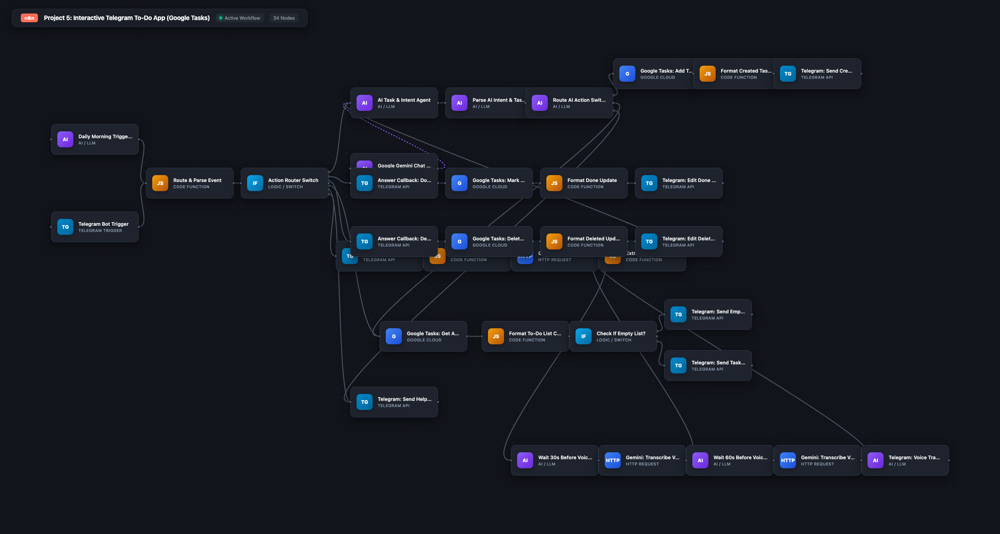

# 📋 Interactive Telegram To-Do App (Google Tasks 2-Way Sync)

A fast, interactive **Personal Task Management Bot** on Telegram that syncs 2-way in real time with **Google Tasks**. 

Send a task like `/add Call investor at 3pm` (or simply send any text note), and the bot immediately registers it in Google Tasks with inline clickable buttons. Every morning at **08:00 AM Berlin time**, a scheduled workflow pulls all active tasks and delivers a clean, iPhone-optimized to-do list with interactive inline buttons (`[✅ Done]`, `[🗑️ Delete]`). Tapping any button triggers an immediate webhook callback back to n8n to update Google Tasks on the spot and update the chat message in-place!

---

## 🖼️ Workflow Architecture Canvas



---

## 🌟 Key Features

* **⚡ Real-Time 2-Way Google Tasks Sync:** Directly integrated with the native Google Tasks API (`@default` task list). Any task created, completed, or cancelled in Telegram is instantly reflected in Google Tasks (web, mobile app, and Gmail sidebar).
* **💬 Natural & Fast Task Creation:**
  - Send `/add Call investor at 3pm` or `/todo Review pitch deck`
  - Or simply send any normal message (e.g. `Buy groceries`) — the bot intelligently creates it as a task.
* **⏰ Automated 08:00 AM Daily Morning Briefing:**
  - Every day at **08:00 AM Europe/Berlin time**, the bot automatically fetches all pending tasks.
  - If you have tasks to do, it sends a neat iPhone-formatted checklist with individual interactive buttons for each task:
    ```text
    📋 Your Morning To-Do List (3 pending)
    🗓 Friday, 23 Oct • 08:00 Berlin
    ━━━━━━━━━━

    1️⃣ Call investor
    2️⃣ Review pitch deck
    3️⃣ Follow up on invoice #104

    ━━━━━━━━━━
    Tap any button below to update immediately:
    ```
    Buttons:
    `[✅ Done #1] [🗑️ Delete #1]`
    `[✅ Done #2] [🗑️ Delete #2]`
    `[✅ Done #3] [🗑️ Delete #3]`
    `[🔄 Refresh Task List]`
  - If you have completed everything:
    ```text
    🎉 All Clear! No Pending Tasks
    🗓 Friday, 23 Oct • 08:00 Berlin
    ━━━━━━━━━━
    You have completed all your tasks for today! Enjoy your day.
    ```
* **🎙️ Voice Message Audio Transcription (Gemini Multimodal):**
  - **Hands-Free Task Management**: Tap the mic button in Telegram and speak naturally (e.g. *"Remind me to call investor at 3pm, send invoice to Alex, and take train to Passau"*).
  - **Automatic Speech-to-Text**: Telegram's voice note (`audio/ogg`) is downloaded and transcribed verbatim in real time using Google Gemini 2.5 Flash Lite.
  - **Automatic Retries**: If the transcription request fails, retry after 30 seconds, then after another 60 seconds. After three failed attempts, the bot asks the user to try again later or send text.
  - **Seamless Action Execution**: Transcribed text feeds directly into the AI Intent & Task Agent, allowing you to create tasks, view lists, or check your schedule entirely by voice!
* **🧠 AI-Powered Natural Intent Classification & Task Splitting:**
  - **Conversational Queries**: Ask in plain natural language or voice (e.g. *"Can you show my to do list, lets see what I have on the list?"* or *"What do I have to do today?"*), and Google Gemini detects your intent is `list_tasks` and displays your list instead of creating a task.
  - **Typo & Shorthand Fixes**: Notes like `trin to pasau at 4.24` are refined into clean, professional titles like `Take train to Passau at 4:24 PM`.
  - **Multi-Task Extraction**: Send multiple tasks in one message or voice note (e.g. `1- buy groceries 2- call investor 3- send deck`), and AI splits them into separate Google Tasks entries.
  - **Concise Titles**: Strictly tuned to produce short, punchy task titles (3–8 words) rather than long paragraphs.
* **🎉 Graceful Empty List Notice:**
  - When you have zero tasks, the bot displays a clean `🎉 All Clear! No Tasks To Do` screen with a `[🔄 Refresh List]` button, without halting or failing the workflow.
* **🔘 Instant Inline Button Actions:**
  - Clicking **`✅ Done`**: Immediately checks off the task in Google Tasks, strikes it through in-place, and keeps the message updated.
  - Clicking **`🗑️ Cancel / Delete`**: Permanently deletes the task via the Google Tasks REST API (`DELETE /tasks/{id}`) and updates the message.
* **📱 iPhone Screen Optimized:** Compact 10-character dividers (`━━━━━━━━━━`), zero horizontal wrapping, clean branch lines, and bold typography designed specifically for mobile screens.
* **🔍 On-Demand Check (`/tasks` or `/list`):**
  - Check your to-do list anytime by sending `/tasks`, typing *"show my tasks"*, sending a voice note, or clicking `[🔄 Refresh List]`.

---

## 🏗️ Workflow Architecture

```mermaid
graph TD
    A[Daily Schedule Trigger<br/>08:00 AM Berlin Time] --> C[Route & Parse Event<br/>Fast-Path, Text & Voice Routing]
    B[Telegram Bot Trigger<br/>Captures Messages, Voice & Button Clicks] --> C
    
    C --> D{Action Router Switch}
    
    %% Voice Message Pipeline
    D -- "voice_transcribe" --> V1[Telegram: Download Voice File<br/>Downloads audio/ogg binary]
    V1 --> VB[Prepare Voice Audio<br/>Read binary buffer and encode Base64]
    VB --> V2[Gemini: Transcribe Voice Note<br/>Multimodal Audio Transcription]
    V2 -- Success --> V3[Extract Voice Transcription]
    V2 -- Error --> VW1[Wait 30 seconds]
    VW1 --> VR1[Gemini: Transcribe Voice Note<br/>Attempt 2]
    VR1 -- Success --> V3
    VR1 -- Error --> VW2[Wait 60 seconds]
    VW2 --> VR2[Gemini: Transcribe Voice Note<br/>Attempt 3]
    VR2 -- Success --> V3
    VR2 -- Error --> VF[Telegram: Voice Transcription Unavailable<br/>Please try again later or send text]
    V3 --> AI
    
    %% Fast-Path & Callbacks
    D -- "mark_done" --> H[Answer Callback: Done<br/>Instant Popup Toast Notification]
    H --> I[Google Tasks: Mark Done<br/>Status -> completed]
    I --> J[Format Done Update<br/>Strikethrough in-place]
    J --> K[Telegram: Edit Done Message]
    
    D -- "delete_task" --> L[Answer Callback: Delete<br/>Instant Popup Toast Notification]
    L --> M[Google Tasks: Delete Task<br/>Deletes item from list]
    M --> N[Format Deleted Update]
    N --> O[Telegram: Edit Deleted Message]
    
    D -- "list_tasks"<br/>(Cron or /tasks fast-path) --> P[Google Tasks: Get Active Tasks<br/>alwaysOutputData: true]
    D -- "help"<br/>(/help fast-path) --> S[Telegram: Send Help Guide]
    
    %% Natural Language AI Agent
    D -- "ai_eval"<br/>(All Natural Language Messages) --> AI[AI Task & Intent Agent<br/>Gemini 2.5 Flash Lite]
    AI --> PAI[Parse AI Intent & Tasks]
    PAI --> D_AI{Route AI Action Switch}
    
    D_AI -- "create_task" --> E[Google Tasks: Add Task<br/>Creates item in @default list]
    E --> F[Format Created Task Card<br/>Builds iPhone Card + Buttons]
    F --> G[Telegram: Send Created Task<br/>Inline Done / Delete buttons]
    
    D_AI -- "list_tasks" --> P
    D_AI -- "help" --> S
    
    %% Task Listing Flow
    P --> Q[Format To-Do List Card<br/>Detects empty vs active tasks]
    Q --> Q1{Check If Empty List?}
    Q1 -- Empty --> R1[Telegram: Send Empty List<br/>"No tasks to do!"]
    Q1 -- Has Tasks --> R2[Telegram: Send Task Cards<br/>Interactive action buttons]
```

---

## ⚙️ Setup & Credentials Guide

### 1. Enable Google Tasks API in Google Cloud Console
1. Open [Google Cloud Console](https://console.cloud.google.com/).
2. Select your existing Google Cloud project (where Google Calendar, Drive, and Sheets are already active).
3. Navigate to **APIs & Services ➔ Library**.
4. Search for **Google Tasks API** and click **Enable**.

### 2. Connect Google Tasks Credential in n8n
1. In your n8n instance (`https://n8n.codewaft.com/`), go to **Credentials ➔ New Credential**.
2. Search for **Google Tasks OAuth2 API**.
3. Use the same OAuth Client ID and Secret you used for Google Calendar / Google Drive.
4. Click **Sign in with Google** and approve the tasks permission (`https://www.googleapis.com/auth/tasks`).
5. Name it `Google Tasks account`.

### 3. Telegram Bot Credential
* Connect your existing Telegram Bot credential (`Telegram Gmail Bot Access`, `Telegram Invoice Bot`, or create a dedicated bot via BotFather).

### 4. Fix Gemini voice transcription: `400 INVALID_ARGUMENT`

If the failed request contains `"inlineData": { "mimeType": "audio/ogg", "data": "" }`, Gemini received no audio bytes. Reading `$binary.data.data` directly is unreliable: n8n can store the bytes separately from the binary metadata. Use its [binary buffer helper](https://docs.n8n.io/code/cookbook/code-node/get-binary-data-buffer/) to read the file, then encode it as Base64. OGG is a [supported Gemini audio format](https://ai.google.dev/gemini-api/docs/audio).

The local `workflow.json` includes this fix. To apply it to an existing workflow in n8n:

1. Enable **Download** in **Telegram: Download Voice File**.
2. Insert a **Code** node named **Prepare Voice Audio** between the download node and **Gemini: Transcribe Voice Note**. Select **JavaScript** and **Run Once for All Items**, then copy the `jsCode` from that node in `workflow.json`.
3. In the Gemini node's JSON body, replace the `inlineData` block with:

   ```json
   "inlineData": {
     "mimeType": "{{ $json.audioMimeType }}",
     "data": "{{ $json.audioBase64 }}"
   }
   ```

4. Run the voice download and preparation nodes again with a fresh voice recording. If using pinned sample data, unpin it first so the actual binary file is downloaded. **Prepare Voice Audio** must output a non-empty `audioBase64` string; missing or zero-byte files now stop with an explicit error before the HTTP request.
5. Run the transcription node and check `candidates[0].content.parts` for the transcript, then save/publish your updated workflow.

The repository uses `gemini-3.1-flash-lite`; if your running workflow uses a different model, retain your configured model when applying this targeted fix. The empty audio payload must be corrected regardless of the model. Editing this repository does not automatically update the workflow running in n8n.

### 5. Voice transcription retries and failure message

The transcription branch now makes at most **three requests per voice message**:

| Attempt | When it runs | If the request fails |
| :--- | :--- | :--- |
| 1 | Immediately after audio preparation | Wait 30 seconds |
| 2 | After the first wait | Wait another 60 seconds |
| 3 | After the second wait | Send the try-later message and end the branch |

The waits start after each failed request completes, so total elapsed time also includes request durations. Any successful attempt goes directly to **Extract Voice Transcription**, then the existing AI/task flow. The failure branch never enters the AI/task flow.

All three HTTP nodes use **Settings → On Error → Continue (using error output)**, with **Retry On Fail** disabled. This handles request failures such as Gemini high-demand `503`, rate-limit `429`, other HTTP errors, and network errors/timeouts. Each retry reads the original linked Base64 audio from **Prepare Voice Audio**, not the previous error payload. The delays use native [Wait nodes](https://docs.n8n.io/integrations/builtin/core-nodes/n8n-nodes-base.wait/); error routing uses n8n's [On Error setting](https://docs.n8n.io/workflows/components/nodes/#node-settings).

After the third failure, **Telegram: Voice Transcription Unavailable** sends this to the original chat:

> Sorry, I couldn't transcribe your voice message after three attempts. Please try again later, or send your request as text.

To apply this to your running workflow, import the updated `workflow.json`, or copy its two Wait nodes, two retry HTTP nodes, and Telegram failure node into your existing workflow. Configure the original transcription node's error output and connect the branches as shown above. All three HTTP nodes must use your intended model URL and Gemini credential; the failure node must use your bot's Telegram credential. Save/publish the updated workflow. The repository changes are not automatically deployed.

Run the local regression checks with:

```sh
node --test projects/05.interactive-telegram-todo-app/tests/voice-transcription-retry.test.mjs
```

These checks simulate success and failure paths, verify the wait durations and retry payloads, and compile every Code node. They do not call Gemini or Telegram or run a live n8n execution.

---

## 📲 How to Use in Telegram

| Command / Message | Action |
| :--- | :--- |
| `/add Call investor at 3pm` | Adds task to Google Tasks and returns interactive buttons |
| `Call investor` (any text) | Creates the task directly |
| `/tasks` or `/list` | Displays active to-do list with clickable action buttons |
| Click `[✅ Done #1]` | Instantly checks off task in Google Tasks and strikes it through in Telegram |
| Click `[🗑️ Delete #1]` | Cancels and removes the task from Google Tasks |
| Click `[🔄 Refresh]` | Re-fetches the latest state from Google Tasks |
| `/help` | Shows the quick command guide |
