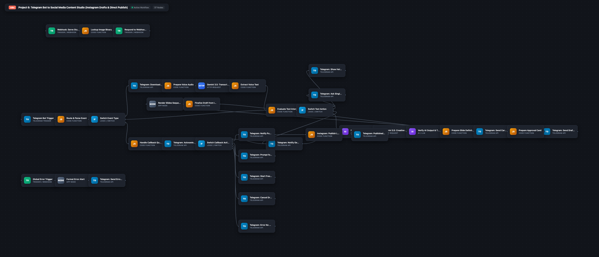

# Telegram Social Content Studio

Create Instagram posts from Telegram text or voice messages, review the generated draft, request changes, and publish after approval.

## 🖼️ Workflow Architecture Canvas



---

## Final working version

The user-confirmed working baseline is **[`workflow.json`](workflow.json)**. It publishes to **`@developmentserhat`**, Instagram account ID **`17841480124544403`**. Both the Instagram and Cloudflare tokens are embedded directly in this file; n8n Variables are not required.

The contents are unchanged from the user-confirmed working file; only the filename was consolidated.

## Project files

- **[`workflow.json`](workflow.json)** — the single final, ready-to-import workflow. Excluded from Git because it contains the real tokens.
- **`README.md`** — setup and runtime reference.

The temporary builder, smoke harness, regression test script, and unused environment files have been removed. They are not required to run the workflow.

## Import into n8n

1. Open the existing Social Content Studio workflow in your n8n instance.
2. Choose **⋯ → Import from File** and select **`workflow.json`**.
3. Confirm that the Telegram and Google Gemini credentials are connected.
4. Save the workflow and publish/activate it when ready to receive Telegram events.

Both tokens are already embedded in `workflow.json`. There is no separate local copy or build step.

## Required server setup

The shared runtime configuration is in [`setup/docker-compose.yml`](../../setup/docker-compose.yml) and [`setup/Caddyfile`](../../setup/Caddyfile).

- n8n uses filesystem binary storage.
- The `n8n_studio_images` volume is writable by n8n at `/home/node/.n8n-files/studio-images` and readable by Caddy at `/srv/studio-images`.
- Caddy serves generated JPEGs at `https://n8n.codewaft.com/studio-images/<uuid>.jpg`.
- The image volume must be writable by the container's n8n user.

## Runtime and memory behavior

```text
Telegram idea → Gemini creative draft → slide definitions
  → sequential native image sub-workflow
      Cloudflare → image-size check → Convert to File
      → streamed disk write → public URL HEAD check → URL-only result
  → Telegram draft review → approval → Instagram publication
```

- Each slide finishes before the next slide starts within that execution.
- Image bytes stay out of Code nodes and parent draft state; the native child still briefly holds the Cloudflare base64 response in memory.
- Child results contain only slide numbers and image URLs.
- The image response guard accepts at most 8 MiB of base64, approximately 6 MiB decoded, after the response is received.
- Child executions have a three-minute timeout; the parent has a fifteen-minute timeout.
- Child execution payloads are not retained. URL checks use `HEAD` rather than downloading images again.
- Sequential slides do not prevent separate workflow executions from overlapping. Available RAM and overall n8n concurrency still matter.
- Generated files remain on disk until removed; monitor the image volume's usage.

## Telegram flow

1. Send a post idea as text or a voice message.
2. Choose a single image or a carousel if prompted.
3. Review the generated images and caption.
4. Request tweaks, start fresh, cancel, or approve publication.
5. After publication, receive the Instagram media ID and account link.

Before cleanup, all 18 offline regression tests passed. The final workflow contents remain unchanged; no server deployment was performed as part of cleanup.
