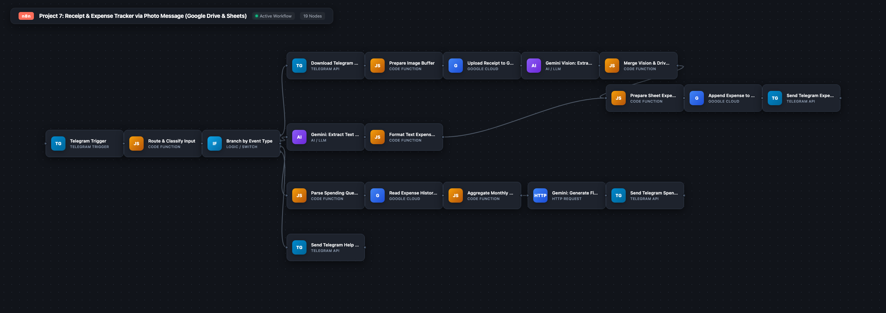
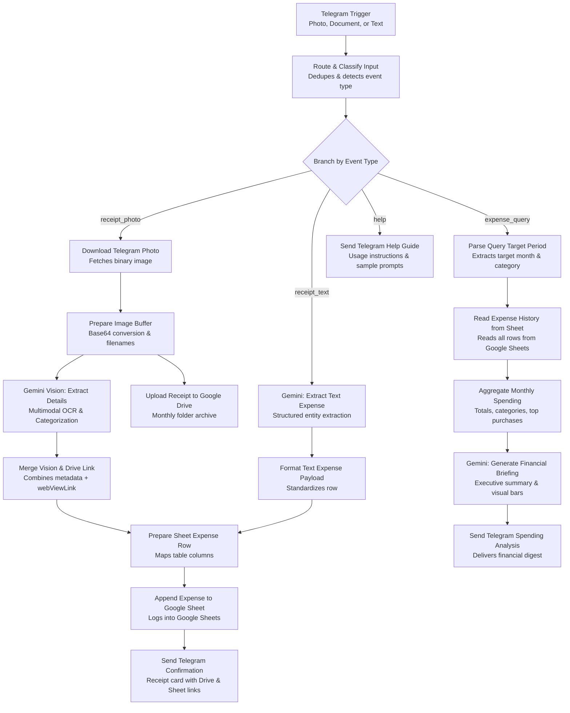

# 🧾 Project 07: Telegram Receipt & Expense Tracker AI

An autonomous, multi-modal **Personal AI Financial Assistant & Receipt Expense Tracker** powered by **Telegram**, **Google Gemini 3.5 Flash Lite (Vision + LLM)**, **Google Drive**, and **Google Sheets**.

Snap a photo of any receipt in your personal life or type a quick expense note into Telegram. The bot instantly archives a high-resolution backup into your **monthly Google Drive folder**, uses **Gemini Vision OCR** to extract the **Merchant**, **Date**, **Total Amount**, and **Category**, and logs the record into your persistent **Google Sheets Expense Tracker**.

Whenever you want, query the bot in natural language (in **English** or **Turkish**) about your current or historical spending (e.g., *"How much did I spend in March?"* or *"Mart ayında ne kadar harcadım?"*), and receive an executive financial briefing with category breakdowns, ASCII budget gauges, and spending insights.

---

## 🖼️ Workflow Architecture Canvas



---

## 🌟 Key Features

* 📸 **Instant Receipt Photo Processing:** Snap a picture of any paper, thermal, or digital receipt and send it to your bot.
* 👁️ **Multi-Modal Gemini Vision OCR:** Accurately extracts:
  * **Merchant / Store Name** (e.g., *Starbucks*, *Rewe*, *Apple Store*)
  * **Date** (ISO format `YYYY-MM-DD`, defaulting to today if unreadable)
  * **Total Amount & Currency** (e.g., `€14.50 EUR`, `$28.00 USD`, `₺350 TRY`)
  * **Intelligent Personal Finance Category** (e.g., *Coffee & Snacks*, *Dining Out*, *Groceries*, *Electronics & Tech*)
  * **Itemized Summary / Line Items**
* 📁 **Automated Google Drive Monthly Cloud Archive:**
  * One-time `Expenses` parent folder in Google Drive.
  * Sub-folders dynamically organized by month (e.g., `2026-11 (November)`).
  * Direct clickable Google Drive preview link attached to every spreadsheet row and Telegram confirmation.
* ✍️ **Natural Language Text Expense Logging:**
  * No photo? Just type: *"Starbucks 5.80 EUR latte"*, *"Rewe 42.50 groceries"*, or *"Taksi 250 TL"*.
  * The bot automatically extracts the vendor, amount, date, and category.
* 📊 **Automated Google Sheets Expense Tracker:**
  * Appends structured columns: `Date`, `Month`, `Merchant`, `Category`, `Amount`, `Currency`, `Receipt Drive Link`, `Items / Notes`, and `Logged At`.
  * Pre-formatted CSV template included in [`sample-data/google-sheets-template.csv`](sample-data/google-sheets-template.csv).
* 📈 **On-Demand Spending & Category Analytics:**
  * Ask questions anytime:
    * *"How much did I spend in March?"*
    * *"What did I spend this month?"*
    * *"Mart ayında kahveye ne kadar harcadım?"*
    * *"Show my groceries and dining breakdown for last month"*
  * Calculates real-time totals, category percentages, top 3 highest purchases, and daily averages.
  * Formulates a polished, emoji-rich financial briefing with ASCII percentage bars:
    `☕ Coffee & Snacks: €65.00 (18.2%) [██░░░░░░░░]`.
* 🌍 **Bilingual Support (English & Turkish):**
  * Understands and responds fluently in both English and Turkish based on the language of your prompt.

---

## 🏗️ Workflow Architecture



---

## 📋 Prerequisites & Credentials

You need 4 standard credentials in n8n:

| Service | Credential Type in n8n | Purpose | Where to Get |
| :--- | :--- | :--- | :--- |
| **Telegram Bot** | `Telegram API` (`telegramApi`) | Listening to user messages and sending confirmations | Free via [@BotFather](https://t.me/BotFather) |
| **Google Gemini** | `Google Gemini(PaLM) API` (`googlePalmApi`) | Multimodal receipt OCR, expense extraction & analytics | Free API key from [Google AI Studio](https://aistudio.google.com/) |
| **Google Drive** | `Google Drive OAuth2 API` (`googleDriveOAuth2`) | Backing up receipt photos into monthly folders | Google Cloud Console OAuth 2.0 Client ID |
| **Google Sheets** | `Google Sheets OAuth2 API` (`googleSheetsOAuth2Api`) | Recording expenses & querying financial history | Google Cloud Console OAuth 2.0 Client ID |

---

## 🏷️ Standard Expense Categories

Gemini standardizes all expenses into 10 personal finance buckets:

| Category | Icon | Example Merchants & Items |
| :--- | :---: | :--- |
| **Coffee & Snacks** | ☕ | Starbucks, Espresso House, bakeries, cafes, donuts |
| **Dining Out & Restaurants** | 🍽️ | Vapiano, Burgermeister, Uber Eats, sushi, bars |
| **Groceries & Supermarket** | 🛒 | Rewe, Edeka, Aldi, Lidl, Carrefour, Migros, convenience stores |
| **Electronics & Tech** | 💻 | Apple Store, MediaMarkt, Cyberport, Amazon tech, cables |
| **Transportation & Travel** | 🚗 | Uber, Taxi, DB Bahn, BVG, gas stations, flights, parking |
| **Shopping & Clothing** | 🛍️ | Zara, Uniqlo, Nike, department stores, home decor |
| **Housing & Utilities** | 🏠 | IKEA, Bauhaus, internet bills, electricity, rent |
| **Health & Pharmacy** | 💊 | Apotheke, DM, Rossmann, doctor visits, vitamins |
| **Entertainment & Leisure** | 🎬 | Cinema, Netflix, Spotify, museums, books, concerts |
| **General & Miscellaneous** | 📦 | Hardware, post office, dry cleaning, uncategorized |

---

## 🚀 Setup Guide

### Step 1: Create your Telegram Bot

1. Open Telegram and search for [@BotFather](https://t.me/BotFather).
2. Send `/newbot` and follow the instructions:
   - Name: `Serhat Expense Tracker`
   - Username: `serhat_expense_bot` (must end in `bot`).
3. Copy the **HTTP API Bot Token** provided by BotFather.
4. Get your Telegram numeric Chat ID by messaging [@userinfobot](https://t.me/userinfobot) or [@raw_data_bot](https://t.me/raw_data_bot) (e.g. `1519369571`).

---

### Step 2: Set up your Google Drive Expenses Folder

1. Open [Google Drive](https://drive.google.com/).
2. Create a new root folder named **`Expenses`**.
3. Inside `Expenses`, you can let n8n automatically create monthly folders (e.g., `2026-11 (November)`), or create your desired sub-folder structure.
4. Copy the Folder ID from the URL (`https://drive.google.com/drive/folders/<FOLDER_ID>`) to paste into the workflow config if desired.

---

### Step 3: Set up your Google Sheets Expense Tracker

1. Open [Google Sheets](https://sheets.new) and create a new spreadsheet named **`Personal Expense Tracker`**.
2. Name the first sheet tab **`Expenses`**.
3. In row 1, add these exact column headers:

| A | B | C | D | E | F | G | H | I |
| :--- | :--- | :--- | :--- | :--- | :--- | :--- | :--- | :--- |
| **Date** | **Month** | **Merchant** | **Category** | **Amount** | **Currency** | **Receipt Drive Link** | **Items / Notes** | **Logged At** |

> [!TIP]
> You can also import [`sample-data/google-sheets-template.csv`](sample-data/google-sheets-template.csv) directly via **File → Import → Upload** to set up the tracker with sample rows in 5 seconds!

4. Copy the **Spreadsheet ID** from the URL:
   `https://docs.google.com/spreadsheets/d/`**`1RfUaHs0S3oYUKWkxjaUpXn8IM3gHcdpL097bS8q8vTM`**`/edit`

---

### Step 4: Configure Google Cloud OAuth Credentials in n8n

Ensure your Google Cloud OAuth Client ID has the following scopes enabled:
* `https://www.googleapis.com/auth/drive.file` (or `drive`)
* `https://www.googleapis.com/auth/spreadsheets`

Connect both credentials under **Credentials** in n8n:
* **Google Drive OAuth2 API**
* **Google Sheets OAuth2 API**
* **Google Gemini (PaLM) API** (using your key from [Google AI Studio](https://aistudio.google.com/))
* **Telegram API** (using your Bot token from BotFather)

---

### Step 5: Import and Configure Workflow in n8n

1. Open your n8n canvas ([https://n8n.codewaft.com](https://n8n.codewaft.com)).
2. Click **Add workflow** → **⋯ → Import from File** and select **[`workflow.json`](workflow.json)**.
3. Open the **`Route & Classify Input`** node. At the top of the code, verify or update your `CONFIG` settings:

```javascript
const CONFIG = {
  // 📊 Google Sheets Document ID (from URL: /spreadsheets/d/<ID>/edit)
  spreadsheetId: "1RfUaHs0S3oYUKWkxjaUpXn8IM3gHcdpL097bS8q8vTM",
  
  // 📑 Target sheet tab name
  sheetName: "Expenses",
  
  // 📁 Parent Google Drive Folder ID
  expensesParentFolderId: "1_vaeg2-25K0fowlTXxCixcANYBNoNQmj",
  
  // 💶 Default currency when ambiguous
  defaultCurrency: "EUR",
  defaultCurrencySymbol: "€",
  
  // ⏰ Timezone
  timezone: "Europe/Berlin"
};
```

4. Confirm all credentials (`Telegram account`, `Google Drive account`, `Google Sheets account`, `Google Gemini Api account`) are selected in their respective nodes.
5. Toggle **Active** in the top right to start tracking!

---

## 📱 How to Use on Telegram

### 1. Log an Expense via Receipt Photo

Simply take a photo with your phone camera and send it to your bot:

```text
[ Photo attached ]
Optional caption: "Coffee with client"
```

**Bot Response:**
> 🧾 **Expense Logged Successfully!**  
> ━━━━━━━━━━━━━━━━━━━━  
> 🏪 **Merchant:** Starbucks Coffee  
> 💰 **Amount:** €9.45 EUR  
> 🏷️ **Category:** ☕ Coffee & Snacks  
> 📅 **Date:** 2026-11-04  
> 📝 **Details:** Caramel Macchiato Venti, Cinnamon Roll  
> ━━━━━━━━━━━━━━━━━━━━  
> 📁 [View Receipt in Google Drive](https://drive.google.com/file/d/sample/view)  
> 📊 [Open Expense Tracker Sheet ↗](https://docs.google.com/spreadsheets/d/sample/edit)

---

### 2. Log an Expense via Text Message

If you paid with cash or didn't get a receipt, send a quick text:

* *"Starbucks 5.80 EUR flat white"*
* *"Rewe 42.50 groceries"*
* *"Uber 18.40 taxi to central station"*
* *"Apple Store 149 euro pencil"*
* *"Taksi 250 TL Kadıköy"*

**Bot Response:**
> 🧾 **Expense Logged Successfully!**  
> ━━━━━━━━━━━━━━━━━━━━  
> 🏪 **Merchant:** Uber  
> 💰 **Amount:** €18.40 EUR  
> 🏷️ **Category:** 🚗 Transportation & Travel  
> 📅 **Date:** 2026-11-04  
> 📝 **Details:** taxi to central station  
> ━━━━━━━━━━━━━━━━━━━━  
> 📊 [Open Expense Tracker Sheet ↗](https://docs.google.com/spreadsheets/d/sample/edit)

---

### 3. Ask Spending & Analytics Questions

Whenever you want to review your budget, ask natural questions in English or Turkish:

#### English Examples:
* *"How much did I spend in March?"*
* *"What did I spend this month?"*
* *"Show my spending breakdown for last month"*
* *"How much have I spent on coffee in November?"*

#### Turkish Examples:
* *"Mart ayında ne kadar harcadım?"*
* *"Bu ayki harcamalarım ve kategorileri neler?"*
* *"Geçen ay markete ne kadar para verdim?"*
* *"Kasım ayı harcama özetimi göster"*

**Bot Executive Briefing Response:**

> 📊 <b>Monthly Financial Digest — March 2026</b>  
> 💰 <b>Total Spent:</b> €412.09 EUR across 10 purchases  
> 📅 <b>Daily Average:</b> €13.29 / active day  
> ━━━━━━━━━━━━━━━━━━━━  
> 🏷️ <b>Spending by Category:</b>  
> 💻 <b>Electronics & Tech:</b> €238.99 (58.0%) <code>[██████░░░░]</code>  
> 🛒 <b>Groceries & Supermarket:</b> €77.70 (18.9%) <code>[██░░░░░░░░]</code>  
> 🍽️ <b>Dining Out:</b> €45.30 (11.0%) <code>[█░░░░░░░░░]</code>  
> 💊 <b>Health & Pharmacy:</b> €22.30 (5.4%) <code>[░░░░░░░░░░]</code>  
> 🚗 <b>Transportation:</b> €18.40 (4.5%) <code>[░░░░░░░░░░]</code>  
> ☕ <b>Coffee & Snacks:</b> €12.30 (3.0%) <code>[░░░░░░░░░░]</code>  
> ━━━━━━━━━━━━━━━━━━━━  
> 🏆 <b>Top Purchases:</b>  
> 1. €149.00 — Apple Store (Apple Pencil Pro)  
> 2. €89.99 — MediaMarkt (USB-C Hub)  
> 3. €42.50 — Rewe (Weekly Groceries)  
> ━━━━━━━━━━━━━━━━━━━━  
> 💡 <b>Financial Takeaway:</b>  
> Your primary expense in March was a hardware upgrade at the Apple Store and MediaMarkt, accounting for 58% of your total outlays. Routine living expenses (groceries and dining) remained well-balanced under €125.  
> ━━━━━━━━━━━━━━━━━━━━  
> 📊 <a href="https://docs.google.com/spreadsheets/d/1RfUaHs0S3oYUKWkxjaUpXn8IM3gHcdpL097bS8q8vTM/edit">Open Full Expense Tracker Sheet ↗</a>

---

## 🛠️ Testing & Sample Payloads

Sample test data is included under [`sample-data/`](sample-data/):
- **[`sample-receipt-extracted.json`](sample-data/sample-receipt-extracted.json)**: Sample JSON extracted by Gemini Vision from a physical thermal receipt.
- **[`sample-monthly-analysis.json`](sample-data/sample-monthly-analysis.json)**: Sample computed metrics used by Gemini to generate the financial report.
- **[`google-sheets-template.csv`](sample-data/google-sheets-template.csv)**: Ready-to-import CSV with pre-populated transactions across March and November 2026.

---

## 🔒 Security & Privacy

* **Deduplication:** Updates are cached and deduped within a 3-minute sliding window to prevent duplicate records if Telegram re-transmits.
* **No Hardcoded Tokens:** All credentials connect via n8n's encrypted credential vault.
* **Storage Efficiency:** Binary images are processed via storage-aware streaming buffers (`helpers.getBinaryDataBuffer`), preventing memory leaks.
* **Direct Drive Links:** Only people with access to your Google Drive account can view full receipt images.

