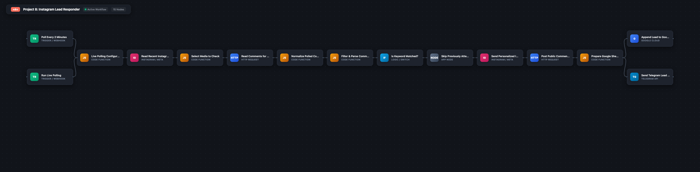

# Project 08: Automated Instagram Comment & DM Lead Responder

Turn Instagram engagement into qualified warm leads automatically. When prospective users comment trigger keywords (such as `INFO`, `PRICE`, `DEMO`, `BİLGİ`, `FİYAT`) on your startup's posts or Reels, the automation instantly:

1. **Afield & Keyword Detection**: Scans comments for trigger keywords (case-insensitive, emoji/punctuation-tolerant).
2. **Instagram Public Reply**: Responds publicly on the post with rotating natural replies (e.g. *"Sent you the link in a DM! 🚀"*).
3. **Instagram Direct Message (DM)**: Dispatches a private reply directly into the user's inbox with your startup's link (`https://codewaft.com/?ref=ig_lead`).
4. **Google Sheets CRM Sync**: Appends lead metadata (`Timestamp`, `Username`, `User ID`, `Keyword`, `Comment`, `Media ID`, `DM Status`, `Lead Status`) into your Google Sheet.
5. **Telegram Founder Alert**: Sends an executive, beautifully formatted HTML briefing directly to the founder's Telegram chat.

---

## 🖼️ Workflow Architecture Canvas



---

## 📂 Two Architectures Available

Depending on your Meta App status, choose the workflow variant that fits your needs:

| Feature | ⚡ [Webhook-Triggered](webhook-triggered/) | ⏱️ [Polling (Every 2 min)](polling/) |
|---|---|---|
| **Folder** | [`webhook-triggered/`](webhook-triggered/) | [`polling/`](polling/) |
| **Trigger Mechanism** | Meta Webhook Push (`POST /webhook/instagram-leads`) | n8n Schedule Trigger (`Every 2 minutes`) |
| **Response Latency** | **Real-time (< 1 second)** | **Up to 2 minutes** |
| **Meta App Mode** | **Live / Published Mode** (requires App Review) | **Development Mode** (No App Review needed ✅) |
| **Best For** | High-volume production scale | Testing, dev accounts, or rapid launch |
| **Deduplication** | Static data memory cache | Database-backed native `Remove Duplicates` node |
| **Setup Complexity** | Requires Webhook verification & Live Mode toggle | Plug & play with standard access token |

---

## 🚀 Quick Start Guide

### Option A: The Polling Responder (Recommended for Development)
If your Meta App is currently in **Development Mode** and not submitted for App Review, use the **Polling** version:
1. Open [`projects/08.instagram-lead-responder/polling/workflow.json`](polling/workflow.json).
2. Import it into your n8n canvas (`https://n8n.codewaft.com`).
3. Set your fresh Meta Access Token in the `Authorization` header of the HTTP Request nodes.
4. Connect Google Sheets and Telegram credentials.
5. Toggle **Active**! The workflow runs every 2 minutes automatically.
6. Read full setup instructions: [`polling/README.md`](polling/README.md).

### Option B: The Webhook Responder (Recommended for Live Scale)
If your Meta App is switched to **Live Mode**:
1. Open [`projects/08.instagram-lead-responder/webhook-triggered/workflow.json`](webhook-triggered/workflow.json).
2. Import it into n8n and activate it.
3. Configure your Webhook URL (`https://n8n.codewaft.com/webhook/instagram-leads`) in Meta Developer Dashboard.
4. Subscribe to the `comments` field in the Meta Dashboard.
5. Read full setup instructions: [`webhook-triggered/README.md`](webhook-triggered/README.md).

---

## 📱 Executive Telegram Alert Preview

Both workflows dispatch the following card to Telegram on every captured lead:

```text
🚀 New Instagram Lead!
━━━━━━━━━━━━━━━━━━━━━━━━

👤 User
   @serhatkumass

💬 Comment
   "INFO please!"

🎯 Triggered by keyword: INFO

━━━━━━━━━━━━━━━━━━━━━━━━

📣 Public Reply
   ✅ Accepted by Meta

📩 Direct Message
   ✅ Accepted by Meta

━━━━━━━━━━━━━━━━━━━━━━━━

🕐 Time: 2026-11-05T13:14:00.000Z
📊 Open Leads Sheet ↗
```

---

## 🎯 Configured Keywords

The keyword detection engine matches with word boundary and case insensitivity:
* **English:** `INFO`, `PRICE`, `LINK`, `START`, `DEMO`, `GUIDE`, `DETAILS`
* **Turkish:** `BİLGİ`, `FİYAT`, `DETAY`

---

## 🧪 Automated Testing

An automated test suite validates both workflow structures, connections, keyword matching regexes, deduplication nodes, and Telegram templates:

```bash
node projects/08.instagram-lead-responder/test.js
```
*Current test status: **73 / 73 checks passing ✅***
