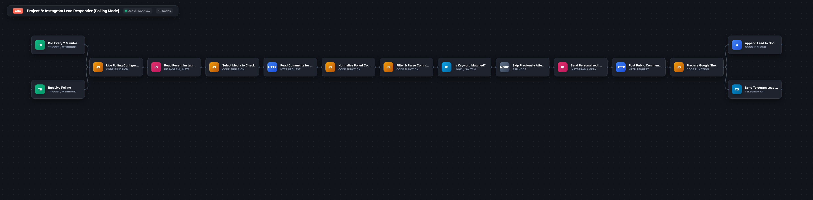
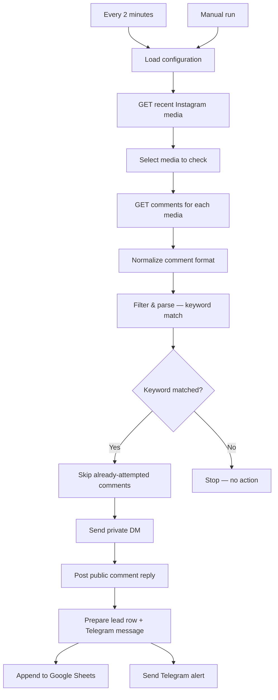

# Instagram Lead Responder — Polling (Every 2 minutes)

Runs on a schedule instead of waiting for Meta webhooks. Every 2 minutes n8n
calls the Instagram Graph API directly to fetch new comments, processes
keyword matches, sends the DM and public reply, and logs the lead.

**Works in Meta Development mode — no app publication or App Review required.**

## 🖼️ Workflow Architecture Canvas



---

## How it works



## Why polling?

Meta's `comments` webhook only fires reliably when the app is in **Live mode**
with **Advanced Access** (requires App Review). Polling sidesteps that by
reading from the Graph API directly — which works with a Development-mode app
and a standard access token. The tradeoff is a maximum ~2-minute delay between
a comment being posted and the bot responding.

## Requirements

| Requirement | Detail |
|---|---|
| Meta App status | Development mode is fine |
| Permissions | `instagram_basic`, `instagram_manage_comments`, `instagram_manage_messages` |
| Access token | Long-lived token or System User token |
| n8n schedule | Built-in Schedule Trigger every 2 minutes |

## Setup

1. **Import** `workflow.json` into your n8n instance (`https://n8n.codewaft.com`).
2. **Credentials** — configure:
   - Google Sheets OAuth2 credential on the **Append Lead to Google Sheet** node.
   - Telegram Bot credential on the **Send Telegram Lead Alert** node.
3. **Access token** — in both **Send Personalized Instagram DM** and **Post Public Comment Reply** nodes, set the `Authorization: Bearer {TOKEN}` header to your fresh Meta access token.
4. **Activate** the workflow (green toggle). It will start polling automatically every 2 minutes.
5. **Manual run** — click **Run Live Polling** node to trigger immediately without waiting for the schedule.

## Configuration (inside the `Live Polling Configuration` node)

```js
const CONFIG = {
  instagramAccountId: '17841480124544403',   // @developmentserhat
  instagramUsername:  'developmentserhat',
  graphBaseUrl:       'https://graph.facebook.com/v26.0',
  spreadsheetId:      '1jF0FozA9pDptoO74bv77uBEJraifoZxerbohMrwEOUA',
  sheetName:          'Leads',
  targetMediaId:      '',                    // Lock to 1 post, or leave empty for all posts
  startupName:        'Codewaft',
  startupLink:        'https://codewaft.com/?ref=ig_lead',
  triggerKeywords:    ['INFO', 'PRICE', 'LINK', 'START', 'DEMO', 'GUIDE', 'DETAILS', 'FİYAT', 'BİLGİ', 'DETAY'],
  telegramChatId:     '1519369571',
  // Polling window
  polling: {
    intervalMinutes:  2,
    lookbackMinutes:  1440,   // 24 hours of comments scanned
    mediaLimit:       5,      // newest 5 posts/reels
    commentsPerMedia: 50,     // up to 50 comments per post
  },
};
```

## Deduplication

This workflow uses n8n's native **Remove Duplicates** node
(`Skip Previously Attempted Comments`) backed by the `processed_data` database
table. Each comment ID is recorded **before** sending to prevent double-firing,
even across separate polling cycles.

## Telegram alert preview

```
🚀 New Instagram Lead!
━━━━━━━━━━━━━━━━━━━━━━━━

👤 User
   @serhatkumass

💬 Comment
   "INFO please!"

🎯 Triggered by keyword: INFO

━━━━━━━━━━━━━━━━━━━━━━━━

📣 Public Reply
   ✅ Accepted by Meta

📩 Direct Message
   ✅ Accepted by Meta

━━━━━━━━━━━━━━━━━━━━━━━━

🕐 Time: 2026-11-05T13:14:00.000Z
📊 Open Leads Sheet ↗
```

## Verified end-to-end

Execution **#354** (5 November 2026, 13:14 Istanbul) processed comment
`18239262013320313` ("INFO please!") posted by `@serhatkumass`:

- ✅ Private DM sent — `recipient_id: 1373664041327603`
- ✅ Public reply posted — reply ID `18098077220134716`
- ✅ Google Sheets row appended
- ✅ Telegram alert message #4 delivered to chat `1519369571`

## When to use this vs. Webhook

| | Polling | Webhook |
|---|---|---|
| Trigger speed | Up to 2 minutes delay | Instant (< 1 second) |
| Meta app requirement | Development mode OK | **Live mode + Advanced Access** |
| Infrastructure | Your server pulls from Meta | Meta pushes to your server |
| Best for | Testing / small volume | Production at scale |

