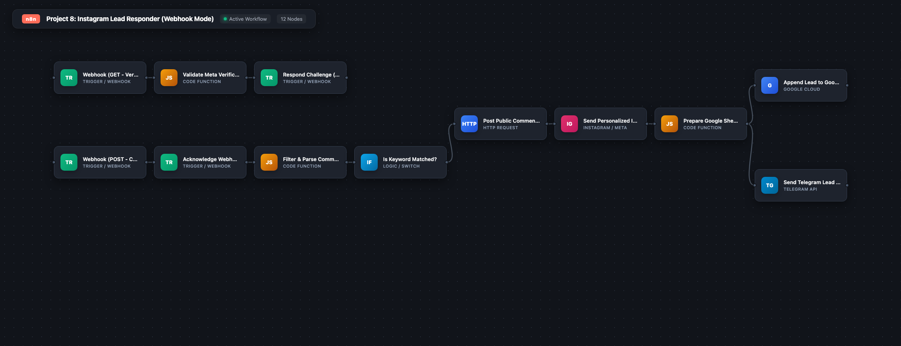
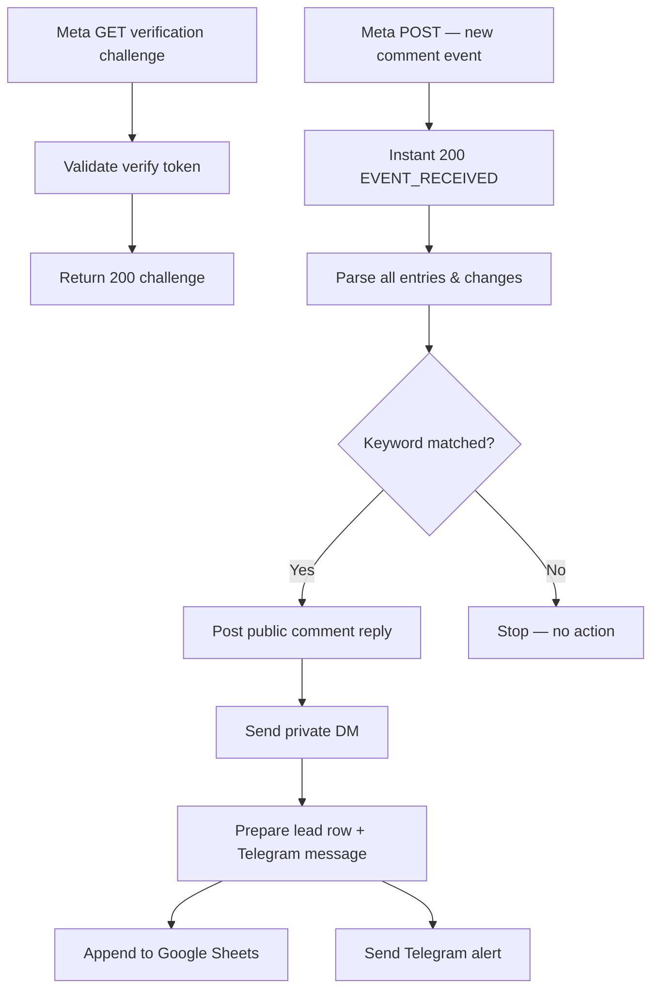

# Instagram Lead Responder — Webhook (Real-time)

Triggered instantly when someone comments a keyword on your Instagram post/Reel.
Meta's webhook dispatcher sends a `POST` to your n8n server within seconds.

## 🖼️ Workflow Architecture Canvas



---

## How it works



## Requirements

| Requirement | Detail |
|---|---|
| Meta App status | **Must be in Live mode** (not Development) |
| Permissions | `instagram_basic`, `instagram_manage_comments`, `instagram_manage_messages`, `pages_manage_metadata`, `pages_read_engagement` |
| Webhook subscription | `comments` field subscribed and Callback URL saved in Meta dashboard |
| Access token | Long-lived or System User token (never-expiring preferred) |

## Setup

1. **Import** `workflow.json` into your n8n instance (`https://n8n.codewaft.com`).
2. **Credentials** — configure:
   - Google Sheets OAuth2 credential on the **Append Lead to Google Sheet** node.
   - Telegram Bot credential on the **Send Telegram Lead Alert** node.
3. **Verify token** — in the **Validate Meta Verification** node, replace `CONFIGURE_META_VERIFY_TOKEN` with a private secret string (e.g. `codewaft_instagram_leads_secret`).
4. **Access token** — in both **Post Public Comment Reply** and **Send Personalized Instagram DM** nodes, set the `Authorization: Bearer {TOKEN}` header to your fresh Meta access token.
5. **Activate** the workflow (green toggle). The webhook URL is:
   ```
   https://n8n.codewaft.com/webhook/instagram-leads
   ```
6. In Meta App Dashboard → Instagram → Configure webhooks:
   - Callback URL: `https://n8n.codewaft.com/webhook/instagram-leads`
   - Verify Token: your secret from step 3
   - Click **Verify and Save**, then **Subscribe** `comments`.
7. **Switch app to Live mode** in the Meta dashboard top bar.

## Configuration (inside the `Filter & Parse Comment Event` node)

```js
const CONFIG = {
  instagramAccountId: '17841480124544403',   // @developmentserhat
  instagramUsername:  'developmentserhat',
  graphBaseUrl:       'https://graph.facebook.com/v21.0',
  spreadsheetId:      '1jF0FozA9pDptoO74bv77uBEJraifoZxerbohMrwEOUA',
  sheetName:          'Leads',
  targetMediaId:      '',                    // Lock to 1 post, or leave empty for all posts
  startupName:        'Codewaft',
  startupLink:        'https://codewaft.com/?ref=ig_lead',
  triggerKeywords:    ['INFO', 'PRICE', 'LINK', 'START', 'DEMO', 'GUIDE', 'DETAILS', 'FİYAT', 'BİLGİ', 'DETAY'],
  telegramChatId:     '1519369571',
};
```

## Telegram alert preview

```
🚀 New Instagram Lead!
━━━━━━━━━━━━━━━━━━━━━━━━

👤 User
   @serhatkumass

💬 Comment
   "INFO please!"

🎯 Triggered by keyword: INFO

━━━━━━━━━━━━━━━━━━━━━━━━

📣 Public Reply
   ✅ Accepted by Meta

📩 Direct Message
   ✅ Accepted by Meta

━━━━━━━━━━━━━━━━━━━━━━━━

🕐 Time: 2026-11-05T13:14:00.000Z
📊 Open Leads Sheet ↗
```

## Test the endpoint (safe — no real actions)

```bash
# Verify the GET handshake (replace YOUR_VERIFY_TOKEN)
curl -i "https://n8n.codewaft.com/webhook/instagram-leads?hub.mode=subscribe&hub.verify_token=YOUR_VERIFY_TOKEN&hub.challenge=123456"

# Test POST ingestion with an empty entry (returns EVENT_RECEIVED, no writes)
curl -i -X POST "https://n8n.codewaft.com/webhook/instagram-leads" \
  -H "Content-Type: application/json" \
  -d '{"object":"instagram","entry":[]}'
```

## When to use this vs. Polling

| | Webhook | Polling |
|---|---|---|
| Trigger speed | Instant (< 1 second) | Up to 2 minutes delay |
| Meta app requirement | **Live mode + Advanced Access** | Development mode OK |
| Infrastructure | Meta pushes to your server | Your server pulls from Meta |
| Best for | Production at scale | Testing / small volume |

