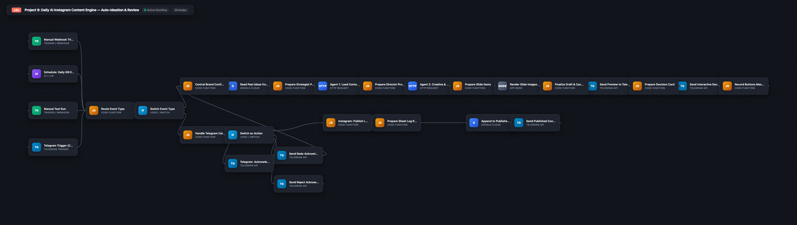
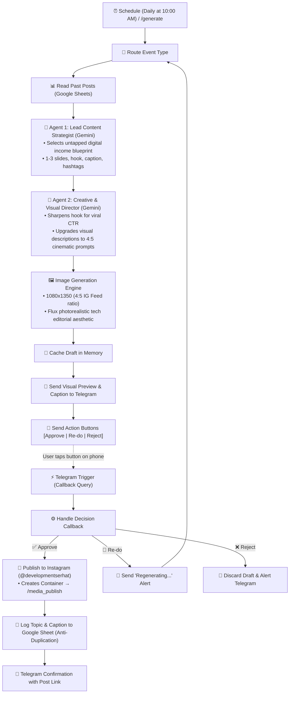

# 🚀 Project 09: Daily AI Instagram Content Engine (Auto-Ideation, Dual-Agent Review & 1-Tap Publish)

An autonomous daily content production and publishing studio built with **n8n**, **Google Gemini 3.5 Flash**, **Telegram**, and the **Meta Instagram Graph API**.

Every morning at **10:00 AM**, the engine checks your past published content history in **Google Sheets**, activates a **Dual-Agent AI Pipeline** to ideate an untapped digital income blueprint, renders high-converting 4:5 visual slides, and delivers an interactive preview with **`[Approve]`**, **`[Re-do]`**, and **`[Reject]`** buttons to your Telegram. 

**Zero content is published without your explicit confirmation.** Tapping `[Approve]` instantly publishes the post to `@developmentserhat` and logs the topic and caption to Google Sheets to guarantee the agent never repeats itself.

---

## 🖼️ Workflow Architecture Canvas

---

## 🏗️ Architecture & Dataflow

---

## 🎯 Brand Identity & Content Pillars (`@developmentserhat`)

The engine is engineered specifically for beginner-to-intermediate creators, freelancers, and solopreneurs looking to build real digital income streams:

1. **AI Agents for Monetization**: Automated lead finders, customer support agents, cold outreach bots, and n8n workflows.
2. **Etsy & Digital Product Blueprints**: Printable planners, Notion templates, Canva bundles, and digital asset arbitrage.
3. **Faceless YouTube & Video AI**: Script-to-video automation, AI voiceovers, and vertical short-form workflows.
4. **Instagram Growth Systems**: High-retention hooks, algorithmic engagement loops, and DM lead responders.
5. **Freelance & Digital High-Income Skills**: Selling automation consulting, client acquisition frameworks, and modern tech tools.

---

## 📊 Google Sheets Setup (Anti-Duplication Memory)

To ensure the AI never repeats ideas you have already posted, create a spreadsheet in Google Drive with the following settings:

* **Spreadsheet Name**: `Daily Instagram AI Content Engine`
* **Tab Name**: `Published Content`

### Column Headers (Row 1, A1:I1)
| Column | Name | Purpose |
|---|---|---|
| **A** | `Date` | Date of publication (`YYYY-MM-DD`) |
| **B** | `Hook / Title` | Primary scroll-stopping title |
| **C** | `Niche Pillar` | Topic category (e.g. `Etsy & Digital Products`) |
| **D** | `Format` | `Single Post`, `Carousel (2 slides)`, or `Carousel (3 slides)` |
| **E** | `Caption` | Full Instagram post caption |
| **F** | `Hashtags` | 5–8 high-reach targeted hashtags |
| **G** | `Visual Prompt` | Slide visual generation prompts |
| **H** | `Instagram Media ID` | Meta Graph API published container ID |
| **I** | `Status` | `Published` |

> [!TIP]
> Once you create this sheet in your Google Drive, copy its **Spreadsheet ID** from the URL (`https://docs.google.com/spreadsheets/d/<SPREADSHEET_ID>/edit`) and paste it into the `Central Brand Configuration` node in n8n.

---

## 📱 Telegram Interactive Review Controls

When the 10:00 AM trigger fires (or when you type `/generate` in your Telegram chat), you receive:
1. **Multi-Slide Visual Preview**: Every slide of the post (1, 2, or 3 images) is rendered via Cloudflare AI (Flux Schnell) and sent sequentially to your Telegram with slide badges (`📖 Slide 1 / 3`, etc.).
2. **Post Breakdown & Caption**: Full caption, hashtags, and strategic value hook.
3. **Interactive Decision Keyboard**:
   * **`[✅ Approve & Publish to Instagram]`**: Executes live Meta Graph API publishing (handles both single posts and multi-slide carousels with status polling), updates Google Sheets, and confirms in chat with your live post link.
   * **`[🔄 Re-do (Different Idea)]`**: Re-invokes Agent 1 and Agent 2 with an instruction to take a completely different angle.
   * **`[❌ Reject]`**: Immediately discards the draft without publishing.

---

## 🔑 Required Credentials in n8n

All credentials are automatically pre-wired on your n8n instance:
* **Google Gemini API**: `Google Gemini(PaLM) Api account` (`zvLpU1ScjMCeOYQq`)
* **Google Sheets OAuth**: `Google Sheets account` (`uIhLunuZ3AaxqaDA`)
* **Telegram Bot API**: `Instagram Auto Post Creation Bot` (`pA8rVUtxHz4zDUHP`)
* **Instagram Graph API**: System User Token with `instagram_content_publish`, `instagram_basic`, and `pages_read_engagement`.

