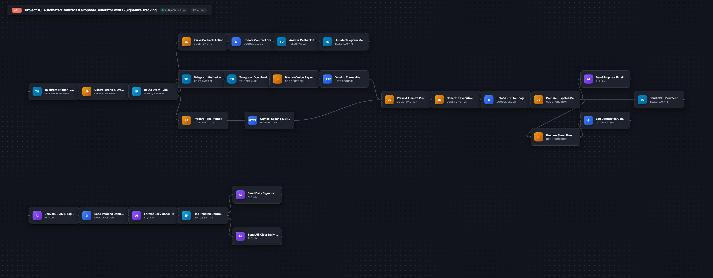
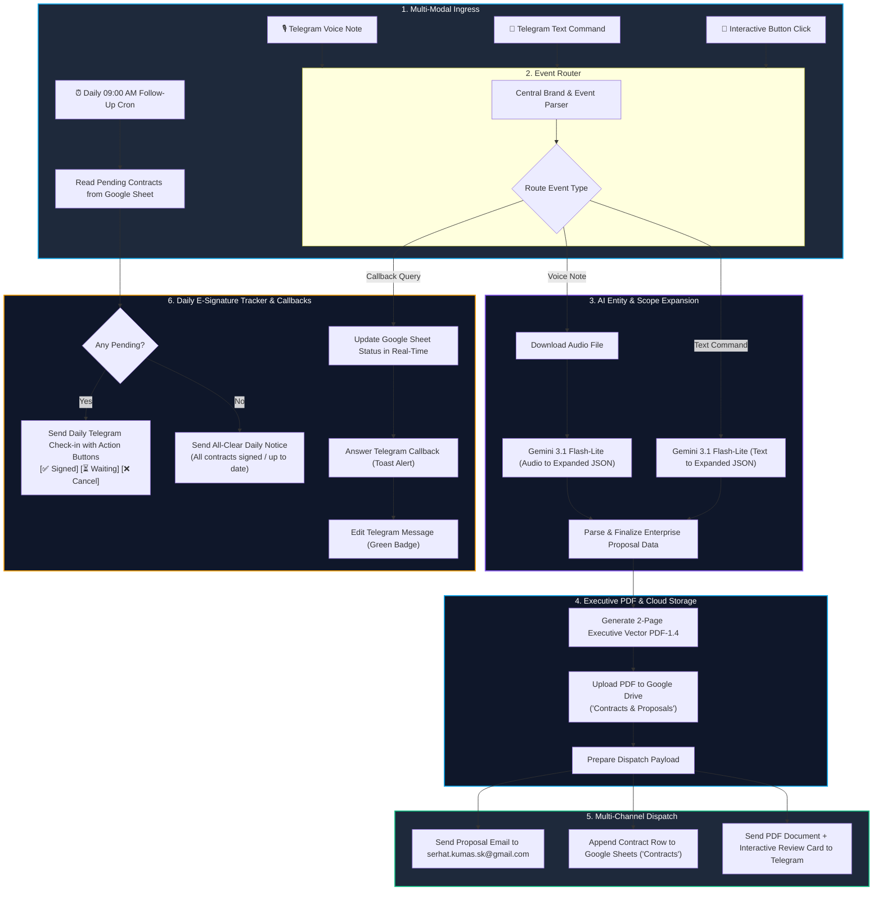

# Project 10: Automated Contract & Proposal Generator with E-Signature Tracking

> **Enterprise AI Contract Suite**: Ingest voice notes or text prompts via Telegram, expand and beautify technical scope with Google Gemini, generate an executive 2-page vector PDF Service Agreement, archive to Google Drive, email to your inbox, track signatures in Google Sheets, and automate daily follow-up check-ins with 1-tap Telegram action buttons.

---

## 🖼️ Workflow Architecture Canvas



---

## 🏗️ Architecture & Workflow Pipeline



---

## ⚙️ Configuration & Credentials

| Service | Credential Name / ID | Purpose |
| :--- | :--- | :--- |
| **Telegram Bot** | `Proposal & Contracts Bot` (`proposalContractsBot`) | Ingestion of voice/text commands, interactive follow-ups, and delivering the PDF document. Bot: `@contract_proposal_sk_bot` (Token: `9134237127:...`). |
| **Google Gemini** | `Google Gemini(PaLM) Api account` (`zvLpU1ScjMCeOYQq`) | AI entity extraction and massive scope beautification into 4 structured enterprise modules (`gemini-3.1-flash-lite`). |
| **Google Drive** | `Google Drive account` (`tvM7ZEvk4taPIOoN`) | Storing contract PDFs directly into folder `Contracts & Proposals` (ID: `1H8Ais1pEsNFImDsnEa0Mj_FfYuRkZTAk`) and obtaining direct `webViewLink`. |
| **Gmail** | `Gmail account` (`GdaQB71L3KFdksjY`) | Dispatching executive proposal summary and attached PDF to `serhat.kumas.sk@gmail.com`. |
| **Google Sheets** | `Google Sheets account` (`uIhLunuZ3AaxqaDA`) | Central contract registry (`1tNOoNdpSQD5yjobV1UfYl73M9bjnHwEDVDjWOYPkoks`, tab: `Contracts`), status tracking, and e-signature follow-up sync. |

---

## 📊 Google Sheets Setup Instructions

Your master contract tracking spreadsheet is linked directly:
👉 **[Open Connected Google Spreadsheet](https://docs.google.com/spreadsheets/d/1tNOoNdpSQD5yjobV1UfYl73M9bjnHwEDVDjWOYPkoks/edit?gid=0#gid=0)**

### 1. Tab Name
```text
Contracts
```

### 2. Exact Column Headers (Row 1)
Your sheet already has these active in Row 1:

| Col | Header Name | Description |
| :---: | :--- | :--- |
| **A** | `Contract ID` | Unique contract reference (e.g. `AGR-202611-4821`) |
| **B** | `Date Created` | Date of contract generation (`YYYY-MM-DD`) |
| **C** | `Client Name` | Client corporate entity (e.g. `Acme GmbH`) |
| **D** | `Scope of Work` | Itemized module names generated by AI |
| **E** | `Pricing / Monthly Retainer` | Retainer or project fee (e.g. `EUR 2,500 / month`) |
| **F** | `Effective Date` | Start date (e.g. `November 1, 2026`) |
| **G** | `Status` | `Pending Signature`, `Signed & Active`, or `Cancelled / Void` |
| **H** | `Google Drive PDF Link` | Direct link to view the PDF in Google Drive |
| **I** | `Client Contact` | Client department or contact person |
| **J** | `Last Follow-Up Date` | Date when client was pinged or status was updated |
| **K** | `Notes / AI Summary` | AI-generated executive summary and strategic objectives |

---

## 📁 Google Drive Setup Instructions

All generated PDFs are automatically routed and saved into your dedicated Google Drive folder:
- **Folder Name**: `Contracts & Proposals`
- **Folder ID**: `1H8Ais1pEsNFImDsnEa0Mj_FfYuRkZTAk`
- **File Name Pattern**: `Service_Agreement_<ClientName>_<ContractID>.pdf`

---

## 📄 Executive 2-Page Vector PDF Specifications

The PDF is generated using a **pure vector PDF-1.4 JavaScript engine** (zero headless browser latency, renders in under 50ms):

- **Header Banner**: Executive Deep Navy (`#0F172A`) with Electric Cyan accent bar (`#0EA5E9`).
- **Provider Details**:
  - **Name**: Serhat Kumas
  - **Title**: AI & Automation Solutions
  - **Location**: Munich, Germany
  - **Email**: `serhat.kumas.sk@gmail.com`
- **Two-Column Parties Box**: Provider credentials vs Client entity details.
- **Section 1: Executive Summary & Objectives**: Strategic business rationale, automation ROI, and architectural objectives.
- **Section 2: Statement of Work (4 Modules across 2 Pages)**:
  - *Module 1*: Conversational AI & Omnichannel Agent Infrastructure
  - *Module 2*: Enterprise CRM & Real-Time Data Pipeline Synchronization
  - *Module 3*: Real-Time Telemetry & Fail-Safe Observability Engine
  - *Module 4*: System Handover, Production Hardening & Staff Enablement
- **Section 3: Service Level Agreement (SLA)**: 99.9% uptime, <4h critical incident response, bi-weekly architecture reviews.
- **Section 4: Commercial Framework**: Retainer/Fee, Net-14 payment window, SEPA wire terms.
- **Section 5: Legal Governance**: 100% IP assignment upon full payment, mutual NDA, Federal Republic of Germany law (Munich jurisdiction).
- **Section 6: Dual Execution & Acceptance**:
  - Provider Certified Digital Signature block (Serhat Kumas).
  - Client Signature & Stamp block with date line.

---

## 🤖 How to Test & Use

### Option A: Send a Voice Note
1. Open Telegram and search for `@contract_proposal_sk_bot`.
2. Tap the microphone and record a voice message:
   > *"Generate a service agreement for Acme GmbH, €2,500 monthly retainer, starting November 1st, scope includes WhatsApp automation and CRM setup."*
3. The bot will download the audio, transcribe and massively expand the scope using Gemini 2.5 Flash, generate the 2-page PDF, email your Gmail, log the row in Google Sheets, and send you the PDF document with interactive buttons!

### Option B: Send a Text Command
1. In the same bot, type:
   ```text
   Generate a service agreement for Acme GmbH, €2,500 monthly retainer, starting November 1st, scope includes WhatsApp automation and CRM setup.
   ```
2. The bot will generate the contract and respond within seconds!

### Option C: Daily Follow-up Check-in (09:00 AM Cron)
- Every morning at 09:00 AM, the bot checks your Google Sheet for rows marked `Pending Signature`.
- **If there are pending contracts**: It sends you an interactive Telegram card for each one:
  > **Has the client replied with the signed copy?**
  > `[✅ Signed & Received]` `[⏳ Still Waiting]` `[❌ Cancelled]`
  > Tapping any button immediately updates Google Sheets, shows a toast notification, and edits the message with a verified status badge!
- **If all contracts are signed or none are pending**: It sends you an all-clear status report:
  > ☀️ **Daily E-Signature Status Report**
  > ✅ **All caught up!** There are currently no contracts pending signature or client approval. All proposals are up to date in your tracking sheet. Have a productive day! 🚀

