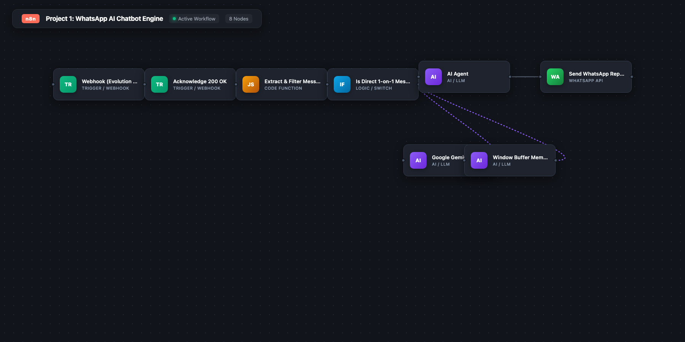
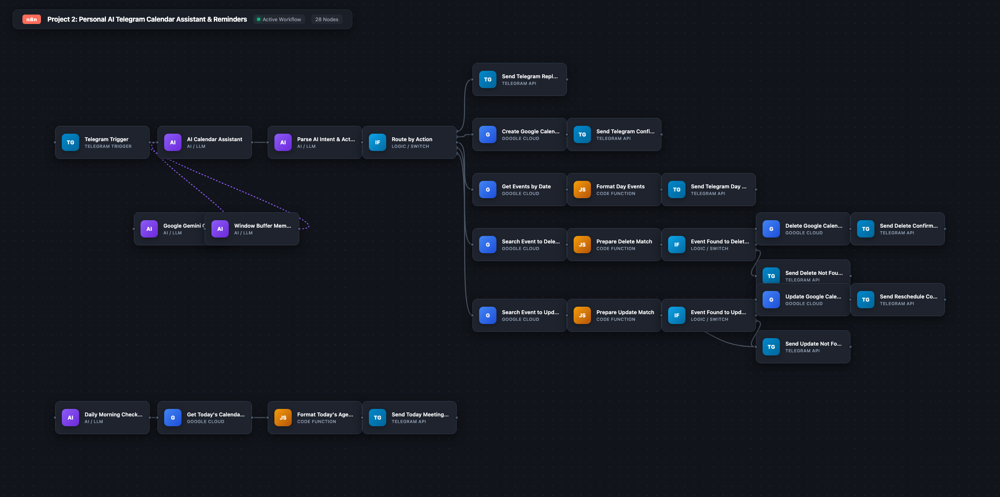
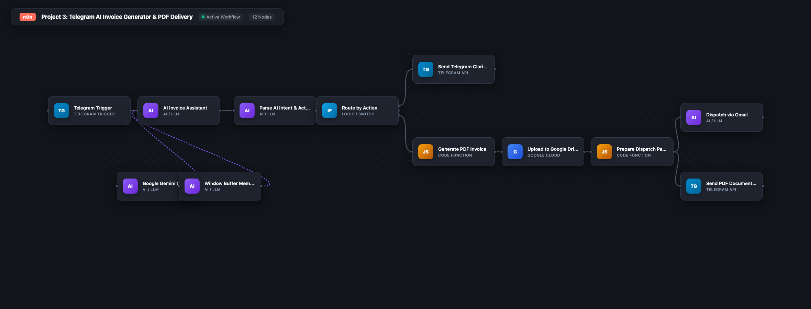
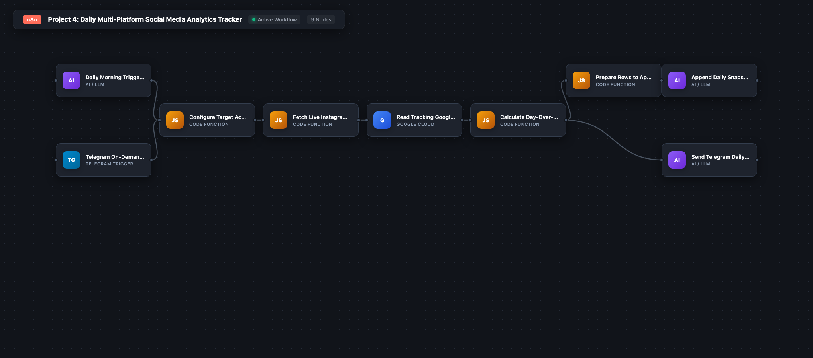
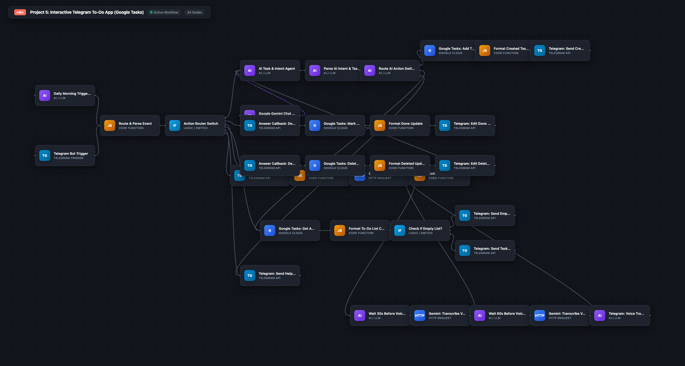
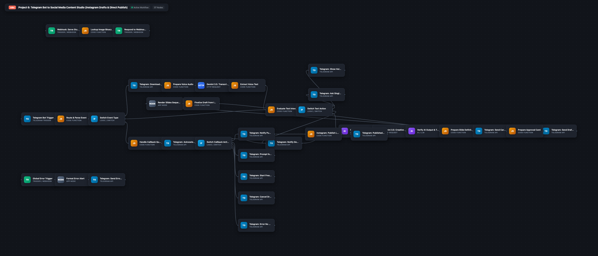
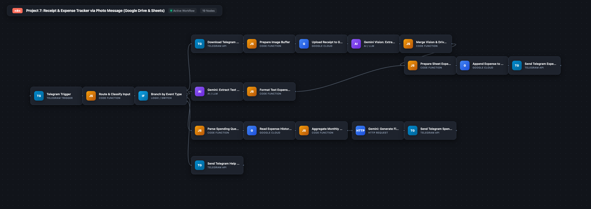
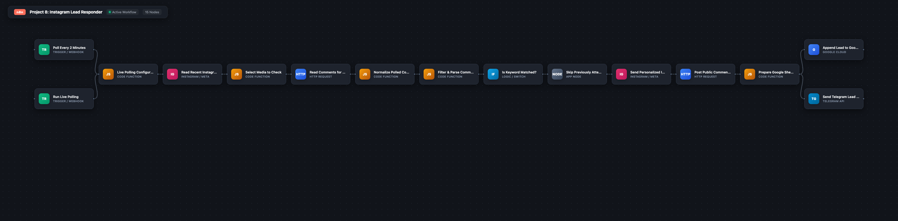
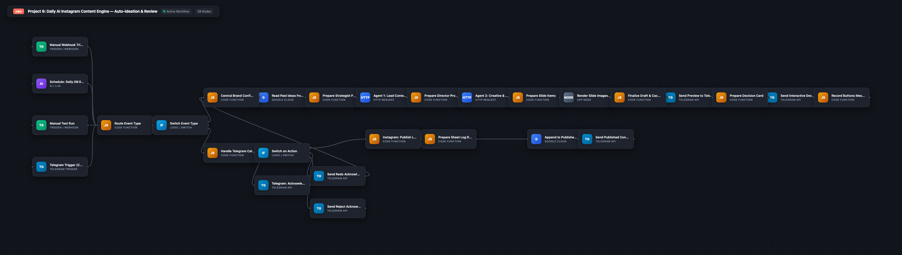
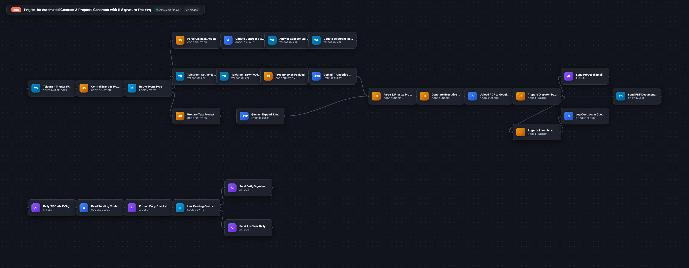

# 📂 Beginner n8n Automation Projects

This directory contains our beginner to early-intermediate production n8n workflows, covering essential messaging bots, PDF generators, social media trackers, expense loggers, and automated contract workflows.

---

## 🏗️ Project Folder Structure

```text
1. Beginner Projects/
├── 01.whatsapp-ai-chatbot-projects/           # WhatsApp AI Auto-Responder (Evolution API & Meta)
│   ├── workflow_screenshot.png               # High-resolution workflow canvas diagram
│   ├── whatsapp-ai-bot-evolution-api/        # QR-code based (Zero Meta verification required)
│   └── whatsapp-ai-bot-meta/                 # Official Meta Cloud API (For verified businesses)
├── 02.telegram-ai-calendar-assistant/         # Telegram AI Executive Secretary & Auto-Reminder
│   ├── workflow_screenshot.png               # High-resolution workflow canvas diagram
│   └── workflow.json                         # Complete n8n workflow export
├── 03.telegram-invoice-generator/             # Automated PDF Invoice Generator & Cloud Dispatcher
│   ├── workflow_screenshot.png               # High-resolution workflow canvas diagram
│   └── workflow.json                         # Complete n8n workflow export
├── 04.daily-social-media-tracker/             # Daily Social Media Follower & Growth Tracker
│   ├── workflow_screenshot.png               # High-resolution workflow canvas diagram
│   └── workflow.json                         # Complete n8n workflow export
├── 05.interactive-telegram-todo-app/          # Interactive Telegram To-Do App (Google Tasks Sync)
│   ├── workflow_screenshot.png               # High-resolution workflow canvas diagram
│   └── workflow.json                         # Complete n8n workflow export
├── 06.telegram-social-content-studio/         # Telegram Content Studio (Instagram Drafts & Publish)
│   ├── workflow_screenshot.png               # High-resolution workflow canvas diagram
│   └── workflow.json                         # Complete n8n workflow export
├── 07.receipt-expense-tracker/                # Telegram AI Receipt & Expense Tracker
│   ├── workflow_screenshot.png               # High-resolution workflow canvas diagram
│   └── workflow.json                         # Complete n8n workflow export
├── 08.instagram-lead-responder/               # Automated Instagram Comment & DM Lead Responder
│   ├── workflow_screenshot.png               # High-resolution workflow canvas diagram
│   ├── polling/                              # Polling variant (Every 2 min, Dev Mode friendly)
│   └── webhook-triggered/                    # Webhook push variant (Real-time, Live Mode)
├── 09.daily-ai-instagram-content-engine/      # Daily AI Instagram Content Engine
│   ├── workflow_screenshot.png               # High-resolution workflow canvas diagram
│   └── workflow.json                         # Complete n8n workflow export
└── 10.automated-contract-proposal-generator/  # Contract & Proposal Generator with E-Signature Tracking
    ├── workflow_screenshot.png               # High-resolution workflow canvas diagram
    └── workflow.json                         # Complete n8n workflow export
```

---

## 🚀 Projects Overview

### [01. WhatsApp AI Chatbot Solutions](01.whatsapp-ai-chatbot-projects/README.md)

- Two production-ready WhatsApp AI solutions powered by **Google Gemini 2.5 Flash** and LangChain Window Buffer Memory.
- **Evolution API (QR Code)**: Connects personal or business WhatsApp via QR code scan without Meta verification.
- **Meta Cloud API**: Enterprise integration with official Meta Business Cloud API.

### [02. Telegram AI Calendar Assistant & Auto-Reminder](02.telegram-ai-calendar-assistant/README.md)

- Personal AI executive secretary on Telegram with natural language slot-filling.
- Automatically creates Google Calendar events with Google Meet links, checks daily agendas, reschedules meetings, and sends an automated morning briefing at 07:00 AM.

### [03. Automated PDF Invoice Generator & Cloud Dispatcher](03.telegram-invoice-generator/README.md)

- Conversational financial assistant on Telegram that creates professional vector PDF invoices with custom bank details.
- Archives to Google Drive, emails via Gmail, and returns the PDF in chat for 1-tap forwarding.

### [04. Daily Social Media Follower & Growth Tracker](04.daily-social-media-tracker/README.md)

- Automated daily tracker monitoring metrics for `@serhatkumass`, `@ssgvrl`, and `@code.waft`.
- Records historical data into Google Sheets and delivers an executive 07:00 AM growth report to Telegram.

### [05. Interactive Telegram To-Do App (Google Tasks 2-Way Sync)](05.interactive-telegram-todo-app/README.md)

- Personal task manager with 2-way Google Tasks synchronization.
- Supports `/add <task>`, automated morning briefings, and interactive inline buttons (`[✅ Done]`, `[🗑️ Delete]`) for real-time task management.

### [06. Telegram Social Media Content Studio (Instagram Direct Publish)](06.telegram-social-content-studio/README.md)

- Multimodal content creation studio. Send voice memos or text notes; Gemini 3.5 Flash Lite writes copy and design themes, Google Imagen 3 renders high-res visuals, and n8n enables interactive revision loops before 1-tap direct publishing to Instagram.

### [07. Receipt & Expense Tracker via Photo Message](07.receipt-expense-tracker/README.md)

- Snap receipt photos on Telegram; n8n backs them up to Google Drive, extracts Merchant, Date, Amount, and Category via Gemini Vision, and appends to Google Sheets. Supports natural language spending analytics (`"Mart ayında ne kadar harcadım?"`).

### [08. Automated Instagram Comment & DM Lead Responder](08.instagram-lead-responder/README.md)

- Real-time lead generation engine available in two distinct architectures:
  - **Webhook-Triggered**: Sub-second push response via Meta Webhooks.
  - **Polling**: Pull execution every 2 minutes for Dev Mode without Meta App Review.
- Posts public replies, sends private DMs with tracked links, logs warm leads to Google Sheets, and alerts Telegram.

### [09. Daily AI Instagram Content Engine](09.daily-ai-instagram-content-engine/README.md)

- Daily content production studio running at 10:00 AM.
- Dual-Agent AI Pipeline (Lead Strategist + Creative Director on Gemini 3.5 Flash) creates digital income blueprints, renders 4:5 vertical visuals, and presents an interactive Telegram card with `[Approve]`, `[Re-do]`, and `[Reject]` buttons before publishing to `@developmentserhat`.

### [10. Automated Contract & Proposal Generator with E-Signature Tracking](10.automated-contract-proposal-generator/README.md)

- Voice- and text-triggered legal suite. Converts Telegram voice notes into an executive 4-module technical architecture with SLA and legal terms, renders a 2-page vector PDF Service Agreement, uploads to Drive, emails the client, logs to Sheets, and runs daily 09:00 AM e-signature follow-up check-ins.

---

## 📥 How to Import a Beginner Workflow

1. Open your n8n dashboard: [https://n8n.codewaft.com](https://n8n.codewaft.com)
2. Click **Add workflow** > **Import from File...**
3. Select `workflow.json` from the project directory.
4. Set up credentials (OAuth, API keys) as detailed in the project's documentation.
5. Toggle **Active** to activate the workflow!
