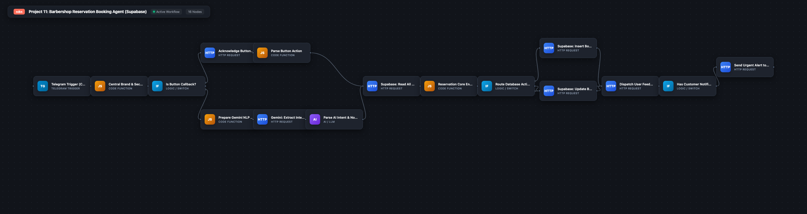
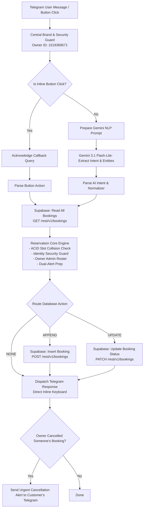

# 💈 Project 11: Barbershop Reservation Booking Agent (Supabase PostgreSQL + Gemini 3.1 Flash-Lite + Telegram)

An enterprise-grade, conversational **Telegram Booking & Cancellation Agent** for a premium barbershop backed by **Supabase PostgreSQL**. It features **ACID-safe slot collision detection**, **strict client identity isolation** (customers can only access and cancel their own bookings), and a **barbershop owner administration portal** with **instant customer cancellation dispatch alerts**.

---

## 🖼️ Workflow Architecture Canvas



---

## 🌟 Key Architecture & Capabilities



### 1. 🛡️ Client Identity Protection
- Every reservation records the customer's Telegram `User ID` (`from.id`).
- When a customer says *"Cancel my reservation"*, the system looks up active reservations matching **only their specific Telegram ID**.
- A customer cannot view, modify, or cancel any other customer's appointment.

### 2. ⚡ ACID Slot Collision Detection & Smart Recommendation
- Operating hours: **Monday – Saturday, 09:00 – 19:00 (1-hour slots)**.
- Supabase enforces a PostgreSQL partial unique index:
  ```sql
  CREATE UNIQUE INDEX idx_unique_confirmed_slot 
  ON public.bookings (booking_date, time_slot) 
  WHERE status = 'Confirmed';
  ```
- If a client requests a slot that is already confirmed $\rightarrow$ the bot explains the spot is taken and dynamically lists **all remaining available slots for that day** with one-tap booking buttons.
- Once cancelled, the slot is instantly freed up for other clients.

### 3. 👑 Barbershop Owner / Admin Suite
- The owner is recognized automatically by their Telegram User ID (`1519369571` — Serhat Kumas).
- **Owner commands**:
  - *"Show all reservations for today / tomorrow"* $\rightarrow$ outputs the full client roster with times, names, services, and booking IDs.
  - *"Cancel John's 3pm appointment"* $\rightarrow$ marks the booking cancelled in Supabase, notifies the owner, and **automatically dispatches a polite Telegram notification to the customer**:
    > *"⚠️ Dear [Customer], your appointment on [Date] at [Time] was cancelled by shop management. Please message us to reschedule at your convenience."*

---

## 🗄️ Supabase PostgreSQL Setup (2 Minutes)

1. Open your Supabase project dashboard at [supabase.com](https://supabase.com).
2. Go to the **SQL Editor** tab (left sidebar).
3. If creating the table for the first time, paste the contents of [`schema.sql`](schema.sql) and click **Run**.
4. If you already created the table, run this quick migration query to add the phone number column:
   ```sql
   ALTER TABLE public.bookings ADD COLUMN IF NOT EXISTS customer_phone VARCHAR(64);
   ```
5. Retrieve your **Project URL** and **Secret Key**:
   - Go to **Project Settings** $\rightarrow$ **API Keys**.
   - Copy **Project URL** (e.g. `https://ngpujpgcwcxvrqoemcio.supabase.co`).
   - Copy **Secret key** (e.g. `sb_secret_...`).

---

## 🚀 n8n Configuration & Deployment

1. **Import Workflow**:
   - Open your n8n workspace $\rightarrow$ **Workflows** $\rightarrow$ **Import from File**.
   - Select [`workflow.json`](workflow.json).
2. The workflow is already **pre-configured** with:
   - `SUPABASE_URL`: `https://ngpujpgcwcxvrqoemcio.supabase.co`
   - `SUPABASE_KEY`: Configured
   - `BOT_TOKEN`: `YOUR_TELEGRAM_BOT_TOKEN`
   - `OWNER_USER_ID`: `1519369571` (Serhat Kumas)
   - `AI MODEL`: `gemini-3.1-flash-lite`
3. **Save and toggle Active** on the workflow.

---

## 🧪 Testing Scenarios

| Test Case | Actor | Command / Action | Expected Result |
| :--- | :--- | :--- | :--- |
| **New Booking (Missing Info)** | Customer | *"Yarın saat 12.00 için randevu almak istiyorum"* | Checks if 12:00 is free; creates pending Draft in Supabase and asks: *"Harika! 12:00 müsait. Kaydınızı tamamlamak için Ad-Soyad ve Telefon Numaranızı yazabilir misiniz?"* |
| **Provide Contact Details** | Customer | *"Ahmet Yılmaz, 0532 123 45 67"* | Promotes Draft to Confirmed, saves Name & Phone in Supabase, and dispatches confirmation card with Booking ID. |
| **Complete 1-Step Booking** | Customer | *"Book tomorrow at 2 PM for Marcus Weber, tel +49 170 1234567"* | Extracts all parameters immediately and confirms reservation with phone on file in 1 step! |
| **Slot Conflict** | Customer | *"Book tomorrow at 12:00"* | Rejects collision; presents interactive inline buttons with available open slots. |
| **Customer Cancellation** | Customer | *"Cancel my appointment tomorrow"* | Cancels their booking, frees the slot in Supabase, sends confirmation. |
| **Owner Daily Roster** | Owner (`1519369571`) | *"Show all bookings for tomorrow"* | Returns structured schedule with customer names, **phone numbers**, times, and services. |
| **Owner Cancellation with Alert** | Owner (`1519369571`) | *"Cancel John Miller's appointment tomorrow at 10:00"* | Cancels booking in Supabase, confirms to owner, and **sends proactive cancellation alert to John's Telegram chat**. |
