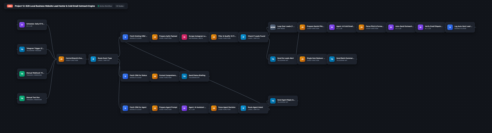
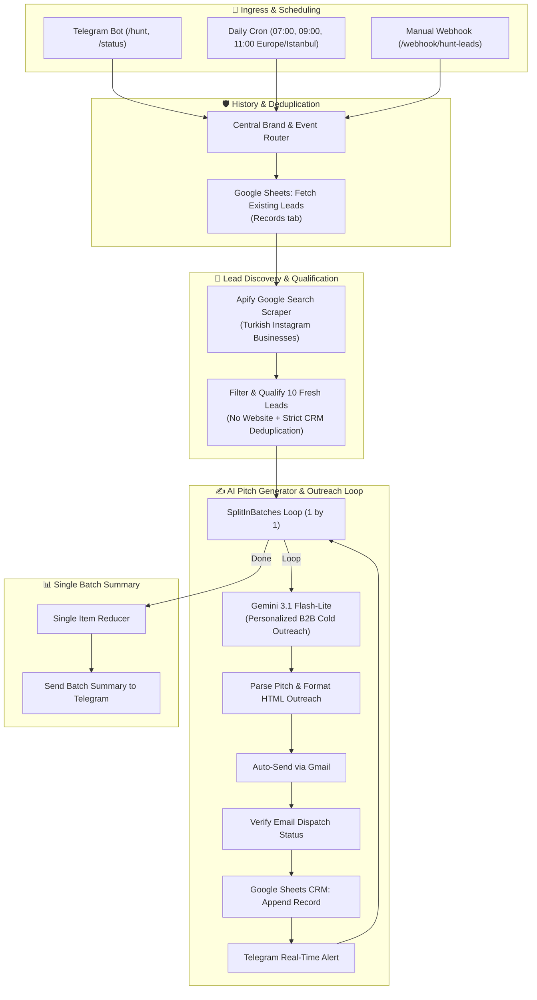

# Project 12: B2B Local Business Website Lead Hunter & Cold Email Outreach Engine

> **Autonomous Local Business Prospector, AI Cold Pitch Specialist & Autonomous Gmail Outreach Engine**

---

## 🖼️ Workflow Architecture Canvas

---

## 🎯 Executive Overview

In Turkey, thousands of high-potential local businesses (boutique hotels, dental clinics, specialty auto shops, law firms, architectural studios, aesthetic salons) thrive on Instagram and Google Maps with outstanding customer reviews, but **have no standalone website**—relying entirely on basic social profiles. 

Every day, prospective clients searching Google for local services bounce to competitors who own dedicated, credible websites with online booking.

**Project 12** turns this exact market gap into an automated client acquisition engine:
1. **Scrapes Turkish Local Businesses** across diverse high-margin industries using Apify Google Search Scraper.
2. **Filters & Qualifies** exactly 10 businesses per run that have **no website** (only Instagram) and have a **direct email address**.
3. **Strict Deduplication**:
   - Queries historical CRM rows from Google Sheet (`Website Lead Records` -> tab `Records`).
   - Checks workflow persistent static data (`seenLeads`).
   - Ensures no previously contacted email or business is ever contacted twice.
4. **Drafts Tailored B2B Pitches with Gemini AI**: Crafts a respectful, high-converting cold email tailored to their specific niche, city, and business profile.
5. **Autonomously Sends via Gmail**: Automatically dispatches the personalized cold email via Gmail.
6. **Logs to Google Sheet CRM**: Automatically records every prospect in Google Sheets (`Records` tab).
7. **Telegram Real-Time Alerts & Single Summary**: Alerts via Telegram for each processed business and sends a clean final summary once all 10 leads are completed.
8. **Automated 3x Daily Cadence**: Runs automatically at **07:00, 09:00, and 11:00** (Europe/Istanbul timezone), plus manual on-demand execution via `/hunt`.

---

## 🏗 System Architecture

---

## 🛠 Credentials & Integrations

| Provider | Credential Name | ID | Purpose |
| :--- | :--- | :--- | :--- |
| **Apify API** | Active Token | `apify_api_dRUzVM...` | Instagram local business search scraping |
| **Google Gemini** | Google Gemini(PaLM) Api account | `zvLpU1ScjMCeOYQq` | Gemini Flash high-converting sales copywriting |
| **Gmail** | Gmail account | `GdaQB71L3KFdksjY` | Dispatches cold emails via Gmail OAuth2 / SMTP |
| **Google Sheets** | Google Sheets account | `uIhLunuZ3AaxqaDA` | CRM tracking (`Website Lead Records`, tab `Records`) |
| **Telegram** | Website Client Lead Bot (`@website_client_lead_sk_bot`) | `websiteClientLeadBot` | Real-time notifications & bot commands |

---

## 📱 Telegram Commands & Usage

| Command | Action | Example |
| :--- | :--- | :--- |
| `/hunt [sektör]` | Scrapes for that exact niche in Turkey, finds 10 uncontacted businesses without websites, and sends pitches. | `/hunt butik otel` `/hunt diş hekimi` `/hunt oto servis` |
| `/hunt` | Scrapes 20 rotating high-margin Turkish industries and targets 10 fresh businesses. | `/hunt` |
| `/status` | Displays system status, daily schedule (07:00, 09:00, 11:00), and link to Google Sheets CRM. | `/status` |

---

## 📂 Google Sheet CRM Schema (`Records`)

Spreadsheet: [Website Lead Records](https://docs.google.com/spreadsheets/d/15kSudUz9LdFcWBgOngH5MrizGJ8njnXQZniFYn7oEG4/edit#gid=0)
Tab: `Records`

| Column | Description |
| :--- | :--- |
| **Date** | Date contacted (`YYYY-MM-DD`) |
| **Business Name** | Name of the local Turkish business |
| **Category** | Inferred industry (e.g. Butik Otel, Diş Kliniği, Mimarlık) |
| **City** | City / Location in Turkey |
| **Phone** | Contact phone number |
| **Email** | Direct email address found on profile |
| **Instagram** | URL to Instagram profile |
| **Address** | City / Region |
| **Status** | `AUTO_SENT_VIA_GMAIL` or `FAILED_GMAIL_AUTH_EXPIRED` |
| **Subject** | AI-generated email subject line |
| **Notes** | Dispatch details and message reference |
