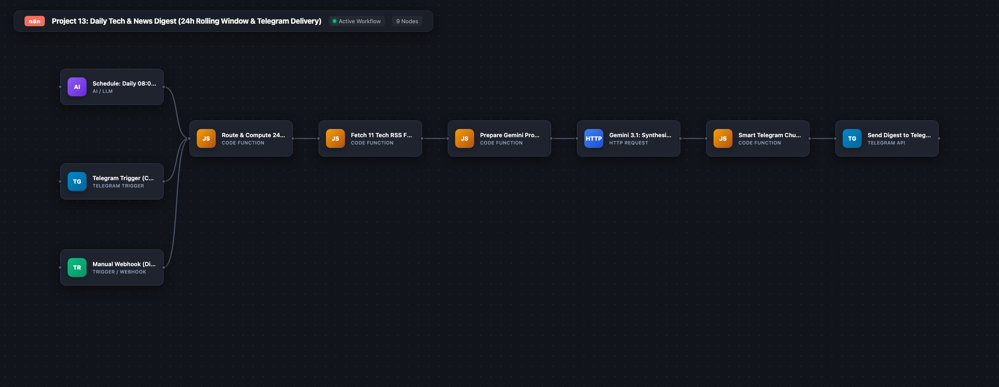
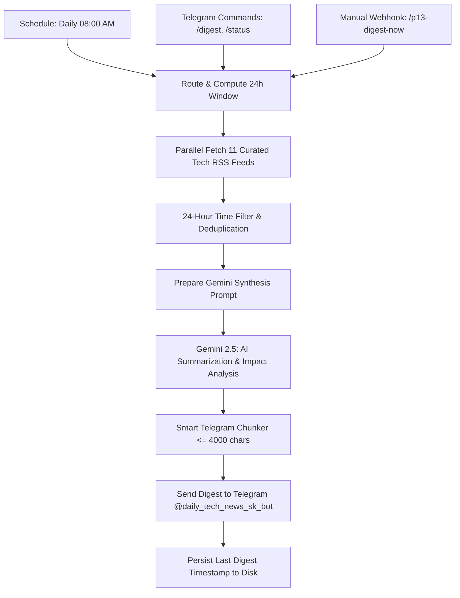

# 🗞️ Project 13: Daily Tech & News Digest (24h Rolling Window)

Production-grade automated daily tech news and developer digest engine built with **n8n**, **11 Curated Global & Turkish RSS Feeds**, **Google Gemini 3.1 Flash-Lite**, and **Telegram Bot**.

- **Workflow ID**: `error-handler-global-001` (Deployed into personal project `6nFAkOIBdxy8Xt7Y`)
- **Telegram Bot**: `@daily_tech_news_sk_bot` (Daily Tech News)
- **Schedule**: Every day at **08:00 AM (Europe/Istanbul)**
- **Manual Trigger**: `GET https://n8n.codewaft.com/webhook/p13-digest-now`
- **Time Window**: Strict 24-hour rolling window (Yesterday 08:00 AM → Today 08:00 AM) with zero-gap state tracking.
- **AI Model**: Google Gemini 3.1 (`gemini-3.1-flash-lite`)

---

## 🖼️ Workflow Architecture Canvas

---

## 🚀 How It Works

---

## 📡 Curated RSS Feed Sources (11 Feeds)

1. **Hacker News (Frontpage)** (`https://hnrss.org/frontpage`) — Developer discussions & top tech breakthroughs.
2. **TechCrunch** (`https://techcrunch.com/feed/`) — Venture capital, startups & tech industry moves.
3. **The Verge** (`https://www.theverge.com/rss/index.xml`) — Consumer tech, AI policies & platform shifts.
4. **Ars Technica** (`https://feeds.arstechnica.com/arstechnica/index`) — Deep technical reporting & infrastructure.
5. **Wired** (`https://www.wired.com/feed/rss`) — Global technology culture, cyber warfare & privacy.
6. **Engadget** (`https://www.engadget.com/rss.xml`) — Consumer gadgets, hardware & reviews.
7. **GitHub Engineering Blog** (`https://github.blog/feed/`) — Software engineering, open source & DevOps.
8. **Google AI Blog** (`https://blog.google/technology/ai/rss/`) — Frontier AI research & Google updates.
9. **MIT Technology Review (AI)** (`https://www.technologyreview.com/topic/artificial-intelligence/feed/`) — Ethical, academic & commercial AI insights.
10. **Webrazzi** (`https://webrazzi.com/feed/`) — Turkish startup, tech investment & regional ecosystem.
11. **Changelog** (`https://changelog.com/feed`) — Developer tooling, languages & frameworks.

---

## 🤖 AI Digest Categories

Gemini synthesizes the collected stories into 5 high-signal sections:
- 🤖 **Yapay Zeka & Büyük Modeller (AI & LLMs)**
- 💻 **Geliştirici Dünyası & Açık Kaynak (Dev & Open Source)**
- 🚀 **Büyük Teknoloji & Startuplar (Big Tech & Startups)**
- 🔒 **Siber Güvenlik & Gizlilik (Security & Privacy)**
- 📱 **Donanım & Tüketici Teknolojisi (Hardware & Gadgets)**

Each news story includes:
- **Bold Turkish Headline**
- **1-2 sentence "Neden Önemli?" impact summary**
- **Direct clickable source link** (`👉 <a href="LINK">Haberi Oku (KAYNAK)</a>`)

---

## 💬 Telegram Bot Commands

Open `@daily_tech_news_sk_bot` in Telegram:
- `/start` — Welcomes the user and explains the bot.
- `/digest` — Instantly triggers an on-demand digest for the last 24 hours.
- `/status` — Displays live bot health, last run time, and RSS sources.
- `/help` — Displays command list.
