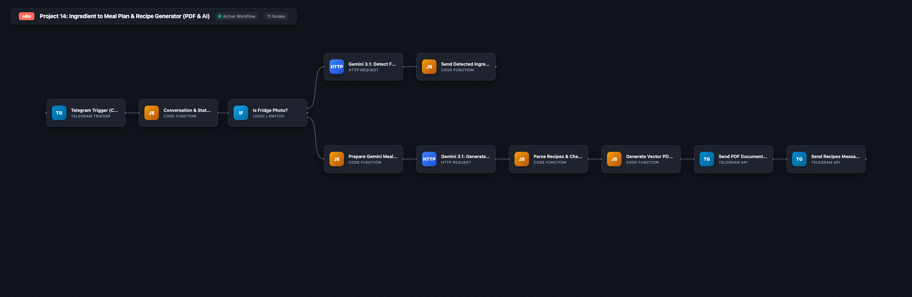
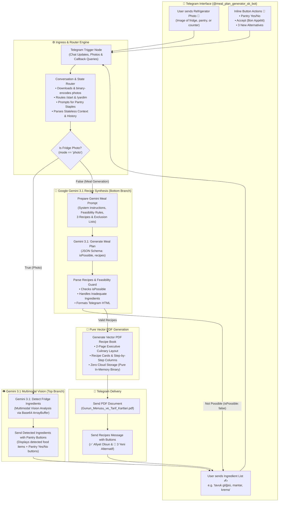

# Project 14: Ingredient to Meal Plan & Recipe Generator (PDF & AI)

> **Autonomous Culinary Kitchen Assistant: Multimodal Refrigerator Photo Recognition, Ingredient-Based Recipe Creator, Vector PDF Recipe Card Generator & Interactive Telegram Bot powered by Google Gemini 3.1 Flash-Lite and n8n**

---

## 🖼️ Workflow Architecture Canvas



---

## 🎯 Executive Overview

Every household frequently faces the classic dilemma: *"What should I cook today with the ingredients left in my kitchen?"* Most recipes found online require extensive grocery runs or specialty seasonings that typical pantries lack, leading to food waste, unnecessary dining out, or analysis paralysis.

**Project 14** solves this by converting raw ingredient lists or a **photograph of your open refrigerator/pantry** into customized, chef-grade cooking plans directly within Telegram:
1. **Multimodal Fridge Photo Recognition**: Send a snapshot of your open refrigerator, pantry shelves, or kitchen counter. Google Gemini 3.1 Vision inspects the image, detects every edible food item, vegetable, dairy product, sauce, and meat, and presents the identified ingredients.
2. **Text Ingredient Ingress**: Alternatively, send a natural Turkish text listing what is in your kitchen (e.g. `tavuk göğsü, krema, mantar, kaşar peyniri`).
3. **Interactive Pantry Check**: The bot asks whether basic pantry staples (*salt, pepper, olive oil/butter, flour, tomato paste, water*) are available with interactive inline buttons (`[🧂 Temel kiler malzemeleri de var]` / `[🚫 Sadece fotoğraftaki / yazdığım malzemeler var]`).
4. **AI Culinary Synthesis**: Google Gemini 3.1 Flash-Lite acts as a professional master chef, producing 3 diverse, distinct, and practical recipes (main course, pan/baking dish, quick starter or soup) with realistic cooking times, portions, and chef's pro tips.
5. **Feasibility & Insufficiency Guard**: If ingredients cannot produce a safe or complete meal (e.g. only `tuz, su` or non-food items), the assistant halts generation and politely recommends key foundational items to add.
6. **Zero-Cloud In-Memory Vector PDF Generation**: Instantly compiles a 2-page publication-grade PDF cookbook card (`Gunun_Menusu_ve_Tarif_Kartlari.pdf`) in-memory using pure vector PDF graphics without saving or uploading any files to Google Drive.
7. **Telegram Document & Message Delivery**: Delivers the printable PDF card document first, followed by the complete recipes breakdown formatted in Telegram HTML.
8. **Interactive Feedback & Infinite Alternatives**:
   - ✅ **"Tarifler Harika! (Afiyet Olsun)"** (`p14_accept`): Confirms the selection and sends a warm culinary blessing (*"Bon appétit!"*).
   - 🔄 **"3 Farklı Alternatif Öner"** (`p14_more`): Extracts the original ingredients and previously proposed recipes from the message context and prompts Gemini to invent 3 completely fresh alternatives with an updated PDF card.

---

## 🏗 System Architecture



---

## 🔄 Interaction Flow & Logic Matrix

| Step | User Action | Bot Behavior | Underlying Logic |
| :--- | :--- | :--- | :--- |
| **1. Greeting** | Sends `/start` or `/yardim` | Welcomes user, gives photo and text formatting examples, explains features. | `Conversation & State Router` intercepts commands; returns early. |
| **2. Fridge Photo** | Sends photo of refrigerator/pantry 📸 | 1. Acknowledges photo receipt.<br/>2. Gemini 3.1 Vision identifies edible ingredients.<br/>3. Displays identified ingredients pill with pantry confirmation buttons. | Router fetches photo binary using `arraybuffer` encoding; Gemini Vision runs object detection; `Send Detected Ingredients with Pantry Buttons` dispatches inline markup. |
| **3. Text Ingress** | Sends `tavuk göğsü, mantar, krema` | Responds with registered ingredient pill and prompts: *"Do you have basic pantry staples?"* with two inline buttons. | Generates inline keyboard with `p14_pantry_yes` and `p14_pantry_no`. |
| **4. Pantry Confirmation** | Clicks `[🧂 Temel kiler malzemeleri de var]` or `[🚫 Sadece fotoğraftaki / yazdığım malzemeler var]` | Acknowledges click via Telegram `answerCallbackQuery`, sends waiting status message, starts AI generation. | Parses ingredients from previous message text statelessly; passes `hasPantry: boolean` forward. |
| **5. Inadequate Items Check** | User inputs `tuz, su` or photo of non-edible items | Returns: *"❌ Yetersiz Malzeme Uyarısı: Mevcut malzemelerle yemek yapılamıyor..."* with chef's advice. | Gemini sets `"isPossible": false`; code halts PDF generation and delivers warning message. |
| **6. Recipes & PDF Dispatch** | Valid ingredients submitted | 1. Delivers `Gunun_Menusu_ve_Tarif_Kartlari.pdf`<br/>2. Delivers formatted message with 3 recipe cards, step-by-step instructions, and action buttons. | Creates vector PDF in memory; executes Telegram `sendDocument` followed by `sendMessage`. |
| **7. Recipe Acceptance** | Clicks `[✅ Tarifler Harika! (Afiyet Olsun)]` | Delivers warm closing greeting: *"Afiyet olsun! Harika bir sofra ve lezzetli bir yemek dilerim! Bon appétit!"* | Intercepts `p14_accept`; acknowledges callback and dispatches closing text. |
| **8. Alternative Request** | Clicks `[🔄 3 Farklı Alternatif Öner]` | Confirms alternative search, excludes previously generated recipes, and produces 3 completely new dishes with a fresh PDF. | Extracts previous recipe titles (`1️⃣`, `2️⃣`, `3️⃣`) from message; instructs Gemini to exclude them. |

---

## 📑 Node Catalog & Details (11 Nodes)

```
┌────┬────────────────────────────────────────────────┬──────────────────────────────┬────────────────────────────────────────────────────────┐
│ #  │ Node Name                                      │ Node Type                    │ Purpose / Configuration Highlights                     │
├────┼────────────────────────────────────────────────┼──────────────────────────────┼────────────────────────────────────────────────────────┤
│ 1  │ Telegram Trigger (Chat & Buttons)              │ telegramTrigger v1.1         │ Ingress for updates: message, photos, callback_query.  │
│ 2  │ Conversation & State Router                    │ code v2 (JavaScript)         │ Binary photo download, command routing, state parser   │
│ 3  │ Is Fridge Photo?                               │ if v2.2                      │ Binary router: branch 0 (photo vision), branch 1 (meal)│
│ 4  │ Gemini 3.1: Detect Fridge Ingredients          │ httpRequest v4.2             │ Multimodal Gemini 3.1 Flash-Lite vision analysis       │
│ 5  │ Send Detected Ingredients with Pantry Buttons  │ code v2 (JavaScript)         │ Sends detected ingredients with pantry yes/no buttons  │
│ 6  │ Prepare Gemini Meal Prompt                     │ code v2 (JavaScript)         │ Crafts strict JSON schema, Turkish culinary persona    │
│ 7  │ Gemini 3.1: Generate Meal Plan                 │ httpRequest v4.2             │ Google Gemini 3.1 Flash-Lite generateContent API       │
│ 8  │ Parse Recipes & Check Feasibility              │ code v2 (JavaScript)         │ Feasibility guard, fallback parser, Telegram HTML      │
│ 9  │ Generate Vector PDF Recipe Book                │ code v2 (JavaScript)         │ In-memory vector PDF generator (2-page cookbook cards) │
│ 10 │ Send PDF Document to Telegram                  │ telegram v1.2 (sendDocument) │ Delivers Gunun_Menusu_ve_Tarif_Kartlari.pdf directly   │
│ 11 │ Send Recipes Message with Buttons              │ telegram v1.2 (sendMessage)  │ Delivers HTML message with ✅ and 🔄 inline buttons    │
└────┴────────────────────────────────────────────────┴──────────────────────────────┴────────────────────────────────────────────────────────┘
```

---

## 🎨 Vector PDF Generator Specifications

Rather than depending on headless Chrome, Puppeteer, or external Google Drive accounts:
- **Zero Heavy Dependencies**: Pure Node.js string-and-buffer vector graphics engine implementing the official ISO 32000-1 PDF standard.
- **2-Page Executive Layout**:
  - **Page 1**: Emerald & Forest Kitchen header, recipe 1 card (left: ingredients checklist, right: preparation steps & chef pro tip), recipe 2 card.
  - **Page 2**: Recipe 3 card, plus comprehensive *Chef's Kitchen Notes & Zero-Waste Guide* (freshness & food storage, broth repurposing, seasoning sequence, mise en place).
- **Direct Transmission**: Outputted as n8n binary object (`data`) and sent directly to Telegram using standard multipart `sendDocument`.

---

## 🛠 Local Setup & Maintenance

### 1. Build and Export
To regenerate `workflow.json` with all JavaScript and node definitions:
```bash
python3 intermediate-projects/14.ingredient-to-meal-plan/build_workflow.py
```

### 2. Synchronization & Deployment to n8n
Deploy the workflow directly into the production n8n SQLite database:
```bash
# Upload workflow JSON
scp intermediate-projects/14.ingredient-to-meal-plan/workflow.json ubuntu@89.168.108.192:/tmp/workflow_p14.json

# Update database & active version
ssh ubuntu@89.168.108.192 "sudo python3 -c \"
import sqlite3, json
with open('/tmp/workflow_p14.json') as f: wf = json.load(f)
conn = sqlite3.connect('/var/lib/docker/volumes/n8n_storage/_data/database.sqlite')
c = conn.cursor()
c.execute('UPDATE workflow_entity SET nodes=?, connections=? WHERE id=\\'meal-plan-generator-p00014\\'', (json.dumps(wf['nodes']), json.dumps(wf['connections'])))
row = c.execute('SELECT activeVersionId FROM workflow_entity WHERE id=\\'meal-plan-generator-p00014\\'').fetchone()
c.execute('UPDATE workflow_history SET nodes=?, connections=? WHERE versionId=?', (json.dumps(wf['nodes']), json.dumps(wf['connections']), row[0]))
conn.commit()
\""
```

---

## 📱 Live Bot Information

- **Bot Username**: `@meal_plan_generator_sk_bot`
- **Display Name**: `Meal Plan Generator`
- **Production Webhook**: `https://n8n.codewaft.com/webhook/p14-meal-plan-generator-telegram-trigger/webhook`
- **AI Model**: Google Gemini 3.1 Flash-Lite (Vision & Recipe Synthesis)
