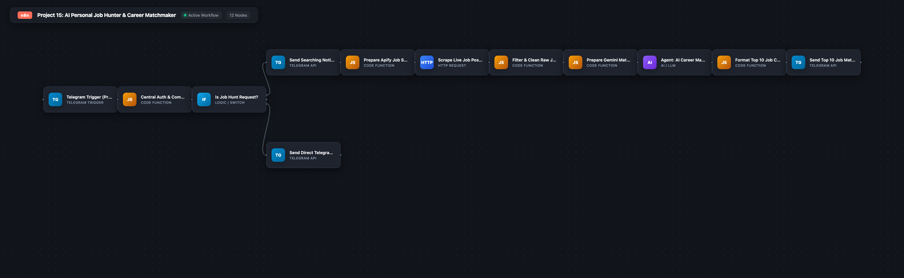
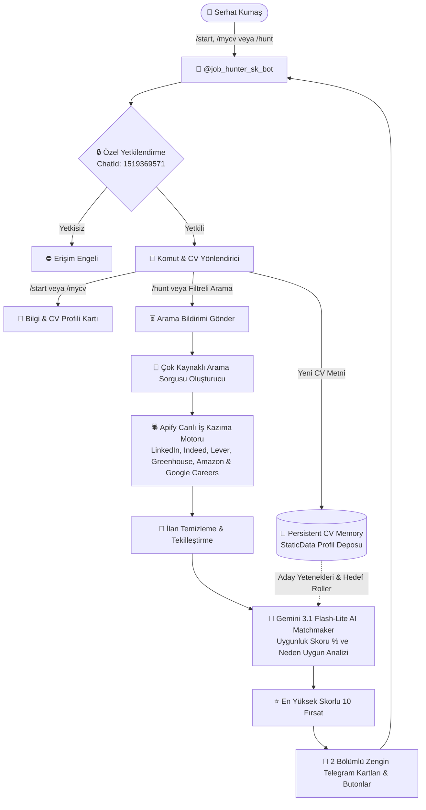

# 🎯 Project 15: AI Personal Job Hunter & Career Matchmaker

> **Orta Seviye (Intermediate) Kapanış Projesi**  
> Serhat Kumaş için özel olarak geliştirilmiş, dış kullanıma kapalı (private), otonom yapay zeka kariyer avcısı ve CV eşleştirme motoru.

---

## 🖼️ Workflow Architecture Canvas

---

## 📌 Proje Özeti

Kullanıcının kariyer hedeflerine odaklanan (özellikle **AI Engineering**, **Forward Deployed Engineering (FDE)**, **AI Solutions Architect**, **Backend Development** ve **AI Integrations**), CV profilini sistem hafızasında saklayan ve tek bir komutla (`/hunt`) internetteki en güncel iş fırsatlarını tarayıp puanlayan akıllı kariyer ajanıdır.

- **Telegram Bot:** [@job_hunter_sk_bot](https://t.me/job_hunter_sk_bot)
- **Workflow ID:** `ai-personal-job-hunter-00015`
- **Aday:** Serhat Kumaş (Solutions Architect & AI Engineer, Passau, DE)
- **Eğitim:** Universität Passau (M.Sc. Computer Science, 2025-Devam), İYTE (B.Sc. Bilgisayar Mühendisliği, 2018-2023)
- **Mevcut Deneyim:** Solutions Architect @ BSH Hausgeräte (Munich) — Google ADK, A2A Protokolleri, Hiyerarşik Ajan Sistemleri, AWS Video Platformu
- **Hedef Odak:** Akademik ML model eğitimi yerine, **çalışan yazılım ve yapay zekanın buluştuğu pratik AI mühendisliği** (LLM entegrasyonları, AI Ajanları, RAG mimarileri, API orkestrasyonu, ölçeklenebilir backend sistemleri).

---

## 🏗️ Mimari & Çalışma Akışı

---

## 🚀 Temel Yetenekler & Komutlar

| Komut / Buton | Açıklama |
|---|---|
| `/start` | Botu başlatır, ana menüyü ve hızlı arama butonlarını getirir. |
| `/hunt` | En güncel 10 global/remote iş fırsatını LinkedIn, Indeed ve kariyer sayfalarından çeker, Gemini 3.1 ile puanlar. |
| `/hunt remote` | Sadece %100 uzaktan (remote) çalışma imkanı sunan ilanları filtreler. |
| `/hunt Germany` / `/hunt London` | Belirli bir ülke veya şehirdeki ilanları hedefler. |
| `/mycv` | Sistem hafızasında kayıtlı aktif CV profilini, becerileri ve kıdem seviyesini gösterir. |
| *CV Metni Gönderme* | Herhangi bir zamanda gönderilen yeni CV metni anında hafızaya işlenir ve sonraki aramalarda kullanılır. |

---

## 📊 İlan Kartı Formatı

Her ilan için Gemini 3.1 tarafından şu detaylar üretilir:
1. **İlan Başlığı & Şirket Adı**
2. **Konum / Çalışma Modeli** (Remote, Hybrid, On-site)
3. **Uygunluk Skoru** (Örn: `🌟 Mükemmel Eşleşme (%96)`)
4. **Neden Uygun?** (Adayın AI ajanları, LLM entegrasyonu ve backend tecrübesine özel 1-2 cümle)
5. **Eşleşen Kritik Yetenekler** (`Python • LLM Agents • FastAPI • Docker`)
6. **Doğrudan Başvuru Linki** (`[ Hemen Başvur & Detayları Gör ↗ ]`)

---

## 🛡️ Güvenlik & Gizlilik

- **Chat ID Whitelist:** Yalnızca Serhat Kumaş (`chatId: 1519369571`) erişebilir. Başka bir kullanıcı bota eriştiğinde sistem otomatik olarak engeller.
- **Webhook Güvenliği:** Telegram Bot API Secret Token doğrulaması (`ai-personal-job-hunter-00015_p15-telegram-trigger-node-001`) ile harici sahte webhook çağrıları engellenir.
- **Karakter Güvenliği:** Türkçe karakter bozulmalarını (GBK mojibake) engelleyen `fixTurkishMojibake` motoru devrededir.
