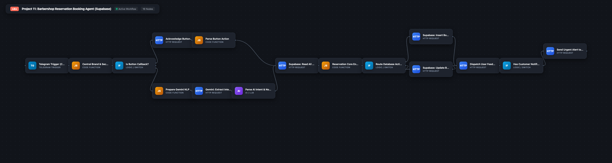
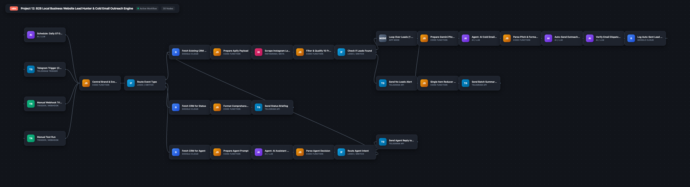
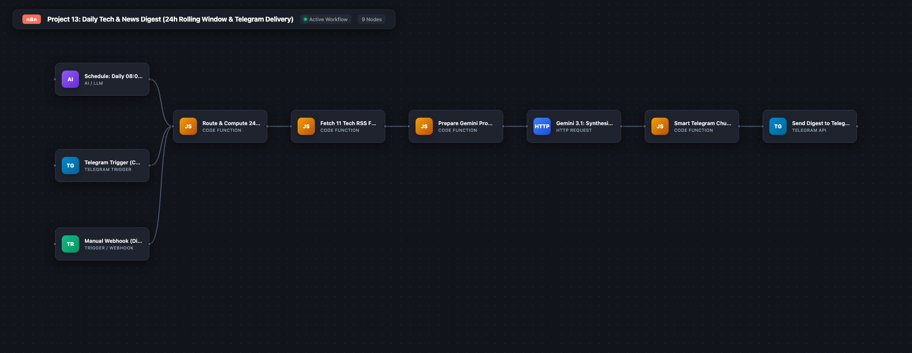
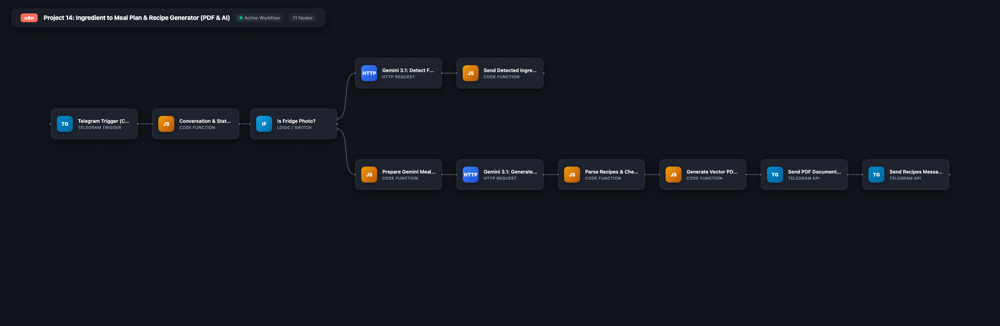
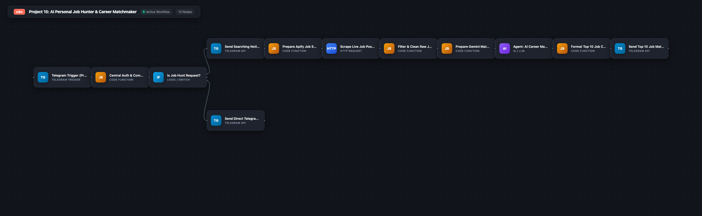

# 📂 Intermediate n8n Automation Projects

This directory contains our intermediate, database-backed and autonomous multi-step AI automation workflows combining external scrapers, vector PDF generation, Supabase PostgreSQL, multimodal vision, and personalized email outreach.

---

## 🏗️ Folder Structure

```text
2. Intermediate Projects/
├── 11.barbershop-reservation-booking/        # Supabase PostgreSQL Booking & Cancellation Agent
│   ├── README.md                             # Technical architecture, security & setup
│   ├── workflow_screenshot.png               # High-resolution workflow canvas diagram
│   ├── workflow.json                         # Complete n8n workflow export
│   └── schema.sql                            # Supabase database schema & RLS policies
├── 12.local-business-website-lead-hunter/    # B2B Lead Hunter & Autonomous Gmail Outreach
│   ├── README.md                             # Prospecting logic, Apify scraper & deduplication
│   ├── workflow_screenshot.png               # High-resolution workflow canvas diagram
│   └── workflow.json                         # Complete n8n workflow export
├── 13.daily-tech-news-digest/                # Daily Tech News Digest (24h Rolling Window)
│   ├── README.md                             # 11 RSS Feeds, Gemini synthesis & rolling window
│   ├── workflow_screenshot.png               # High-resolution workflow canvas diagram
│   └── workflow.json                         # Complete n8n workflow export
├── 14.ingredient-to-meal-plan/               # Multimodal Fridge Vision & Vector PDF Recipes
│   ├── README.md                             # Refrigerator photo recognition & vector PDF generator
│   ├── workflow_screenshot.png               # High-resolution workflow canvas diagram
│   └── workflow.json                         # Complete n8n workflow export
└── 15.ai-personal-job-hunter/                # Autonomous AI Career Hunter & Matchmaker
    ├── README.md                             # Custom CV scoring, job scraping & Telegram alerts
    ├── workflow_screenshot.png               # High-resolution workflow canvas diagram
    └── workflow.json                         # Complete n8n workflow export
```

---

## 🚀 Projects Overview

### [11. Barbershop Reservation Booking Agent](11.barbershop-reservation-booking/README.md)

- **Database & Storage**: Supabase PostgreSQL with ACID-safe slot collision detection.
- **Client Identity Isolation**: Customers can only view and cancel their own appointments via Telegram (`from.id` verification).
- **Owner Admin Portal**: Barbershop owner can view the daily roster, confirm walk-ins, and trigger instant cancellation notifications directly to customers.

### [12. B2B Local Business Website Lead Hunter & Cold Email Outreach Engine](12.local-business-website-lead-hunter/README.md)

- **Autonomous Prospector**: Scrapes high-margin Turkish local businesses (boutique hotels, dental clinics, specialty auto shops, law firms) lacking dedicated websites.
- **Strict Deduplication**: Cross-checks persistent static memory and Google Sheets CRM to prevent duplicate outreach.
- **AI Cold Email Pitch**: Google Gemini crafts personalized, high-converting B2B pitches autonomously dispatched via Gmail.

### [13. Daily Tech & News Digest (24h Rolling Window)](13.daily-tech-news-digest/README.md)

- **11 Curated Feeds**: Aggregates top global and Turkish tech RSS feeds (Hacker News, TechCrunch, Verge, Webrazzi, GitHub Trending).
- **Strict 24h Window**: Evaluates news strictly published in the last 24 hours (08:00 AM yesterday → 08:00 AM today).
- **Executive Synthesis**: Gemini 3.1 Flash-Lite formats an actionable, distraction-free morning digest delivered to `@daily_tech_news_sk_bot`.

### [14. Ingredient to Meal Plan & Recipe Generator (PDF & AI)](14.ingredient-to-meal-plan/README.md)

- **Multimodal Fridge Vision**: Snap a photo of your open refrigerator or pantry; Gemini Vision identifies all ingredients automatically.
- **Chef-Grade Culinary Synthesis**: Generates 3 distinct meal recipes based only on available ingredients with pantry staple checks.
- **Vector PDF Cookbook Delivery**: Compiles a 2-page publication-grade PDF recipe card in-memory and delivers it to Telegram with interactive feedback buttons.

### [15. AI Personal Job Hunter & Career Matchmaker](15.ai-personal-job-hunter/README.md)

- **Personalized Career Engine**: Tailored specifically for Serhat Kumaş (Solutions Architect & AI Engineer, Munich/Passau).
- **Autonomous Scoring**: Scrapes live job boards and ranks postings against his verified CV profile (Google ADK, A2A, AWS, LLM orchestration).
- **Executive Briefing**: Delivers match percentages, company insights, and 1-click apply links to Telegram.

---

## 📥 How to Import an Intermediate Workflow

1. Open your n8n dashboard: [https://n8n.codewaft.com](https://n8n.codewaft.com)
2. Click **Add workflow** > **Import from File...**
3. Select `workflow.json` from any of the project directories.
4. Set up credentials as outlined in each project's documentation.
5. Toggle **Active** to activate the automation!
