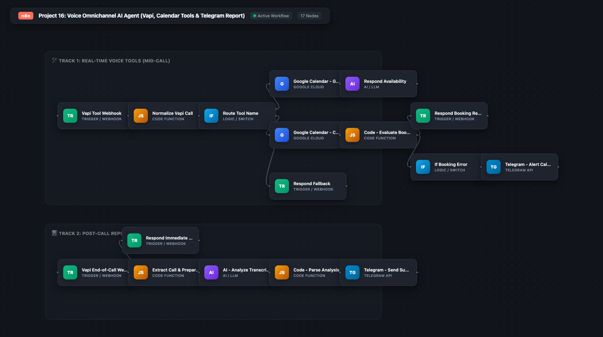

# 🎙️ Project 16: Voice & Telegram Omnichannel AI Agent

> **End-to-End Enterprise Voice AI & Omnichannel Receptionist**  
> Integrated with **Vapi.ai**, **Twilio SIP/Telephony**, **Google Calendar**, and **n8n Automation Hub** on Oracle Cloud Infrastructure ([https://n8n.codewaft.com](https://n8n.codewaft.com)).

---

## 🖼️ Workflow Architecture Canvas



---

## 🏗️ System Architecture

```mermaid
flowchart TD
    Caller([📞 Inbound Telephone Caller]) -->|PSTN Phone Call| Twilio[📱 Twilio Telephony Carrier]
    Twilio -->|SIP Trunk / WebRTC| Vapi[🎙️ Vapi.ai Voice Pipeline\nDeepgram STT • LLM • ElevenLabs TTS]
    
    subgraph Vapi Engine ["Vapi Runtime Engine"]
        Vapi -->|Natural Speech Turn| Caller
        Vapi -->|Function Calling| ToolsRouter{Tool Trigger}
    end

    subgraph n8n Platform ["n8n.codewaft.com Hub"]
        ToolsRouter -->|POST /webhook/vapi-tools| WfTools[⚡ Track 1: Real-Time Voice Tools]
        WfTools -->|Check Slots| GCalCheck[(📅 Google Calendar Availability)]
        WfTools -->|Book Event| GCalBook[(📅 Google Calendar Booking)]
        GCalCheck -->|Spoken Open Slots| Vapi
        GCalBook -->|Spoken Confirmation| Vapi

        Vapi -.->|POST /webhook/vapi-end-of-call\n(On Call Hangup)| WfReport[📊 Track 2: Hangup Analysis]
        WfReport --> Gemini[🧠 Gemini 2.0 AI Call Analyst]
        Gemini --> TgFormat[📝 Structured Analysis & Summary]
        TgFormat --> TG[📲 Telegram Admin Alert Channel]
    end

    TG --> Admin([👤 Business Owner / Admin: @customer_call_sk_bot])
```

---

## 📁 Repository Structure

```text
3. Advanced Projects/16.voice-omnichannel/
├── README.md                           # Master implementation & setup guide
├── configs/
│   └── .env.example                    # Environment variable template
├── schemas/
│   ├── check_calendar.json             # Vapi tool schema for availability check
│   └── book_calendar.json              # Vapi tool schema for appointment booking
├── prompts/
│   ├── vapi_system_prompt.txt          # Voice AI receptionist (Alex) system prompt
│   ├── post_call_analysis_prompt.txt   # Post-call conversation analysis prompt
│   └── telegram_report_template.txt    # HTML formatted Telegram summary template
├── scripts/
│   └── unify_workflows.py              # Automated deployment script for SQLite
└── n8n-workflows/
    └── vapi_voice_omnichannel_unified.json  # Unified 2-track workflow (Tools + Post-Call Report)
```

---

## 🚀 Setup & Deployment Guide

### Step 1: Deploy n8n Unified Workflow
The project runs as a single unified workflow (`vapi_voice_omnichannel_unified.json`) with two distinct webhook tracks:
1. **Track 1 (`POST /webhook/vapi-tools`):**
   - Receives tool calls from Vapi in real time (<1s SLA).
   - Queries Google Calendar for open availability.
   - Books confirmed appointments with customer name, phone number, and consultation topic.
   - Returns speech-optimized responses so Vapi immediately speaks back to the caller.
2. **Track 2 (`POST /webhook/vapi-end-of-call`):**
   - Triggers when caller hangs up.
   - Uses Gemini 3.1 Flash-Lite to evaluate sentiment, lead tier (HOT/WARM/COLD), action items, and booking status.
   - Dispatches a formatted HTML notification card with direct audio recording link to Telegram (`@customer_call_sk_bot`).

---

### Step 2: Configure Vapi.ai Assistant

1. **Create an Assistant in Vapi Dashboard:**
   - Log into [Vapi.ai Dashboard](https://dashboard.vapi.ai/).
   - Click **Create Assistant** (Select *Blank Template*).
   - Name: `Alex - AI Receptionist`.

2. **Configure Model & System Prompt:**
   - **Model:** `gpt-4o` or `claude-3-5-sonnet` (Temperature: `0.3`).
   - **System Prompt:** Copy the entire content of [`prompts/vapi_system_prompt.txt`](./prompts/vapi_system_prompt.txt) into the **System Prompt** box.

3. **Configure Voice & Transcriber:**
   - **Transcriber:** Deepgram (`nova-2`, language: English or Turkish).
   - **Voice:** ElevenLabs (e.g. *Rachel* or *George*) or Cartesia for ultra-low latency (<400ms).
   - **Interruption Handling (Barge-in):** Enable *Interruptible* with 500ms sensitivity.

4. **Attach Tools (Function Calling):**
   - In the **Tools** tab, click **Add Custom Tool**.
   - Create Tool 1: Import [`schemas/check_calendar.json`](./schemas/check_calendar.json).
     - Server URL: `https://n8n.codewaft.com/webhook/vapi-tools`
   - Create Tool 2: Import [`schemas/book_calendar.json`](./schemas/book_calendar.json).
     - Server URL: `https://n8n.codewaft.com/webhook/vapi-tools`

5. **Set End-of-Call Server URL:**
   - In the Assistant's **Server URL** (Advanced Settings):
     `https://n8n.codewaft.com/webhook/vapi-end-of-call`
   - Set URL: `https://n8n.codewaft.com/webhook/vapi-end-of-call`
   - Event: `end-of-call-report`.

---

### Step 3: Connect Twilio Telephony Carrier

1. In [Twilio Console](https://console.twilio.com/), purchase an inbound local or toll-free telephone number with Voice capability.
2. In Vapi Dashboard, navigate to **Phone Numbers** > **Import Twilio Number**.
3. Provide your Twilio Account SID, Auth Token, and phone number (`+1...`).
4. Select your **Alex - AI Receptionist** assistant from the dropdown.
5. All inbound telephone calls to this number will now connect directly to the Voice AI Assistant!

---

### Step 4: Verification & End-to-End Testing

#### 1. Test Availability Check Tool (cURL):
```bash
curl -X POST "https://n8n.codewaft.com/webhook/vapi-tools" \
  -H "Content-Type: application/json" \
  -d '{
    "message": {
      "type": "tool-calls",
      "toolCalls": [
        {
          "id": "call_test_001",
          "type": "function",
          "function": {
            "name": "check_calendar_availability",
            "arguments": { "date": "2026-11-20" }
          }
        }
      ]
    }
  }'
```
**Expected Response:**
```json
{
  "results": [
    {
      "toolCallId": "call_test_001",
      "result": "We currently have open appointment slots on this date at 10:00 AM, 2:30 PM, and 4:00 PM. Which one works best for you?"
    }
  ]
}
```

#### 2. Test End-of-Call Webhook (cURL):
```bash
curl -X POST "https://n8n.codewaft.com/webhook/vapi-end-of-call" \
  -H "Content-Type: application/json" \
  -d '{
    "message": {
      "type": "end-of-call-report",
      "durationSeconds": 142,
      "transcript": "Caller: Hi, I would like to schedule a consultation regarding AI automation.\nAlex: Certainly! What date works best for you?\nCaller: Next Friday afternoon.\nAlex: I have 2:30 PM available. Shall I book that for John Doe?\nCaller: Yes please, my number is +1234567890.\nAlex: Perfect, John! You are confirmed for Friday at 2:30 PM.",
      "recordingUrl": "https://api.vapi.ai/recordings/test.mp3",
      "customer": { "number": "+1234567890" }
    }
  }'
```
**Expected Result:** A Telegram alert card arrives immediately in your Telegram channel with lead score (`🔥 HOT LEAD`), appointment status, summary, and audio player link.
