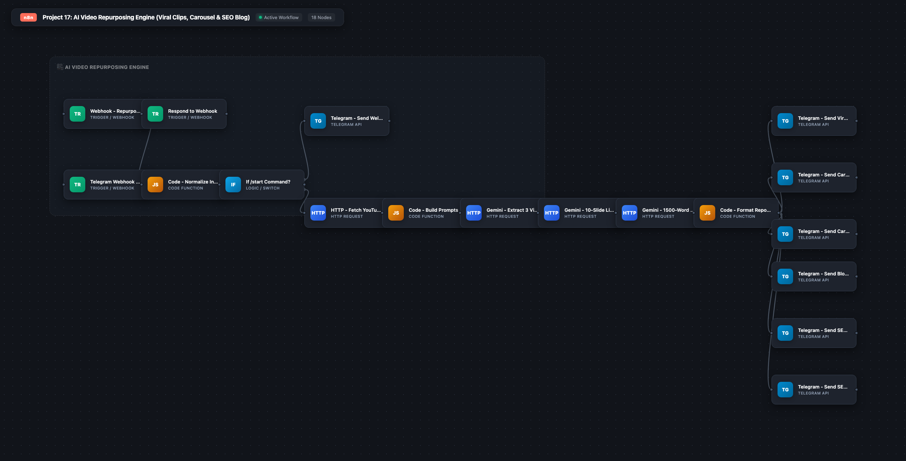
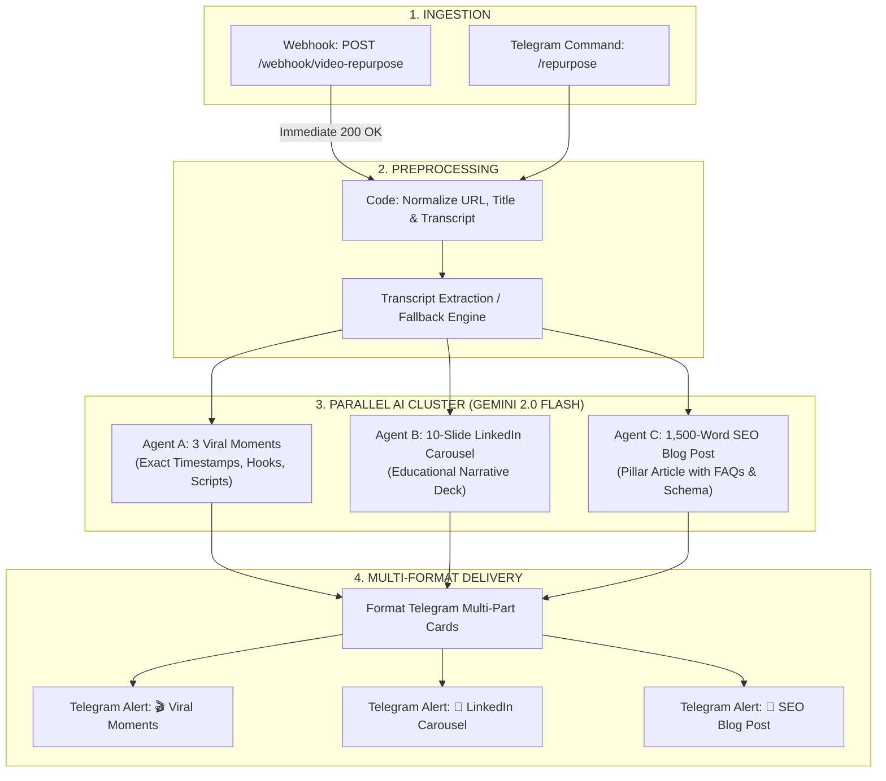

# Project 17: AI Video Repurposing Engine (Multi-Format Content Factory)

> **Autonomous multi-agent pipeline that ingests long-form video or audio (YouTube, MP4, Podcast) and produces 3 high-impact viral moments with exact timestamps, a 10-slide LinkedIn PDF Carousel, and a 1,500-word SEO-optimized pillar blog post delivered directly to Telegram.**

---

## 🖼️ Workflow Architecture Canvas



---

## 🎯 Architecture & Workflow Diagram



---

## 🚀 Key Features

1. **Dual Ingestion Options:**
   - **Webhook:** Trigger via HTTP POST (`/webhook/video-repurpose`) from any CMS, Zapier, or frontend app.
   - **Telegram:** Send `/repurpose <youtube_url>` directly to `@customer_call_sk_bot`.
2. **Top 3 Viral Moments Extractor:**
   - Detects peak retention moments based on controversy, counter-intuitive data, and storytelling spikes.
   - Outputs exact millisecond start and end timestamps (e.g. `00:00:15` ➔ `00:00:45`).
   - Crafts a spoken psychological hook, 45-60s short-form script, caption, and B-roll editing instructions.
3. **10-Slide LinkedIn PDF Carousel:**
   - Follows proven B2B slide architecture (Hook, Problem Agitation, Framework, Tactical Steps, Transformation, Call to Action).
   - Generates structured JSON ready for automated HTML-to-PDF rendering (`scripts/generate_carousel_pdf.py`).
4. **1,500-Word SEO Pillar Article:**
   - Full markdown article with H1, H2, H3 headings, Executive Summary, comparison tables, and FAQ schema.
   - Meta description and target keyword clusters included.
5. **Instant Telegram Dispatch:**
   - Sends 3 high-contrast HTML cards directly to your admin Telegram channel.

---

## 📁 Project Structure

```
17.ai-video-repurposing-engine/
├── configs/
│   └── .env.example                     # API keys and environment variables
├── prompts/
│   ├── video_analysis_prompt.txt        # Prompt for 3 viral moments extraction
│   ├── linkedin_carousel_prompt.txt     # Prompt for 10-slide carousel generation
│   └── seo_blog_post_prompt.txt         # Prompt for 1,500-word SEO article
├── scripts/
│   ├── fetch_transcript.py              # YouTube metadata and transcript extractor
│   └── generate_carousel_pdf.py         # Converts carousel JSON into 1080x1350 HTML/PDF
├── sample-data/
│   ├── sample_youtube_input.json        # Test webhook payload
│   ├── sample_viral_moments_output.json # Sample viral clips JSON
│   ├── sample_linkedin_carousel.json    # Sample 10-slide carousel JSON
│   └── sample_seo_blog_post.md          # Sample 1,500-word SEO article
├── n8n-workflows/
│   └── ai_video_repurposing_engine.json # Complete production n8n workflow
└── README.md
```

---

## 🛠️ Setup & Deployment Guide

### 1. Environment Configuration
Copy `configs/.env.example` to `.env` or set the following in your n8n environment:
```bash
GEMINI_API_KEY=your_gemini_api_key_here
TELEGRAM_BOT_TOKEN=YOUR_TELEGRAM_BOT_TOKEN
TELEGRAM_ADMIN_CHAT_ID=1519369571
```

### 2. Import into n8n
1. Open your n8n dashboard (e.g., `https://n8n-advanced.codewaft.com` or `https://n8n.codewaft.com`).
2. Click **Add workflow** ➔ **Import from File**.
3. Select `n8n-workflows/ai_video_repurposing_engine.json`.
4. Click **Publish / Activate**.

---

## 🧪 Testing the Workflow

### Method A: Trigger via Webhook
Run the following curl command in your terminal:
```bash
curl -X POST https://n8n.codewaft.com/webhook/video-repurpose \
  -H "Content-Type: application/json" \
  -d '{
    "youtube_url": "https://www.youtube.com/watch?v=dQw4w9WgXcQ",
    "video_title": "Why Autonomous AI Swarms Are Replacing Single Prompts in 2026",
    "chat_id": "1519369571"
  }'
```

### Method B: Trigger via Telegram Bot
Open Telegram and message `@customer_call_sk_bot`:
```text
/repurpose https://www.youtube.com/watch?v=dQw4w9WgXcQ
```

Within 30–45 seconds, the bot will deliver 3 detailed cards with viral timestamps, carousel slides, and your SEO blog post.

---

## 📄 Automated Carousel Rendering
To render the generated 10-slide JSON into an Instagram/LinkedIn 4:5 carousel deck:
```bash
cd "3. Advanced Projects/17.ai-video-repurposing-engine"
python3 scripts/generate_carousel_pdf.py sample-data/sample_linkedin_carousel.json carousel_output.html
open carousel_output.html
```
