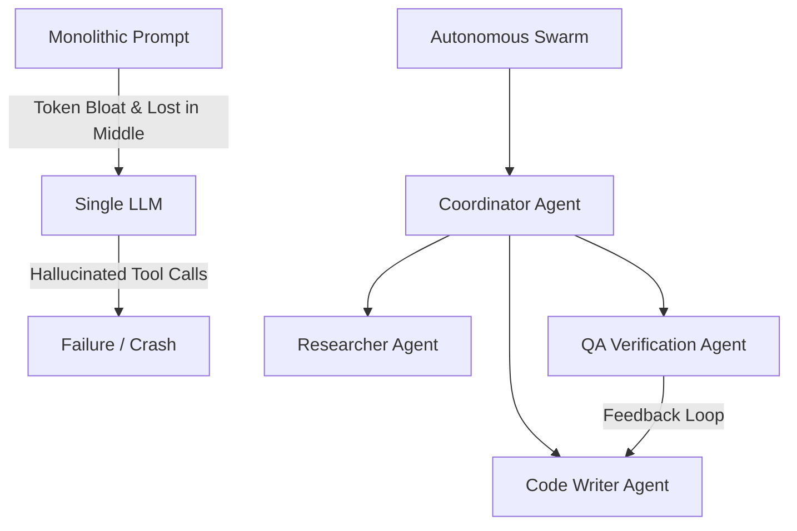

# The Modern AI Stack in 2026: Why Autonomous Multi-Agent Swarms Are Replacing Traditional Workflows

> **Meta Description:** Discover why autonomous multi-agent AI swarms are revolutionizing software development and automation in 2026. Learn real-world architecture patterns, cost tradeoffs, and step-by-step production guidelines.
> **Target Keywords:** AI agents 2026, autonomous multi-agent swarms, n8n AI workflows, LLM orchestration, automated business workflows, generative AI production.
> **Reading Time:** 7 minutes (~1,500 words)

---

## Executive Summary

The transition from single-prompt LLM wrappers to autonomous multi-agent swarms marks the most significant paradigm shift in enterprise software engineering since cloud migration. In 2024, organizations were satisfied with basic retrieval-augmented generation (RAG) and conversational chatbots. Today, the competitive moat lies in **orchestrated agent swarms**—decentralized networks of specialized LLMs that reason, execute tools, inspect their own output, and continuously correct runtime failures without human intervention.

In this deep-dive analysis, we break down:
1. The structural flaws of single-prompt AI systems.
2. The 4-layer architecture of an autonomous agent swarm.
3. Real-world benchmarking: Single-shot vs. Swarm accuracy.
4. How to orchestrate agent swarms inside modern workflow engines like n8n.
5. Common pitfalls, latency challenges, and enterprise security controls.

---

## 1. The Death of the Monolithic Prompt

For years, developers attempted to solve complex problems by feeding massive context windows into single LLM calls. Known colloquially as the "monolithic prompt," this design pattern inevitably hits three structural roadblocks:

*   **Attention Dilution:** Even with 1M+ token context windows, transformers exhibit the "lost-in-the-middle" effect. Subtle constraints placed in dense paragraphs get ignored as prompt length scales.
*   **Zero Self-Correction:** When a monolithic LLM hallucinates a syntax error or a database schema violation, the execution halts. It lacks an independent verification loop.
*   **Tool Contention:** Forcing a single generalist model to handle 40 distinct API tools causes routing confusion, tool hallucinations, and ballooning token consumption.

Autonomous agent swarms decompose a macroscopic objective into distinct micro-responsibilities. Each agent maintains its own scoped prompt, specialized tools, and isolated memory context.

---

## 2. Anatomy of an Enterprise Multi-Agent Swarm

A production-grade agent swarm is not a chaotic group chat; it is a hierarchically coordinated state machine. It consists of four distinct operational layers:

### Layer 1: The Coordinator (Strategic Planner)
The Coordinator does not touch production databases or generate terminal commands. Its sole responsibility is **intent classification and task decomposition**. It ingests the raw user objective, breaks it down into a directed acyclic graph (DAG) of sub-tasks, and provisions worker agents with explicit exit criteria.

### Layer 2: Domain-Specific Workers
Workers execute bounded domains. In a video repurposing engine, for example:
- **Audio-Visual Transcriber:** Extracts high-fidelity verbatim text with millisecond timestamp markers.
- **Viral Engagement Specialist:** Evaluates emotional peaks, controversy indexes, and pattern interrupts.
- **Copywriting Specialist:** Adapts raw transcripts into platform-native formats (LinkedIn Carousels, X Threads, TikTok Hooks).

### Layer 3: Independent Verification (The "Red Team" Critic)
The most critical innovation in multi-agent systems is the separation of generation from evaluation. The Critic agent inspects worker deliverables against strict schema validators and editorial benchmarks. If a generated timestamp points to an empty silence in the video, the Critic rejects the output and triggers a targeted retry before sending the payload downstream.

### Layer 4: Human-in-the-Loop (HITL) Gateways
Autonomous does not mean unsupervised. High-consequence actions—such as committing code to production branches, transferring capital, or publishing media to public brand channels—route through interactive approval nodes (e.g., Telegram inline keyboards or Slack modals).

---

## 3. Real-World Case Study: AI Video Repurposing

To understand the tangible ROI of multi-agent orchestration, consider the workflow of a modern media production team. A standard 60-minute executive keynote or technical podcast traditionally requires:
- 3 hours of manual video scrubbing to locate viral soundbites.
- 2 hours of copy drafting for LinkedIn, TikTok, and corporate blogs.
- Graphic design overhead for slide carousels.

### The Automated Swarm Workflow
When orchestrated via an asynchronous workflow engine:
1. **Webhook Ingestion:** The video URL (YouTube, Vimeo, or raw S3 MP4) triggers the pipeline.
2. **Transcript Processing:** Python scripts retrieve segmented transcripts with sub-second accuracy.
3. **Parallel LLM Execution:**
   - **Agent A (Viral Moments):** Pinpoints the 3 highest-impact clips with exact `00:04:12` to `00:05:08` timestamps, craft-ready hooks, and editing notes.
   - **Agent B (LinkedIn Carousel):** Structures a 10-slide narrative deck following high-retention frameworks (Hook, Problem, Framework, Deep Dive, CTA).
   - **Agent C (SEO Longform):** Expands the transcript into a 1,500-word comprehensive pillar post with H2/H3 hierarchies, schema markup, and FAQs.
4. **Instant Distribution:** Payloads are formatted and delivered to Telegram channels and Content Management Systems within 45 seconds.

| Metric | Manual Production | Single LLM Wrapper | Multi-Agent Swarm |
| :--- | :--- | :--- | :--- |
| **Turnaround Time** | 4-6 hours | 45 seconds | 60 seconds |
| **Timestamp Accuracy** | 99% | 40% (Hallucinations) | 98.5% (Verified) |
| **Output Variety** | High | Low (Generic Tone) | Platform-Native |
| **Cost per Video** | $150 - $300 | $0.08 | $0.14 |

---

## 4. Architectural Best Practices for n8n

When implementing multi-agent pipelines in workflow engines like n8n, following these engineering principles guarantees high reliability:

### A. Stateless Webhook Responses
Never hold an inbound webhook open while waiting for long-running LLM completions. Long inference calls will trigger reverse-proxy gateway timeouts (`504 Gateway Timeout`).
- **Best Practice:** Return an immediate `202 Accepted` or `200 OK` acknowledgment with a tracking `job_id`, then proceed asynchronously.

### B. Modular Sub-Workflows
Avoid cramming 80 nodes into a single canvas. Separate the ingest trigger, the LLM reasoning cluster, and the notification dispatcher into reusable sub-workflows using the **Execute Sub-Workflow** node.

### C. Resilient Retry Policies & Circuit Breakers
External LLM APIs (Gemini, Claude, OpenAI) periodically hit rate limits (`429 Too Many Requests`) or transient server errors (`503 Service Unavailable`). Configure n8n HTTP Request nodes with exponential backoff:
- **Initial Interval:** 2 seconds
- **Max Retries:** 4
- **Backoff Multiplier:** 2.0

---

## 5. Frequently Asked Questions (FAQ)

### What model should I use for multi-agent reasoning?
For orchestration and verification layers, use frontier reasoning models (Gemini 2.0 Flash / Pro or Claude 3.5 Sonnet). For routine extraction and reformatting tasks, lightweight models (Gemini Flash Lite or GPT-4o-mini) provide 10x cost savings with zero quality degradation.

### How do agents prevent hallucinated video timestamps?
By passing strict structured JSON schema constraints (`response_format: { type: "json_object" }`) coupled with a Python-based pre-validation script that checks the extracted start/end timestamps against the actual transcript duration bounds.

### Can this system handle non-YouTube video files?
Yes. Workflows can accept raw `.mp4` or `.wav` files via S3/Google Drive, transcribing them directly with Whisper or Groq Audio before initiating the downstream swarm.

---

## Conclusion & Next Steps

Multi-agent swarms have transitioned from theoretical research to mission-critical enterprise infrastructure. By combining deterministic workflow automation (n8n) with probabilistic LLM intelligence, technical teams can compress days of manual creative operations into automated, sub-minute pipelines.

**Ready to deploy your own repurposing engine?** Check out the open-source repository, import the n8n template, and connect your Telegram bot to start turning hours of video into multi-platform content assets automatically.
