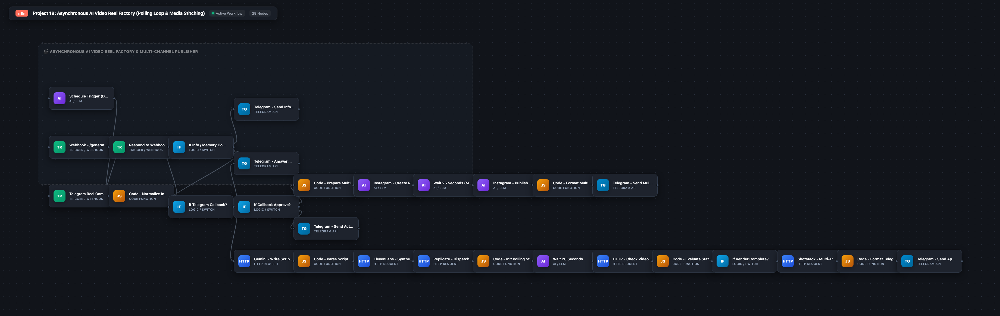
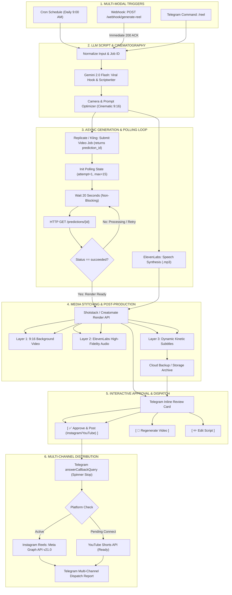

# Project 18: Asynchronous AI Video Reel Factory (End-to-End Media Pipeline)

> **Autonomous media production factory that takes a scheduled topic or Telegram prompt, writes viral scripts, synthesizes voiceovers with ElevenLabs, generates 9:16 vertical video via Kling / Replicate using a resilient asynchronous polling loop, burns in dynamic subtitles via Shotstack/Creatomate, and delivers an interactive Human-in-the-Loop approval card to Telegram.**

---

## 🖼️ Workflow Architecture Canvas



---

## 🎯 Architecture & Workflow Diagram



---

## ⚡ The Asynchronous Polling Loop (Advanced Architecture)

Generative video models (Kling 1.5, Luma Dream Machine, MiniMax on Replicate) cannot return video files synchronously because diffusion rendering takes **60 to 180 seconds**.

### How Traditional Workflows Fail:
- Synchronous HTTP requests exceed reverse-proxy timeouts (`504 Gateway Timeout` or n8n node execution limits).
- Unbounded loops can crash n8n memory or spin infinitely if an upstream GPU cluster stalls.

### How This Pipeline Solves It:
1. **Initial Dispatch:** `POST /v1/predictions` returns an HTTP 201 with `{"id": "pred_xyz", "status": "starting"}` in under 500ms.
2. **Stateful Wait Node:** Uses n8n's native, non-blocking `Wait` node configured for 20 seconds. This releases thread execution and prevents CPU locking.
3. **Evaluation Gate:** `Code - Evaluate Status` checks status:
   - If `"succeeded"`, breaks the loop and passes the video CDN URL downstream.
   - If `"processing"`, increments `pollAttempt` and loops back to `Wait 20 Seconds`.
   - If `pollAttempt >= maxRetries` (15 retries = 300s), gracefully aborts and triggers an alert.

---

## 🎬 Multi-Track Cloud Video Stitching

Once the audio and video assets are generated, they are composited via **Shotstack** or **Creatomate**:

```json
{
  "timeline": {
    "soundtrack": { "src": "https://api.elevenlabs.io/.../audio.mp3" },
    "tracks": [
      {
        "clips": [
          {
            "asset": {
              "type": "title",
              "text": "Stop writing prompts. Build swarms instead.",
              "style": "chunk",
              "color": "#FFE500"
            },
            "start": 0,
            "length": 30
          }
        ]
      },
      {
        "clips": [
          {
            "asset": {
              "type": "video",
              "src": "https://replicate.delivery/.../output.mp4"
            },
            "start": 0,
            "length": 30,
            "fit": "cover"
          }
        ]
      }
    ]
  },
  "output": {
    "format": "mp4",
    "resolution": "1080",
    "aspectRatio": "9:16"
  }
}
```

---

## 📱 Interactive Telegram Human-in-the-Loop Review

The rendered video is delivered to Telegram with inline buttons for full editorial control:

*   **`[ ✅ Approve & Post ]`**: Schedules or publishes immediately to Instagram Graph API & YouTube Data API.
*   **`[ 🔄 Regenerate Video ]`**: Re-rolls the visual diffusion prompt with fresh seeds while keeping the approved audio.
*   **`[ ✏️ Edit Script ]`**: Opens a prompt to adjust the hook or body text.
*   **`[ ❌ Reject & Discard ]`**: Archives the project and halts publication.

---

## 📁 Project Structure

```
18.async-ai-video-reel-factory/
├── configs/
│   └── .env.example                                # API keys for ElevenLabs, Replicate, Shotstack, Telegram
├── prompts/
│   ├── reel_scriptwriting_prompt.txt               # High-retention short-form script prompt
│   └── video_prompt_optimizer.txt                  # Diffusion prompt optimization for Kling / Luma
├── scripts/
│   ├── poll_job_status.py                          # Reference python implementation of polling loop
│   └── stitch_video_preview.py                     # Multi-track timeline JSON generator
├── sample-data/
│   ├── sample_reel_script.json                     # Sample generated script & prompts
│   ├── sample_polling_response.json                # Step-by-step polling state progression
│   ├── sample_creatomate_shotstack_payload.json    # Shotstack / Creatomate JSON manifest
│   └── sample_telegram_approval_card.json          # Telegram inline keyboard payload
├── n8n-workflows/
│   └── async_video_reel_factory.json               # Master n8n production workflow
└── README.md
```

---

## 🧪 Testing the Workflow

### 1. Trigger via Webhook
```bash
curl -X POST https://n8n.codewaft.com/webhook/generate-reel \
  -H "Content-Type: application/json" \
  -d '{
    "topic": "Why Multi-Agent AI Swarms Replace Prompts in 2026",
    "chat_id": "1519369571"
  }'
```

### 2. Trigger via Telegram Bot
Send a message to `@customer_call_sk_bot`:
```text
/reel The Future of Quantum Computing and AI
```

The system will acknowledge the request, execute the async polling loop, assemble the media tracks, and return your interactive video approval card with actionable buttons.
