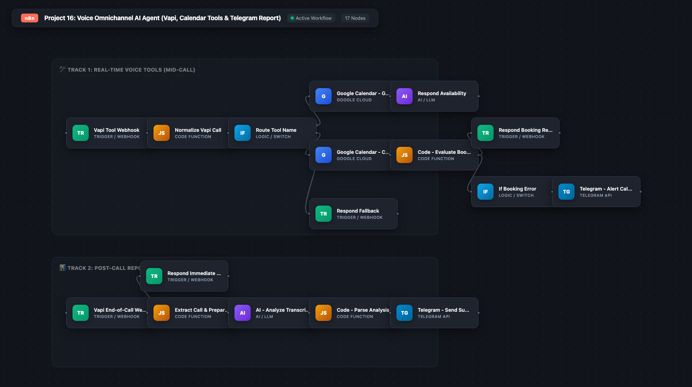
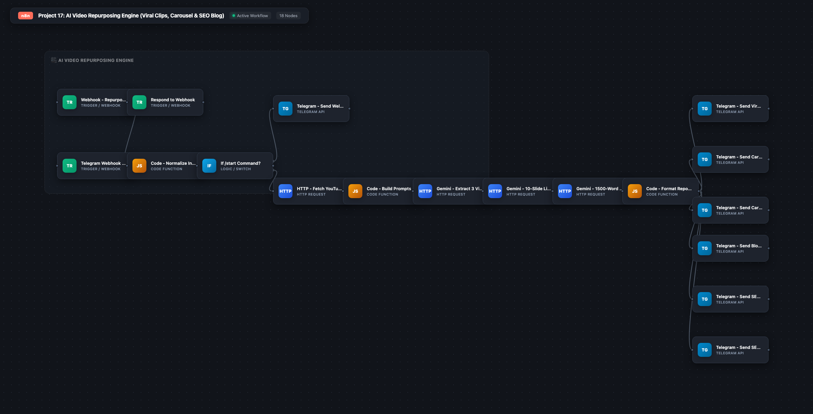
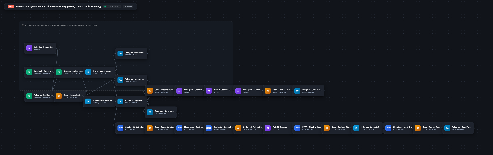

# 📂 Advanced n8n Automation Projects

This directory contains our advanced, enterprise-grade AI automation workflows combining multimodal voice AI, telephony, video synthesis, long-running asynchronous polling pipelines, and multi-channel orchestration.

---

## 🏗️ Folder Structure

```text
3. Advanced Projects/
├── 16.voice-omnichannel/             # Voice & Telegram Omnichannel AI Agent (Vapi, Twilio & n8n)
│   ├── README.md                     # Full technical documentation & setup guide
│   ├── workflow_screenshot.png       # High-resolution workflow canvas diagram
│   ├── configs/                      # Environment variable configuration
│   ├── schemas/                      # Vapi function calling schemas (Google Calendar)
│   ├── prompts/                      # System & operational analysis prompts
│   └── n8n-workflows/                # Production n8n workflows
├── 17.ai-video-repurposing-engine/   # Multi-Format Video Repurposing Engine
│   ├── README.md                     # Architecture, prompts & sample outputs
│   ├── workflow_screenshot.png       # High-resolution workflow canvas diagram
│   ├── configs/                      # Environment settings
│   ├── prompts/                      # Viral moments, LinkedIn carousel & SEO prompts
│   ├── scripts/                      # YouTube transcript & PDF carousel generator
│   ├── sample-data/                  # Sample inputs, JSON outputs & blog markdown
│   └── n8n-workflows/                # Master n8n workflow
└── 18.async-ai-video-reel-factory/   # Asynchronous AI Video Reel Factory
    ├── README.md                     # Polling loops, multi-track stitching & HITL review
    ├── workflow_screenshot.png       # High-resolution workflow canvas diagram
    ├── configs/                      # ElevenLabs, Replicate & Shotstack API keys
    ├── prompts/                      # 9:16 scriptwriting & prompt optimizer
    ├── scripts/                      # Reference polling loop & timeline manifests
    ├── sample-data/                  # Scripts, polling states & Telegram review cards
    └── n8n-workflows/                # Master async n8n workflow
```

---

## 🚀 Projects Overview

### [16. Voice & Telegram Omnichannel AI Agent](16.voice-omnichannel/README.md)

- **Real-Time Voice AI**: Powered by Vapi.ai and Twilio SIP with sub-second latency and full natural interruption handling (Barge-in).
- **Google Calendar Integration**: Function calling endpoints (`https://n8n.codewaft.com/webhook/vapi-tools`) enable conversational schedule checks and instant meeting bookings.
- **Hangup Analytics Pipeline**: Automatic post-call hook (`https://n8n.codewaft.com/webhook/vapi-end-of-call`) extracts structured meeting details, lead scores, and alerts the business owner on Telegram (`@customer_call_sk_bot`).

### [17. AI Video Repurposing Engine](17.ai-video-repurposing-engine/README.md)

- **Multi-Format Repurposing**: Ingests long-form YouTube videos, podcasts, or lectures via Webhook or Telegram (`/repurpose <url>`).
- **Parallel AI Swarm (Gemini 2.0 Flash)**: Generates 3 viral shorts/reels with exact start/end timestamps and 3-second hooks, a 10-slide LinkedIn carousel outline with image generation prompts, and a 1,500-word SEO pillar blog post.
- **Telegram Delivery**: Automatically dispatches all formatted content directly to Telegram for immediate review.

### [18. Asynchronous AI Video Reel Factory](18.async-ai-video-reel-factory/README.md)

- **Multi-Video Engine**: Includes a curated library of 4 distinct Meta-compliant 9:16 vertical MP4s (`cyber_agent.mp4`, `matrix_code.mp4`, `neural_core.mp4`, `reel_sample.mp4`) matched dynamically to topic keywords.
- **Persistent Channel Memory**: Remembers channel niche, audience, and tone of voice. Supports Telegram commands: `/context`, `/set_context <instructions>`, `/topics`, `/reset_context`, and `/reel <topic>`.
- **Non-Blocking Asynchronous Polling Loop**: Safely handles multi-minute rendering tasks without holding open connections.
- **Human-in-the-Loop Review & Live Instagram Publishing**: Sends an interactive Telegram review card with inline buttons. Clicking `[ ✅ Approve & Post ]` publishes the Reel directly to Instagram (`@developmentserhat`).
